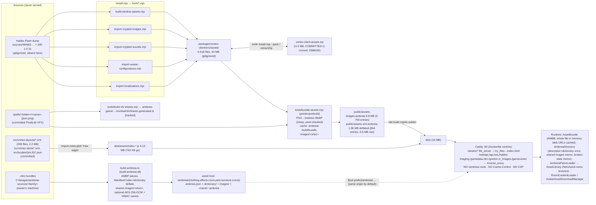
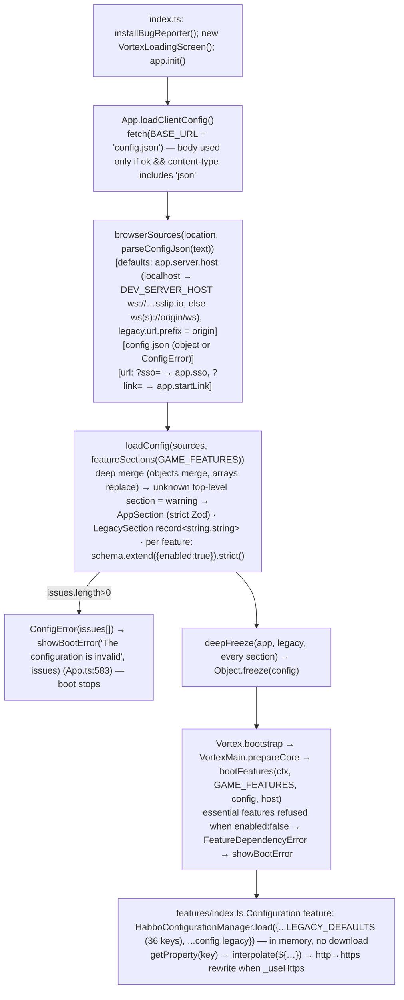

# Ambreia client — assets, configuration, build/release, deployment, security audit

Scope: read-only architecture audit of `/home/user/ambreia-client` @ `aeb88ba` (branch `claude/determined-ritchie-omy2dy` == `origin/rpg-character`).
Specialist: asset pipeline, runtime asset caches, kernel configuration, localization, client threat model, build & release, Docker/Caddy, boot critical path, supply chain.
No tracked file was modified (`git status --short` empty at the end, see §F). Builds were run into the scratchpad only.

Reused from the coordinator: `pnpm install --frozen-lockfile` OK; `pnpm check` green (369 pass, 7 skipped); `pnpm lint` 427 errors (none in package `src/`); `pnpm build` fails at `[ambreia:release-headers] No release revision` (emulator checkout absent); `pnpm audit` 0 critical / 59 high / 16 moderate; `node install.mjs` unpacked the assets; no CI (`.github/` holds only `copilot-instructions.md`).

---

## A. Facts and diagrams

### A.1 Asset pipeline (measured on this checkout)



Facts:
- Two bundle formats exist: `AMBB` (client's own assets, `AssetBundle.ts`: magic, u16 version=1, u16 flags bit0=deflate-raw, then u32 version=1 again + entry table) and `AMBP` (one `.nitro` → one piece, `AmbreiaPiece.ts`: magic, u16 version=1, u16 flags, 8-byte dictionary id, manifest, images). Both check magic and version and throw with a named reason; neither carries a checksum or length-vs-table validation (`AssetBundle.parse` validates the table but not that `offset+size ≤ data.length`; a bad entry fails later as a `RangeError` on `new Uint8Array`).
- `bundle-assets.mjs` is deterministic by construction: keys sorted (`localeCompare`), no timestamps, fixed deflate level 9, WebP encode re-run twice on a 12-file sample gave 12/12 identical digests (§F). Cross-machine determinism depends on the libvips/sharp version (not pinned beyond `^0.34.5`).
- `build-vfx-sheets.mjs` is deterministic (`render(readSheets())` twice identical and equal to the committed `vfxSheets.generated.ts`).
- `install.mjs --pack` is **not** deterministic: `zip.mjs:111` writes `dosDateTime(statSync(entry.path).mtime)`, so re-packing the same tree on another checkout yields a different 13 MB blob.
- `extractZip` guards zip-slip (`zip.mjs:221 relative(targetDir, target).startsWith('..') → throw`).
- `.ambreia` directories: `ambreia.json` has `v`, `kind`, `dictionary`, `encrypted`, `keyId`; a piece built with another dictionary is refused (`AmbreiaDirectory.ts:77`); key mismatch, missing descriptor/dictionary or WebCrypto absent mark the directory `broken` for the session (`DirectoryBroken`), while network/5xx failures reset `_open` for a retry. Encryption: HKDF-SHA256 → HMAC names (first 32 hex) + AES-256-GCM per file with logical path as AAD. The key is in public `config.json` (documented as provisional in assets.md and the feature's Zod doc).
- Caches at runtime: `AssetBundle._urlCache` (blob URLs, revoked in `dispose()`; the App never disposes its two bundles — by design, they are the UI's texture source for the session); `AmbreiaDirectory._shared` (shared-image promises, failed ones evicted); `RoomContentLoader._assetLibraries / _graphicAssetCollections` (deleted on content-type removal at lines 1767/1815/1830, no LRU/size ceiling); `AvatarAssetDownloadManager` (`purge()` drops unused downloaded libraries; `MAX_SIMULTANEOUS_DOWNLOADS = 6`). No persistent cache (Cache API) — listed as "à reprendre" in the 2026-10-08 bilan. Textures: `NitroAsset.dispose()` destroys spritesheet/base texture (`NitroAsset.ts:139,144`); `AmbreiaPieceLoader.transferOwnership()` hands them over so the loader's `dispose()` leaves them alone.
- Failure visibility: missing piece → `log.once(...).warn('<name>: not in <dir> — it will not display')` + `ioError 404` (`AmbreiaPieceLoader.ts:148-150`); unreadable directory → `log.once(...).error` once per directory; `AssetLibrary.getAssetByName` miss → `warn('No asset named … renders nothing')` (`AssetLibrary.ts:506`). No silent `catch {}` in `common/src/assets` (the `return null` sites are documented "not found" paths; the one swallowed catch is `lossless-webp.mjs` which falls back to PNG, a build tool).
- Async race: `AmbreiaPieceLoader.loadPiece` checks `this._disposed` in both `then` branches and in the parse rejection; `BaseFileLoader.handleLoadEvent` logs `warn` when `complete` arrives after dispose; `App.readImageAssets` awaits every decode before the engine boots (comment at App.ts:279-282 documents the race it fixed).

### A.2 Configuration load



Facts: one parse, validated before any feature runs, frozen; `section()` throws for an undeclared id; only **1 of 13** game features declares a `config` schema (`asset-packs`), the others get `{enabled}` only; `essential` is set on `configuration`, `communication`, `communication-demo`. `index.html` holds no host and no `window.VortexConfig` any more (README still documents both: README "Configuration" section and `VortexConfig.connection` — stale).

### A.3 Release / revision handshake

```mermaid
sequenceDiagram
  participant E as vortex-rpg-emulator (scripts/revision-new.mjs)
  participant R as Releases/AMBREIA-yyyyMMddHHmm.json {revision, events{}, composers{}}
  participant V as vite build (vite-plugin-release.mjs)
  participant C as built client
  participant S as emulator (ReleaseRevision)
  E->>R: draw ids 1..3999 (crypto RNG), ClientHelloMessageEvent=4000, DisconnectReasonComposer=4000
  R->>V: AMBREIA_RELEASE=<path> | VORTEX_EMULATOR_DIR | ../vortex-rpg-emulator newest file (else build FAILS)
  V->>V: resolveId(Headers.generated) → virtual module {REVISION, Incoming:{}, Outgoing:{}}; post-transform replaces Incoming.X/Outgoing.X by numbers; unknown name → build error
  V->>C: sourcemap:false; check-release-bundle.mjs: no name, no .map in dist/assets/*.js
  C->>S: ClientHello(4000, REVISION)
  alt same revision
    S-->>C: handshake continues (SSO ticket, …)
  else revision unknown to S (client older OR newer)
    S-->>C: DisconnectReason(4000) reason 122
    C->>C: alert ${disconnect.updaterequired.*} → UPDATE_REQUIRED → iframe: postMessage DISCONNECTED to site · top level: location.replace(pathname)
  end
```

Outcomes: old client + new server → 122 → reload → fixed. **New client + old server** (client deployed before the emulator restarts, or emulator stays on `AMBREIA-DEV`) → the same 122 → "update available" dialog → reload → same client → dialog again, until the server catches up; message is misleading but user-paced (dialog each cycle), no tight loop (see AC-03).

---

## B. Findings

Severity scale: CRITICAL / HIGH / MEDIUM / LOW / INFO. Effort S/M/L.

### AC-01 | HIGH | Confidence: high | Build/Deployment
**Evidence** — `Dockerfile:17-21` and `Dockerfile.imager:21-25`:
```
COPY packages/vortex-client/package.json packages/vortex-client/
COPY packages/vortex-engine/package.json packages/vortex-engine/
COPY packages/vortex-glaze/package.json packages/vortex-glaze/
COPY packages/vortex-imager/package.json packages/vortex-imager/
RUN pnpm install --frozen-lockfile
```
`pnpm-lock.yaml` has 14 importers (`packages/ambreia-avatar`, `-common`, `-game`, `-iso`, `-kernel`, `-net`, `-protocol`, `-ui`, `-map-editor`, `-map-editor-core`, plus the 4 copied). `.dockerignore:7` excludes `**/node_modules/` from the later `COPY . .`.
**Files** `Dockerfile`, `Dockerfile.imager`, `pnpm-lock.yaml`, `packages/*/package.json`. **Symbols** dependency layer.
**Observed** (simulation in scratchpad, §F): with only those 4 manifests, `pnpm install --frozen-lockfile --offline` *succeeds* (exit 0) but creates dangling links `packages/vortex-client/node_modules/@ambreia/common -> ../../../ambreia-common` and installs none of the `@ambreia/*` importers' own dependencies: no `zod` anywhere in the tree (in the real install `zod` lives only at `packages/ambreia-kernel/node_modules/zod`, `pako` at `packages/ambreia-common/node_modules/pako`; root `node_modules/zod` does not exist — pnpm isolated layout, no `.npmrc` hoisting).
**Why it matters** After `COPY . .` the links resolve to source but `packages/ambreia-kernel/node_modules/` never exists, so `tsc && vite build` fails on `import {z} from 'zod'` (`AppConfig.ts:1`) and `vite build` on `pako` from `@ambreia/common/assets/pack/AmbreiaPiece.ts:1`. The dependency-layer cache optimisation the comment describes also no longer covers the manifests that actually change.
**Failure scenario** Every Coolify deploy of the client and the imager fails at the build step since the J1–J6 package split (nothing in this repo builds the image to catch it).
**Recommended architecture** Copy every workspace manifest in one layer: `COPY packages/*/package.json` is not expressible in Dockerfile; use `COPY pnpm-lock.yaml pnpm-workspace.yaml package.json ./` + a small `scripts/docker-manifests.sh` that `find packages -name package.json` into a staging dir, or `pnpm fetch` (lockfile-only, workspace-agnostic) followed by `pnpm install --offline` after `COPY . .`.
**Minimal fix** Add the ten missing `COPY packages/ambreia-*/package.json …` lines to both Dockerfiles (and a test that greps the lockfile importers against the Dockerfile).
**Long-term fix** `pnpm fetch` + `pnpm install --offline --frozen-lockfile` after the full copy; `pnpm deploy --prod --filter vortex-imager` for the imager runtime stage.
**How to verify** `docker build -t ambreia-client --build-arg AMBREIA_RELEASE=release/X.json .` succeeds; or re-run the scratchpad simulation and check `ls packages/ambreia-kernel/node_modules/zod`.
**False-positive review** The only way this passes today is a root-level hoist (`shamefully-hoist`/`public-hoist-pattern` in an `.npmrc`): none exists (`ls -a` shows no `.npmrc`), and the real install has no `node_modules/zod`. The simulation reproduced the exact layer. Residual doubt: Coolify could inject its own build pack — DEPLOYMENT.md §6 insists on `Build Pack = Dockerfile`.
**Regression risk** none (build-only). **Effort** S (lines) / M (fetch-based layering).

### AC-02 | HIGH | Confidence: medium (documented procedure, Coolify state not visible) | Deployment
**Evidence** `DEPLOYMENT.md` "8. Watch Paths": client list = `packages/vortex-client/**`, `packages/vortex-engine/**`, `Dockerfile`, `Caddyfile`, `install.mjs`, `vortex-client-assets.zip`, `package.json`, `pnpm-lock.yaml`, `pnpm-workspace.yaml`; imager list likewise without any `packages/ambreia-*/**`.
**Observed** The game, protocol, iso, ui, avatar, kernel, net and common code now live under `packages/ambreia-*` (CLAUDE.md map); a push touching only those paths matches no watch path, so Coolify's webhook skips the deploy.
**Why it matters** A protocol or game change is committed, the emulator is redeployed, the client is not: exactly the client/server skew the revision mechanism exists to prevent, and nothing reports it.
**Failure scenario** Message parser fix in `ambreia-protocol` + emulator release → production client keeps the old parser; players get garbage or disconnects until someone presses Redeploy.
**Recommended architecture** Watch paths derived from the Dockerfile `COPY` surface: `packages/**` (minus editors) for both apps; or drop watch paths and let the lockfile/manifest gating decide.
**Minimal fix** Add `packages/ambreia-*/**` to both lists in Coolify and in DEPLOYMENT.md. **Long-term** A `deploy/watch-paths.txt` generated from the workspace and checked by a test. **Verify** Push a comment change in `packages/ambreia-game` and watch the webhook. **False-positive review** If the owner already edited Coolify and not the doc, the finding degrades to "doc stale"; the doc is the only source we have. **Regression risk** none. **Effort** S.

### AC-03 | MEDIUM | Confidence: high | Release handshake
**Evidence** `HabboCommunicationDemo.ts:548-566` `alertUpdateRequired()` → alert `${disconnect.updaterequired.title}` → on close `UPDATE_REQUIRED`; `App.ts:969-979` `_onUpdateRequired`: iframe → `postMessage DISCONNECTED`, top level → `window.location.replace(window.location.pathname)`. Spec 2026-10-08 §3.5: the server rejects *any* unknown revision with the same reason.
**Observed** Direction is not distinguished: a client *newer* than the server (deploy order, emulator stuck in `AMBREIA-DEV`, rollback of the emulator) is told "an update is available" and reloads into the same bundle; each cycle re-downloads index.html + 4.1 MB JS + 8.8 MB bundles (no cache headers, AC-06). User-paced by the dialog, so not a tight loop; the `?sso=` ticket is dropped by the reload, which also demotes a site-framed player to the login screen.
**Why it matters** Wrong message + wasted bandwidth + support noise during every deploy window; no telemetry (REVISION of client vs server is never logged).
**Recommended architecture** Server sends the two revisions in the disconnect payload (or a distinct reason for "client too new"); client logs both, shows "server is being updated, retry in N s" with backoff, and only reloads when the served `index.html` hash differs (HEAD request on `/` with ETag).
**Minimal fix** Log `REVISION` and the reason at `warn`; add a `sessionStorage` reload counter (max 2 per minute) before `location.replace`. **Long-term** Deploy orchestration: emulator first with dual-revision acceptance for one window (spec says "hors périmètre" — worth revisiting). **Verify** Run the dev client against an emulator in release mode (spec §6 "de bout en bout"). **False-positive review** The dialog prevents a tight loop; severity set to MEDIUM for that reason. **Regression risk** low. **Effort** S/M.

### AC-04 | MEDIUM | Confidence: high | Config / Security hygiene
**Evidence** `packages/ambreia-kernel/src/config/browserSources.ts:10`:
`export const DEV_SERVER_HOST = 'ws://ourvjasausgxlxmrunm7ys1w.72.60.91.223.sslip.io';` with the comment "The socket a page served from this machine dials: the hotel's dev server"; used when `hostname ∈ {localhost, 127.0.0.1}` (`:29-31`). README still says "The game socket is dialled directly at `127.0.0.1:40001`" and documents `index.html`'s `VortexConfig.connection`, which no longer exists. The string survives in the production bundle (`sslip host present: true`, §F).
**Observed** Every developer running `pnpm dev` without a `public/config.json` connects over plaintext `ws://` to a public IP that is not theirs; a production build discloses a dev/staging socket address; the sslip.io name encodes the IP so it cannot be rotated without a code change.
**Why it matters** Dev traffic (SSO tickets, chat) to an unintended host in clear text; a public pointer at an unprotected emulator; doc/code drift about where the socket is configured.
**Recommended architecture** Defaults never name a remote host: localhost → `ws://127.0.0.1:40001` (what `config.example.json` and `install.mjs`'s probe assume); a developer who wants the shared dev server sets `app.server.host` in `public/config.json` (gitignored) or `VITE_SERVER_HOST`.
**Minimal fix** Replace the constant by `ws://127.0.0.1:40001`; move the sslip host to a `config.dev.example.json`. **Verify** `pnpm dev` without config.json dials 127.0.0.1 (DevTools Network). **Regression risk** developers relying on the shared server must add a config.json (one line). **Effort** S.

### AC-05 | MEDIUM | Confidence: high | Security — SSO ticket hygiene
**Evidence** `browserSources.ts:46-49` reads `?sso=`; no `history.replaceState`/`pushState` anywhere in `packages/*/src` (grep empty). `BugReporter.ts:208-211`: `page: (location.pathname + location.search).slice(0, MAX_CONTEXT)` posted to `/webapi/api/user/reports` (the comment even notes the `?sso=` on it). `index.html` and `Caddyfile` set no `Referrer-Policy`. Nothing logs the ticket (`Logger` greps clean; `HabboCommunicationManager` only stores it).
**Observed** The ticket stays in the address bar, browser history and bookmarks; it is sent in `Referer` on every same-origin request (`/webapi`, `/ws`, `/assets`, `/ambreia/*` through Caddy → emulator/asset-host access logs); it is persisted in the reports table together with the player's message, readable by whoever reads reports.
**Why it matters** Mitigated by the server (single-use, short-lived ticket — not verified here), so impact is a replay window on logs/DB, not account takeover. Hardening, not a vulnerability by itself.
**Recommended architecture** Consume the ticket then `history.replaceState(null, '', location.pathname)` right after `loadClientConfig()`; BugReporter sends `pathname` only; `Referrer-Policy: same-origin` (or `strict-origin`) in Caddy/`<meta>`.
**Minimal fix** Two lines in `App.init` (replaceState) and one in `BugReporter.send` (drop `search`). **Verify** DevTools: Network → Referer header has no `sso`; address bar clean after boot. **Regression risk** `_onUpdateRequired` already relies on the query being gone; the site re-issues a ticket per frame. **Effort** S.

### AC-06 | MEDIUM | Confidence: high | Deployment — cache policy
**Evidence** `Caddyfile` has no `header` directive; `/assets/*` → `file_server`; everything else → `try_files {path} /index.html`. `index.html` (built) references `/assets/index-<hash>.js`; `assets-images.ambreia`, `assets-xml.ambreia`, `config.json` are fetched from the root without hash or query (`App.ts:375,615,620`).
**Observed** Caddy emits `Last-Modified`/`ETag` only; browsers apply heuristic freshness to `index.html`, both `.ambreia` bundles and `config.json`. After a deploy: (a) stale `index.html` → `/assets/old-hash.js` → 404 (good: loud) or, if the old chunk is still cached, old JS + **new** `.ambreia` bundle; (b) fresh `index.html` + heuristically cached old `.ambreia` → layout keys the new code expects are missing → windows render blank with `warn`s only. Protocol ids are inlined in JS, so JS/protocol cannot skew; config.json can.
**Why it matters** Silent UI breakage after deploys for a fraction of players; no `immutable` on hashed assets means revalidation round-trips on every load of 4 MB JS.
**Recommended architecture** `header /assets/* Cache-Control "public, max-age=31536000, immutable"`; `header /index.html Cache-Control "no-cache"`; move both `.ambreia` bundles under `/assets/` with a content hash in the name (emit from `bundle-assets.mjs` + inject the names via a tiny manifest or `import.meta.env`), or at least `Cache-Control: no-cache` + ETag for them and `config.json`.
**Minimal fix** Caddy headers (3 lines) — no code change. **Long-term** hashed bundle names. **Verify** `curl -I` each path for `Cache-Control`. **Regression risk** none. **Effort** S.

### AC-07 | MEDIUM-LOW | Confidence: high | Security headers
**Evidence** No `Content-Security-Policy`, `X-Content-Type-Options`, `X-Frame-Options`/`frame-ancestors`, `Referrer-Policy` in `Caddyfile` or `index.html` (grep empty). The client is designed to be framed by the site (`SiteChannel.ts`, same-origin `postMessage` with `event.origin` checks).
**Observed** XSS surfaces are small: `innerHTML` only with constant markup (`BugReporter.ts:99`, `App.ts:393` with a constant title, debugger dev-only, map-editor static strings); no `eval`/`new Function`/`document.write`; blob URLs from own bundles only. `DOMParser` parses XML from the build bundle and from the asset host (trusted infra); browser DOMParser does not expand external entities; Node tools use `linkedom` (no entity expansion either).
**Why it matters** Defense in depth: a CSP (`default-src 'self'; connect-src 'self' wss:; img-src 'self' blob: data:; worker-src blob:` + `wasm-unsafe-eval` for freetype/harfbuzz) and `frame-ancestors <site origin>` would make the framing assumption explicit and stop clickjacking/embedding by third parties.
**Minimal fix** Caddy `header` block with the four headers. **Verify** No console CSP violations through login → room (`run-vortex-client`). **Regression risk** medium (WASM + blob workers need the right directives; test first in Report-Only). **Effort** S/M.

### AC-08 | MEDIUM (imager) / LOW (build tools) | Confidence: medium (advisory applicability by path; exploitability not assessed) | Supply chain
See table E.2. The only advisories that reach a *shipped runtime* are **fastify 5.11.2** (request validation bypass, X-Forwarded-* spoofing) and **fast-uri** (host confusion / authority injection) in `vortex-imager`, which is publicly reachable through Caddy `/habbo-imaging/*`. The imager declares no route schemas (`grep schema: server.ts` empty) so the "validation bypass" has nothing to bypass; the realistic exposure is the proxy-header spoofing. Everything else (sharp/libvips, xmldom, vite dev server, postcss, nanoid, brace-expansion, esbuild 0.24, picomatch, rollup path traversal) runs at build time on trusted inputs. **Fix** `pnpm up fastify fast-uri` (`fastify` 5.12.5 is the listed latest); `pnpm up sharp` to ≥0.35.5 for the build chain hygiene. **Verify** `pnpm audit --prod --filter vortex-imager` clean. **Effort** S.

### AC-09 | MEDIUM | Confidence: high | Bundle composition (measured, see E.3)
**Evidence** `dist/assets/index-*.js` = 4 129 kB raw / 762 kB gzip, single chunk (Vite warning). Source-map attribution (measurement build, pre-minify): `vortex-client/vortex-layouts` **1 722 kB (15.3 %)** — 269 own XML layouts inlined as string literals via `import.meta.glob('./vortex-layouts/*.xml', {query:'?raw', eager:true})` (`App.ts:1118`); `pixi.js` 991 kB; `zod` 359 kB (full `zod` import in 4 files; `zod/mini` not used); `pako` 221 kB; `vortex-client/debugger` 99 kB survives although `WindowDebuggerOverlay` itself is eliminated (`'Window Debugger'` absent from the bundle). Fonts: the ten `.ttf` are shipped **twice** — inside `assets-xml.ambleia` (`webfonts/`, 1.3 MB, registered via `FontFace` in `loadWebFonts`) and as hashed `/assets/*.ttf` (1.25 MB) because `_index.scss` declares `@font-face … url('./assets/webfonts/…')`. `freetype-*.wasm` 830 kB + `harfbuzz-*.wasm` 390 kB are fetched during boot (`await import('truffle-text/generative')` inside `loadWebFonts`, awaited by `doBootstrapEngine`).
**Why it matters** ~1.7 MB of XML parsed as JS string literals on the main thread at startup, duplicated font bytes, and a WASM text engine on the critical path before the first window.
**Recommended architecture** Own layouts/skins go through `bundle-assets.mjs` into the deflated XML bundle (same reader, lazy per key) instead of the JS graph; drop the SCSS `@font-face` (the FontFace API path already registers them) or drop the bundle copy; `import('truffle-text/generative')` deferred until the first text draw (fallback `fillText` already exists); `manualChunks` for pixi/zod; `zod/mini` in the kernel.
**Minimal fix** Remove the SCSS `@font-face` block (−1.25 MB of assets) and make the truffle import non-blocking (`void import(...).then(...)`). **Verify** `vite build` sizes; `run-vortex-client` boot screenshot identical. **Regression risk** medium for font timing (first frames may use fallback font until registered; already the case for the atlas path). **Effort** S (fonts, defer) / M (layouts into bundle).

### AC-10 | MEDIUM | Confidence: high (static) | Boot critical path & observability
**Evidence** `App.init` (`App.ts:566-705`) awaits, in series: `fetch(config.json)` → `Promise.all(AssetBundle.load ×2)` (8.8 MB, progress 0–0.6) → `bootstrapEngine` = `readWindowAssets` (atlas decodes, parse 788+269 layouts, 133 skins, decode every layout-named bitmap: `await Promise.all(decodes)`) → `Vortex.bootstrap` (Pixi `Application.init`, `bootFeatures`, DI `initialize`) → `loadWebFonts` (truffle WASM 1.2 MB + 10 FontFace loads) → `createCanvas` → `initClientUi` → `loadTexts` → `LoginScreen.signIn()` (user) → `connect()` (socket, handshake, SSO, then `waitForAuthentication(∞)` until a character enters) → `isConfigured()` replay. After auth: `SessionDataManager` downloads furnidata (`furnidata.load.url`), `AvatarRenderManager` figure libraries on demand from `/ambreia/clothing`, room pieces on room entry.
**Observed** No `performance.mark`/`measure` anywhere; `Vortex.trackLoginStep` (`client.init.start/config.loaded/localization.loaded/room.ready/core.running/core.fail`) only `log.debug`s and emits an event nobody records; `VortexMain._progressLog` fingerprints the bar for dev tools. Dev-only `vite-plugin-perf-log` records `:stresstest` frames, not boot.
**Recommended** `performance.mark` at each `trackLoginStep` + `config.fetched`, `bundles.loaded`, `windowAssets.ready`, `pixi.ready`, `fonts.ready`, `login.shown`, `socket.open`, `auth.ok`, `room.ready`; `performance.measure` summary logged at `info` and attached to BugReporter. Measure with `run-vortex-client` + Chrome Performance; targets: time-to-login-screen, time-to-room.
**Minimal fix** Marks in `trackLoginStep` (3 lines). **Effort** S.

### AC-11 | MEDIUM-LOW | Confidence: high | Release pipeline operability & diagnostics
**Evidence** `vite-plugin-release.mjs:30-43` `findReleaseFile`: `AMBREIA_RELEASE` → `VORTEX_EMULATOR_DIR` → sibling checkout, else throw; no dev/fixture switch, so `pnpm build` cannot run in a clone without the emulator (coordinator's failure). `check-release-bundle.mjs` scans `dist/assets/*.js` and `.map` only. `BugReporter.ts:215` sends `clientVersion: '<MODE> · <userAgent>'`; `App.ts:30` `CLIENT_VERSION` = `package.json` version `0.1.0` (static); `REVISION` (`Headers.generated.ts:6`) is used only by `ClientHelloMessageComposer`. No commit SHA/build time anywhere in the bundle or in `/health`-like endpoint of the client.
**Why it matters** Support cannot tell which client (revision/commit) a report comes from; the release gate cannot be exercised by a developer or a future CI without the emulator repo; a message name leaking into a non-`assets/` file (e.g. a worker chunk under another dir) would not be caught (today all chunks are under `assets/`).
**Recommended** `vite define` `__AMBREIA_BUILD__ = {revision, commit, builtAt}`; BugReporter and the login screen footer show it; `AMBREIA_RELEASE=dev` documented as "AMBREIA-DEV ids, forbidden for deploy" with a loud banner in the bundle check; scan the whole `dist/` recursively. **Effort** S.

### AC-12 | MEDIUM-LOW | Confidence: high | Legacy configuration residue
**Evidence** `legacy.defaults.json` has 36 keys; 73 `getProperty(` textual sites across `packages/*/src` (coordinator's 132 presumably counted `getProperty` in all forms incl. localization's `getProperty(key, params)` which is a *text* lookup, not configuration). Of the 36 defaults ~14 are read by code outside the enum (`flash.client.url`, `furnidata.load.url`, `group.badge.url`, `image.library.*`, `pet.configuration`, `web.api`, `web.shop.relativeUrl`, `habbopages.url`, `link.format.userpage`, `environment.id`, `error_handling.exclude_crashing`, `seasonalcurrency.id.*`, `zoom.enabled`); `avatar.widget.enabled`, `avatareditor.*`, `diamonds.enabled`, `effects.in.avatar.editor`, `extra_data_*`, `room.camera.follow_user`, `room.dragging.always_center`, `stories.image_url_base`, `talent.track.*` appear only in `HabboProperty.ts` or nowhere (dead defaults). Six read keys have **no default**: `catalog.clothes.page`, `spaweb`, `gpu.ignored_furni`, `external.variables.txt`, `connection.info.host/.port` (the last two documented as not what the socket dials).
**Why it matters** Spec §5 says each migrated feature removes its keys; today only `asset-packs` has a schema and no feature has removed a key, so the `legacy` adapter cannot be retired. See migration map E.1.
**Minimal fix** Delete the dead defaults and the six default-less reads (or give them defaults); **Long-term** per-feature schemas per E.1. **Effort** M.

### AC-13 | LOW (documented) | Confidence: high | Asset encryption key in public config
`features/asset-packs/feature.ts:28-33` and `.claude/rules/assets.md` both state the key only stops URL browsing/name guessing. Threat model is consistent with spec §7 (client is never a barrier). Keep as documented; the "key after login" message is still due. No action beyond tracking.

### AC-14 | LOW | Confidence: high | Generated-asset policy gaps
`hooks/lib.mjs` READ_ONLY covers `sources/`, `*.generated.ts`, `src/assets/window-{layouts,skins}/`, `.vortex-dev/`. Not covered though generated: `public/*.ambreia`, `src/assets/{images,sounds,configurations,localizations}` (install.mjs output), `AGENTS.md` and `.github/copilot-instructions.md` (sync-agents output; the pre-commit catches drift but the editor hook does not). `prebuild` rewrites the tracked `vfxSheets.generated.ts` without a `--check` mode (determinism verified, so today harmless). **Fix** three more rules + `build-vfx-sheets.mjs --check` in pre-commit. **Effort** S.

### AC-15 | LOW-MEDIUM | Confidence: high | Committed asset archive
`vortex-client-assets.zip` 13 384 095 bytes in one commit (`29682d0`); README says "4,384 files, 8.9 MB" (stale); `zip.mjs:111` stamps file mtimes → every `--pack` is a brand-new 13 MB blob even with identical content, and two developers packing the same tree get different bytes. `.git` is 17 MB now; each re-pack adds ~13 MB forever (no LFS: `.gitattributes` only has husky). **Fix** `dosDateTime(new Date(0x…1980))` constant + sort entries; consider Git LFS or a release asset. **Effort** S.

### AC-16 | LOW | Confidence: high | `.ambreia` integrity & validation
No checksum in `AMBB`/`AMBP`; `AssetBundle.parse` does not verify `offset+size ≤ data.length`; `decodePiece` trusts `manifestLength`/`count` (an oversized length yields an empty subarray and a JSON parse error, caught as "does not decode" → `_missing`). Encrypted directories get integrity from GCM; plain ones rely on TLS. Truncated bundle download → `DecompressionStream` error → boot error screen text "Failed to download required client libraries" (`index.ts:36`). **Fix** bounds check in `parse` with a named error; optional `sha256` of the body in the header. **Effort** S.

### AC-17 | LOW | Confidence: high | Dependency hygiene
`vortex-engine/package.json` lists `inversify` and `reflect-metadata`: no import anywhere in `packages/**` (grep empty) — dead runtime deps. `vite` is a **production** dependency of the root (`package.json dependencies.vite ^6.4.3`) while the client has `vite ^6.0.0` → two Vite copies (6.4.1 used by the client build, 6.4.3 at root); three esbuild versions (0.24.2 imager, 0.25.12 client, 0.28.1 transitive); `pnpm-workspace.yaml` carries both `allowBuilds` and `onlyBuiltDependencies` with different sets (`@parcel/watcher` only in the first). `packageManager pnpm@11.8.0` and `engines` are pinned (good); no `.nvmrc`. **Fix** remove the two deps, move root `vite` to devDependencies and align the range, keep one install-script allowlist. **Effort** S.

### AC-18 | LOW | Confidence: high | Localization
Texts: Habbo `localizations/habbo.<lang>.json` from the bundle + own `src/locales/<lang>/*.json` (17 en, 15 fr: `fishing.json` and `upstream-missing.json` missing in fr — fishing is a removed feature, so the en file is likely dead), English layered under any other language (`Texts.ts:29-40`). Missing key: `getLocalization` returns `''`, `${key}` tokens stay raw in windows, `_nonExistingKeys` printed only on request. No runtime language switch (`app.language` or browser at boot). Hardcoded English strings outside the text system: `BugReporter` dialog, `index.ts` error messages, `App.showBootError` titles, `SocketConnection` warns (dev-facing, fine). French demo literals (`'Gorzug le Brise-crâne'`, `'Niv. 35 · Boss'`) are behind the dev hook `__ambreia.hud.demo()` (`hud/feature.ts:125-137`), not user-facing in normal flow. **Fix** route BugReporter/boot errors through `OWN_TEXTS` once texts load (keep English fallback before), delete `en/fishing.json`. **Effort** S.

### AC-19 | INFO | Confidence: high | Debug surfaces in production
`globalThis.__ambreia` (kernel report, attached components, the full legacy configuration map) is installed unconditionally (`VortexMain.ts:394-403`); `PacketLogger.install()` (`__packets`) and `__log` likewise; `?log=` query enables debug logging. All run in the player's own browser, so this is not a security issue (spec §7), only bundle weight and a decision to make explicit (`import.meta.env.DEV` gates exist for `window.Vortex` and the debugger).

### AC-20 | LOW | Confidence: medium | Docker images
Client runtime `caddy:2-alpine` runs as root (image default), ~45 MB + 16 MB dist; healthcheck probes `/` (fine). Imager runtime copies the whole `/src` (370 MB `node_modules` + 44 MB unpacked assets + 13 MB zip + sources of every package) into `node:22-slim`, runs as root, no `pnpm deploy --prod` (acknowledged in the Dockerfile comment). A local `docker build .` from a working copy would bake a developer's gitignored `public/config.json` into the image (`.dockerignore` does not exclude it; Coolify clones from git, so not in the documented path). `config.example.json` is served publicly from `dist/` (harmless). **Fix** `.dockerignore` += `packages/vortex-client/public/config.json`; `USER` directives; `pnpm deploy`. **Effort** S/M.

### AC-21 | INFO | Caddy routes vs assets
`Caddyfile` proxies `/gamedata,/c_images,/dcr,/gordon,/gamecenter` but **not `/ambreia/*`**; `vite.config.ts` proxies `/ambreia`. With the default `asset-packs` URLs (`${url.prefix}/ambreia/<family>/` = client origin) a production client would fall into the SPA fallback and get `index.html` for `ambreia.json` → `JSON.parse` error → directory broken → nothing renders, unless `config.json` points the families at `assets.<host>` (then cross-origin: the asset image must send CORS headers; DEPLOYMENT.md says that Caddy does). Either add `handle /ambreia/* { reverse_proxy {$ASSETS_UPSTREAM}:80 }` or document the config.json requirement. Severity LOW-MEDIUM depending on the deployed config (not visible here). **Effort** S.

---

## C. Positive findings

| Verdict | What | Evidence |
|---|---|---|
| KEEP | Typed, strict, once-parsed, frozen configuration with a boot error screen listing every faulty field and a warning per unknown section | `loadConfig.ts`, `ConfigError.ts`, `App.ts:575-589`, `showBootError` |
| KEEP | `essential` features refuse `enabled:false` with a named reason; dependency check names the disabled provider | `bootFeatures.ts:52-58, 86-99` |
| KEEP | Release plugin + bundle leak check + `sourcemap:false`: verified 0 leaks, `REVISION` inlined, `Incoming.`/`Outgoing.` gone, debugger eliminated (§F) | `vite-plugin-release.mjs`, `check-release-bundle.mjs`, tests |
| KEEP | `.ambreia` reader semantics: broken-for-good vs retryable failures, shared-image memo with eviction on failure, `log.once` per missing piece / per broken directory, disposed-loader guards | `AmbreiaDirectory.ts:92-125`, `AmbreiaPieceLoader.ts:139-170` |
| KEEP | Lossless WebP verified pixel-by-pixel with PNG fallback; sha1 encode cache; deterministic bundle layout | `lossless-webp.mjs`, `bundle-assets.mjs` |
| KEEP | `extractZip` traversal guard; `writeZip` refuses ZIP64 limits loudly | `zip.mjs:177-221` |
| KEEP | One-origin deployment design (no CORS/cookies), `/assets/*` outside the SPA fallback so a missing hashed file is a 404 not HTML | `Caddyfile` |
| KEEP | Pinned `packageManager`, `engines`, lockfile, install-script allowlist | `package.json`, `pnpm-workspace.yaml` |
| KEEP+STRENGTHEN | AMBB/AMBP magic + version checks with explicit messages — add bounds/checksum (AC-16) | `AssetBundle.ts:120-135`, `AmbreiaPiece.ts:103-107` |
| KEEP+STRENGTHEN | `trackLoginStep` hooks exist — add `performance.mark` (AC-10) | `Vortex.ts:388` |
| KEEP+STRENGTHEN | BugReporter (console tail, unhandled rejections, native dialog) — add build stamp, drop `location.search` (AC-05, AC-11) | `BugReporter.ts` |
| REFACTOR | Own layouts inlined into JS via `?raw` glob → into the XML bundle (AC-09) | `App.ts:1118` |
| REFACTOR | `legacy` section + `getProperty` adapter → per-feature schemas (E.1) | `legacy.defaults.json` |
| REPLACE | `DEV_SERVER_HOST` public sslip constant → localhost default (AC-04) | `browserSources.ts:10` |
| REPLACE | Dockerfile manifest layer → full workspace manifests / `pnpm fetch` (AC-01) | `Dockerfile:17-21` |

---

## D. Scorecards (0–10)

| Area | Score | Rationale |
|---|---|---|
| `@ambreia/common` — assets part | 7 | Clear formats, good failure semantics and logging, deterministic build tools, tests; missing bounds/checksum, no persistent cache, no size ceiling on `RoomContentLoader` collections |
| `@ambreia/kernel` — config | 8 | Spec §5 implemented faithfully (strict Zod, once, frozen, error screen, unknown-section warning, `enabled`); minus the public dev host constant and only 1/13 features declaring a schema |
| `vortex-client` host | 6 | Solid boot ordering comments and error screens; but 4.1 MB single chunk with inlined XML, duplicated fonts, blocking WASM, no perf marks, SSO left in URL |
| Build / release | 5 | Release gate is well designed and verified; but `pnpm build` is impossible without the emulator checkout, no CI, no build stamp, prebuild writes a tracked file, archive non-reproducible |
| Deployment (Docker/Caddy/docs) | 3 | Dockerfiles cannot install the current workspace (AC-01), watch paths miss the engine packages (AC-02), no cache or security headers, `/ambreia` not routed, imager image carries the workspace |
| Security (client scope) | 6 | Threat model is right (server authority), XSS surface tiny, WSS warning, encrypted assets; hardening gaps: SSO in URL/referer/reports, no CSP/frame-ancestors, plaintext dev host, fastify advisories in the imager |

---

## E. Tables

### E.1 Legacy `getProperty` migration map (reads in `packages/*/src`, excluding `localization.getProperty(key, params)` which is a text lookup)

| Key | Readers (file) | Default? | Target section (spec §5) | Note |
|---|---|---|---|---|
| `web.api`, `url.prefix` | `communication/login/WebApiLoginProvider.ts` (×3), `room/RoomEngine.ts` (`url.prefix`) | yes / page origin | `app.baseUrl`, `app.webApi` | `AuthApi` already hardcodes `/webapi`; unify |
| `connection.info.host/.port` | `communication/HabboCommunicationManager.ts` | no | delete | documented as not what the socket dials (`app.server.host` is) |
| `flash.client.url` | `communication/demo/HabboCommunicationDemo.ts`, `vortex-imager/src/index.ts` | yes | `asset-packs` / imager config | gordon tree is slated for removal (spec 2026-10-09 §4) |
| `external.variables.txt` | `communication/demo/HabboCommunicationDemo.ts:427` | **no** | delete | second download path spec §5 says disappears |
| `furnidata.load.url` | `session/SessionDataManager.ts`, `vortex-imager/src/room/RoomStack.ts` | yes | `session-data.furnidataUrl` | needs a `session-data` feature section |
| `pet.configuration`, `gpu.ignored_furni` | `ambreia-iso/scene/RoomContentLoader.ts` | yes / **no** | `room-engine` section → `IRoomContentConfiguration` options object | engine must not read keys (§5.1): pass typed options |
| `group.badge.url`, `image.library.url`, `image.library.badgepart.url` | `session/BadgeImageManager.ts`, `window/widgets/BadgeImageWidget.ts`, imager | yes | `badges` feature section (or imager-only) | imager uses `/habbo-imaging/badge` anyway |
| `catalog.clothes.page` | `avatar/AvatarEditorView.ts`, `avatar/common/AvatarEditorGridView.ts`, `avatar/effects/EffectsParamView.ts` | **no** | delete (catalog removed) | RPG spec §7 |
| `web.shop.relativeUrl`, `habbopages.url`, `link.format.userpage` | `window/handlers/HabbletLinkHandler.ts`, `window/utils/habbopedia/HabboPagesViewer.ts`, `session/SessionDataManager.ts` | yes | delete or `links` section | hotel modules cut |
| `seasonalcurrency.id.*` | `window/utils/ActivityPointTypeEnum.ts` | yes | `currency` section (`Record<number,string>`) | |
| `environment.id` | `communication/demo/ErrorPopupCtrl.ts` | yes | `app.environment` | |
| `error_handling.exclude_crashing` | `ambreia-kernel/runtime/CoreComponentContext.ts` | yes | `app.errorHandling` | kernel reading legacy is a layering smell |
| `spaweb` | `vortex-engine/src/VortexMain.ts` (heartbeat) | **no** | delete | AS3 web heartbeat |
| `zoom.enabled`, `avatar.*`, `avatareditor.*`, `diamonds.enabled`, `effects.in.avatar.editor`, `extra_data_*`, `room.camera.follow_user`, `room.dragging.always_center`, `stories.image_url_base`, `talent.track.*`, `error_handling.{crash_on_critical_error,show_error*,show_stacktrace}` | enum/`HabboProperty.ts` only or none | yes | delete from defaults | dead |

### E.2 Advisory applicability (from `scratchpad/audit.json`, 37 advisory entries → 27 high / 10 moderate distinct; the coordinator's 59/16 counts findings per path)

| Module (version) | Sev | Where it runs | Reachable by untrusted input? | Realistic severity | Fix |
|---|---|---|---|---|---|
| fastify 5.11.2 | high ×2 + mod | **imager runtime**, public via `/habbo-imaging/*` | yes (HTTP) | **Medium** (no schemas to bypass; X-Forwarded spoofing under trustProxy — `trustProxy` not set) | `pnpm up fastify` → 5.12.5 |
| fast-uri 3.1.5 / 4.1.2 | high ×2 | imager runtime (fastify dep) | URL parsing of requests | Medium-Low | transitive via fastify update |
| sharp 0.34.5 (libvips CVE-2026-33327/33328/35590) | high | build tools only (`bundle-assets`, `build-ambreia`), inputs = own PNGs | no | Low | `pnpm up sharp` ≥0.35.5 |
| @xmldom/xmldom 0.8.11 / 0.9.8 | high + mod | `vortex-client` devDeps (tools), transitive | dump XML (trusted) | Low | update / drop if unused |
| vite 6.4.1 (dev server WS file read) | moderate | dev only | LAN exposure of dev server | Low (dev) | `pnpm up vite` |
| esbuild 0.24.2 (imager dev) | moderate | build | no | Low | align to 0.25.x |
| postcss, nanoid, brace-expansion, picomatch, rollup path traversal | high/mod | build chain | no | Low | routine updates |

### E.3 Bundle size (MEASUREMENT ONLY — built with a synthetic release table `scratchpad/release/SYNTHETIC-MEASUREMENT-ONLY.json` (revision `AMBREIA-209912312359`, sequential ids); **not a valid release, not deployable**)

| Artifact | Raw | Gzip | Note |
|---|---|---|---|
| `assets/index-*.js` (initial, single chunk) | 4 129 kB | 762 kB | Vite >500 kB warning; 1 896 sources, 11.5 MB pre-minify |
| ↳ `vortex-client/vortex-layouts` (269 own XML as strings) | 1 722 kB pre-minify (15.3 %) | — | inlined via `?raw` glob |
| ↳ `pixi.js` | 991 kB pre-minify | — | plus lazy renderer chunks below |
| ↳ `ambreia-iso` (scene+furniture+avatar+effects) | ~1 720 kB pre-minify | — | |
| ↳ `ambreia-game` (room 602, avatar 352, window 337, session 287, ui 228, features 365, communication 156 kB) | ~2 400 kB pre-minify | — | |
| ↳ `ambreia-ui` | ~1 570 kB pre-minify | — | |
| ↳ `zod` | 359 kB pre-minify | — | full build |
| ↳ `pako` | 221 kB pre-minify | — | |
| `assets/generative-*.js` (truffle-text, lazy but awaited at boot) | 187 kB | 65 kB | + `freetype-*.wasm` 830 kB (365 kB gz) + `harfbuzz-*.wasm` 390 kB (162 kB gz) |
| Pixi lazy chunks (WebGL 68, WebGPU 38, RenderTarget 45, browserAll 41, Canvas 23, BitmapFont 12, webworkerAll 11, BufferResource 11 kB) | 249 kB | 71 kB | |
| `assets/*.ttf` ×10 (from SCSS `@font-face`) | 1 245 kB | — | duplicated inside `assets-xml.ambreia` |
| `assets-images.ambreia` | 6 817 kB | (WebP, incompressible) | 5 759 entries |
| `assets-xml.ambreia` | 1 955 kB (9.6 MB raw) | — | 864 entries incl. 1.3 MB fonts |
| `index.html` + css + splash PNGs | ~50 kB | — | |
| **dist total** | **16 MB** | | |

Build time: 15 s (`✓ 2646 modules transformed`), exit 0; leak scan: `[]`.

### E.4 Cache-busting matrix (production, Caddy as committed)

| Artifact | Name hashed? | Cache-Control | On deploy | Skew risk |
|---|---|---|---|---|
| `index.html` | no | none (heuristic) | may be served stale | old HTML → 404 on new chunks (loud) |
| `/assets/*.js|css|ttf|wasm` | yes (Vite) | none (no `immutable`) | revalidated each load | none (content-addressed) |
| `assets-images.ambreia`, `assets-xml.ambreia` | **no** | none | heuristic staleness possible | **silent**: new JS + old bundle → missing layout/image keys → blank windows + warns |
| `config.json` | no | none | heuristic | stale server URL / asset-pack URLs after a config change |
| protocol ids | inlined in hashed JS | — | atomic with JS | none client-side; client/server skew → reason 122 |
| `/ambreia/<family>/…` pieces | opaque (HMAC) or `<name>.ambreia` | asset host's choice (not in repo) | — | directory `dictionary` id guards piece/dictionary mismatch |
| `gamedata/*` via `hashes.json` | hashed URL | asset image | — | manifest regenerated at image build |

---

## F. Commands run and outputs (last lines)

```
$ git status --short                                   → (empty)   # before and after every build
$ node -e '…parse AMBB headers…'
assets-images entries 5759 body 6816831 prefixes images
assets-xml entries 864 body 9602478 prefixes configurations,localizations,sounds,webfonts,window-layouts,window-skins

$ node --input-type=module -e '…optimise() twice on 12 PNGs…'
webp determinism sample: { same: 12, diff: 0, keptPng: 0 }
$ node --input-type=module -e '…render(readSheets()) twice…'
vfx render deterministic: true matches committed file: true

# Dockerfile dependency-layer simulation (scratchpad/docker-sim: root manifests + the 4 copied package.json only)
$ HUSKY=0 pnpm install --frozen-lockfile --offline --ignore-scripts
Done in 1.6s using pnpm v11.8.0        EXIT 0
$ ls -la packages/vortex-client/node_modules/@ambreia/
common -> ../../../ambreia-common   game -> ../../../ambreia-game   (dangling)
$ ls node_modules/zod node_modules/.pnpm/zod* node_modules/.pnpm/node_modules/zod
ls: cannot access … No such file or directory  (×3)
# real repo:
$ ls -d packages/ambreia-kernel/node_modules/zod packages/ambreia-common/node_modules/pako node_modules/zod
ls: cannot access 'node_modules/zod': No such file or directory
packages/ambreia-common/node_modules/pako
packages/ambreia-kernel/node_modules/zod

# MEASUREMENT ONLY build (synthetic release: incoming 71, outgoing 32 names from Headers.generated.ts)
$ AMBREIA_RELEASE=…/SYNTHETIC-MEASUREMENT-ONLY.json NODE_OPTIONS=--max-old-space-size=4096 \
  pnpm --filter vortex-client exec vite build --outDir …/dist-audit --emptyOutDir
…/dist-audit/assets/index-Bkm-KNDP.js   4,129.11 kB │ gzip: 761.76 kB
(!) Some chunks are larger than 500 kB after minification.
✓ built in 14.97s        EXIT 0
$ du -sh …/dist-audit → 16M
$ node … findLeaks(dist-audit/assets, synthetic names)
leaks: []
REVISION present: true | Window Debugger string present: false | sslip host present: true | getProperty count: 30 | "Incoming." literal: false

# second MEASUREMENT build with --sourcemap into …/dist-audit-map for attribution (never deployable)
sources: 1896 total source chars (pre-minify): 11.52 MB
  1722 KB 15.3% vortex-client/vortex-layouts | 991 KB 8.8% dep:pixi.js | 956 KB 8.5% ambreia-iso/scene | 602 KB 5.3% ambreia-game/room | 573 KB ambreia-ui/components | 503 KB ambreia-iso/furniture | 365 KB ambreia-game/features | 359 KB dep:zod | … | 221 KB dep:pako | 99 KB vortex-client/debugger

$ git log --format='%h %ad %s' --date=short -- vortex-client-assets.zip
29682d0 2026-10-09 éditeur : accueil et navigateur de zones en fenêtres…   (13384095 bytes)
$ git count-objects -vH → size-pack: 16.97 MiB ; du -sh .git → 18M

$ grep -rn "getProperty(" packages/*/src --include=*.ts | wc -l → 73
$ node -e "…Object.keys(legacy.defaults.json).length" → 36
$ diff <(ls locales/en) <(ls locales/fr) → fishing.json, upstream-missing.json only in en
$ grep -rn "replaceState|pushState" packages/*/src → (empty)
$ grep -rn "Content-Security-Policy|X-Frame|frame-ancestors|referrer" Caddyfile index.html packages/*/src → (empty)
$ grep -rn "reflect-metadata|from 'inversify'" packages --include=*.ts --include=*.mjs (excl. node_modules) → (empty)
$ find node_modules/.pnpm -maxdepth 1 -name "pixi.js@*" → pixi.js@8.16.0 (one copy); vite@6.4.1 and vite@6.4.3; esbuild@0.24.2/0.25.12/0.28.1
$ git status --short | wc -l → 0
```

Scratch artefacts: `scratchpad/release/SYNTHETIC-MEASUREMENT-ONLY.json`, `scratchpad/dist-audit/`, `scratchpad/dist-audit-map/`, `scratchpad/docker-sim/`, `scratchpad/vite-build-audit.log`, `scratchpad/vite-build-map.log`. Tracked tree untouched; `packages/vortex-client/public/*.ambreia` and `.ambreia-build/` (gitignored) were already present from the coordinator's run and were not rewritten by this audit.

---

## G. Not verified

- An actual `docker build` (no Docker in the container): AC-01 rests on a faithful simulation of the dependency layer plus the real repo's `node_modules` layout.
- Coolify state (watch paths, build variables, env), the asset image's Caddyfile (CORS, `/ambreia` layout, cache headers), and the emulator's behaviour on an unknown revision (read from the spec, not the code).
- Imager runtime security beyond advisories (no route-level review); `trustProxy` absence noted, exploitability of fastify CVEs not assessed.
- Cross-machine reproducibility of WebP output across sharp/libvips versions (only same-process determinism measured).
- Server-side SSO ticket lifetime/single-use (assumed from the design notes; it decides AC-05's real impact).
- Runtime behaviour (boot timings, cache behaviour, blank-window skew) — static analysis only; `run-vortex-client` was not used (no emulator/asset host here).
- The `pnpm audit` JSON on disk is malformed after byte 88 218 (two concatenated documents); counts were extracted by regex (37 advisory entries) and may undercount paths; the coordinator's metadata (59 high / 16 moderate) is per-path.
