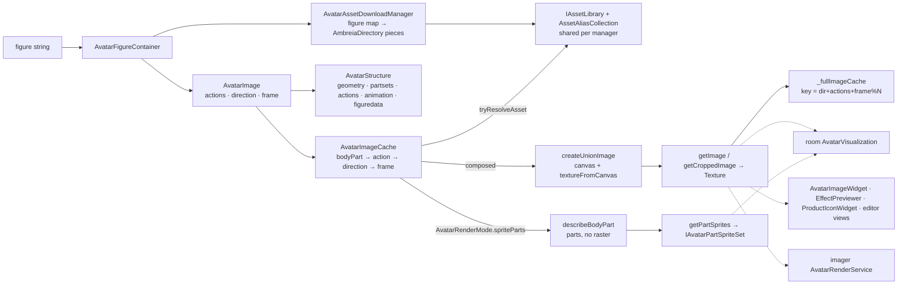
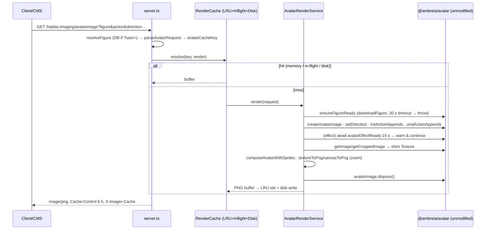

# Audit — `@ambreia/avatar`, `vortex-imager`, platform boundary

Repo `/home/user/ambreia-client` @ `aeb88ba` (branch `claude/determined-ritchie-omy2dy`). Read-only audit; nothing in the repo was modified.
Scope: (a) `packages/ambreia-avatar` (86 files, 15 443 lines), (b) the game's avatar editor as a consumer, (c) `packages/vortex-imager` (6 043 lines), (d) `platform()` and every browser global in the engine packages, (e) avatar caches, (f) "one renderer", (g) pets/monsters, (h) Node tests.

---

## (A) Facts

### A.1 The avatar package

- Entry: `AvatarRenderManager(options: IAvatarRenderOptions)` — plain class, **no DI**. Options = `{assets: IAssetLibrary, data: IAvatarData, clothing: AmbreiaDirectory, effects: AmbreiaDirectory, onLibraryLoaded?}` (`IAvatarRenderOptions.ts:79-91`). Constructor parses the shipped XML (`initStructure`, `AvatarRenderManager.ts:475-490`) and starts the two download managers (`initDownloadManagers`, :493-521). Spec §3 rule 1 is met on this seam.
- Five construction sites, all with the same options object: game feature `features/index.ts:257`, imager `AvatarRenderService.ts:417`, tool `tools/render-avatar.mjs:60`, iso sandbox `sandbox/main.ts:72`, test `avatar-render-options.test.ts:28`.
- Only runtime platform access on the avatar path is `platform()`: `AvatarRenderManager.ts:533 platform().parseXml`, `AvatarImage.ts:744/1018/1072 createOffscreenCanvas`, `AvatarImageCache.ts:1120/1373/1412 createOffscreenCanvas`, `textureFromCanvas()`. A grep for `new OffscreenCanvas|document\.|createImageBitmap|DOMParser|fetch(` in `packages/ambreia-avatar/src` returns only a comment (`AvatarImageCache.ts:1387`) and a local variable named `document` (`AvatarXmlUtils.ts:67-69`). `OffscreenCanvas*` appears otherwise only in **type positions**.
- Import closure of `tools/render-avatar.mjs` (esbuild metafile, externals `@napi-rs/canvas`, `linkedom`): `ambreia-avatar` 61 files, `ambreia-common` 31 files, `pixi.js/lib` **681 files**, `eventemitter3`, `pako` (NitroAsset inflate), `@xmldom/xmldom`/`earcut`/`ismobilejs`/`@pixi/colord`/`tiny-lru`/`parse-svg-path` (pixi's own deps). No `kernel`, `game`, `iso`, `ui`, `net`, `protocol`, `vortex-*`. `linkedom`/`@napi-rs/canvas` are imported **only** from `tools/node-platform.mjs` and `tools/render-avatar.mjs`, never from `src/` (package.json lists them as devDependencies, `packages/ambreia-avatar/package.json:16-19`).
- Tests run here: `node --test packages/ambreia-avatar/test/render.test.mjs` → 2 tests, **both SKIP** ("set AMBREIA_ASSETS to the asset server, and run node install.mjs for the embedded avatar XMLs"); no asset host in this container. `render-avatar.mjs` with no args prints usage and exits 2 (expected). ESLint on `packages/ambreia-avatar/src`: **115 `@typescript-eslint/no-explicit-any` in 42 files**, no other rule fires. Top: `FigureSetData.ts` 11, `AvatarStructure.ts` 11, `PartSetsData.ts` 7, `SetType.ts` 6, `AnimationAction.ts` 6, `AvatarRenderManager.ts` 6, `AvatarAssetDownloadManager.ts` 6, `AvatarImage.ts` 5.
- `structure/EmbeddedAvatarAnimationData.ts` (1 526 lines, `EMBEDDED_AVATAR_ANIMATION_DATA`) has **no importer anywhere** (`grep -rn EMBEDDED_AVATAR_ANIMATION_DATA packages --include=*.ts` → only its own file). The live animation data comes from `data.animation` (`AmbreiaAvatarAnimation.xml`, `AvatarData.ts:120`).



### A.2 The imager

- Boot (`src/index.ts:9-24`): `installGlobals()` **before** any engine import (dynamic `await import`), then `AvatarRenderService.boot` → `RoomStack.boot` → `createServer`. `tools/build.mjs:42-44` aliases `pixi.js` to `src/shim/pixi.ts` for the whole graph.
- `AvatarRenderService.initialize()` (:392-441): `Core.instantiate()` (kernel), `new AssetLibrary()` (imported from the **game** barrel `@ambreia/game/core/assets/index`, which re-exports `@ambreia/common/assets/AssetLibrary`), `HabboConfigurationManager` (game) loaded with `LEGACY_DEFAULTS` + `url.prefix` (:447-455), `openAssetDirectories(config.assetPacks, text => configuration.interpolate(text))`, then the same `new AvatarRenderManager({assets, data, clothing, effects})` as the client.
- What the imager actually takes from kernel/game (every import, `grep from '@ambreia/(kernel|game)'`): kernel → `Core`, `CoreComponentContext` (type), `IID_Core`, `IID_AssetLibrary`; game → `HabboConfigurationManager`, `LEGACY_DEFAULTS`, `IID_HabboConfigurationManager`, `IID_AvatarRenderManager`, `AssetLibrary` (barrel), `IHabboLocalizationManager` (type, cast at `RoomStack.ts:478-481`). Used for: `interpolate('${url.prefix}')`, `getProperty('furnidata.load.url' | 'flash.client.url' | 'image.library.badgepart.url')`, `getBoolean`, and satisfying `IRoomContentConfiguration` (`iso/scene/IRoomContentConfiguration.ts:9-12`, **one method**: `getProperty(key)`). `attachInstance(IID_AvatarRenderManager, …)` (:424) is never resolved by anything in the imager.
- Request flow and caches: `server.ts:412-443` → `resolveFigure` (DB or `figure=`) → `parseAvatarRequest` → `RenderCache.resolve('avatar:'+avatarCacheKey)` → `AvatarRenderService.render()` → `avatarImage.dispose()` in `finally` (:206-210). `RenderCache` = LRU (`lru-cache`, max/ttl from env) + in-flight de-dup Map + optional `DiskCache` (`<cacheDir>/<build>/<sha1[0:2]>/<sha1>.png`, atomic tmp+rename, build from `flash.client.url`, no TTL on disk). Rooms use a separate memory-only cache (60 s TTL).
- Node shims (`shim/globals.ts`): `OffscreenCanvas` (→ `createCanvas`), `createImageBitmap` (→ `loadImage`), `DOMParser`/`Document`/`Element` (linkedom), `document.createElement('canvas')` + linkedom fallback, in-memory `localStorage`, optional file-backed `fetch`. `shim/pixi.ts` (543 lines) reimplements `Texture`/`TextureSource`/`ImageSource`/`Spritesheet`/`Assets` and inert `Container/Sprite/Text/Graphics/Filter/ColorMatrixFilter/Rectangle/Renderer/Ticker/GlProgram/Color`.



### A.3 Platform boundary

```mermaid
flowchart TB
  subgraph common
    P[platform(): createCanvas · decodeImage · parseXml<br/>BROWSER_PLATFORM default, setPlatform()]
    TF[textureFromCanvas(): own typeof detection]
  end
  subgraph honours platform()
    AV[@ambreia/avatar — 100% of runtime globals]
  end
  subgraph bypasses platform()
    ISO[@ambreia/iso: ~18× document.createElement('canvas'), new OffscreenCanvas ×5]
    UI[@ambreia/ui: new OffscreenCanvas ×~40, new DOMParser ×2, fetch+createImageBitmap]
    CM[common off-path: AssetBitmap, BitmapSlot, Canvas, BitmapFileLoader, AssetBundle]
  end
  subgraph Node hosts
    T[tools/render-avatar.mjs → setPlatform(nodePlatform())]
    IM[vortex-imager → installGlobals() shims + esbuild pixi alias]
  end
  T --> P
  IM --> P
  IM -. needed only because of .-> ISO
  IM -. needed only because of .-> CM
```

Two parallel mechanisms coexist: the explicit `platform()` (used by `avatar` and by nothing else) and the imager's global monkey-patches, which exist because `iso` and off-path `common` still reach for `document`/`OffscreenCanvas`/`createImageBitmap` directly.

### A.4 Consumers of the renderer (one renderer?)

| Consumer | Path | Divergent implementation? |
|---|---|---|
| Room avatars (`iso/avatar/visualization/AvatarVisualization.ts`) | `createAvatarImage` per object (`:1403`), `getPartSprites(FULL)` when `AvatarRenderMode.spriteParts` else `getImage(FULL, isHighlighted)` (`:1767-1793`) | No |
| HUD portraits / party frames / character screen (`features/hud/HudPanelsView.ts:283,309,439`, `features/character/WindowBits.ts:65`) | `IAvatarImageWidget.figure=` → game `AvatarImageWidget.refresh()` (`window/widgets/AvatarImageWidget.ts:460-477`): `createAvatarImage(figure,'h','',this,null)` → `getCroppedImage/getImage` → dispose | No |
| Avatar editor (`game/src/avatar/**`, 10 k lines) | `AvatarImageSnapshot.avatarImageToBitmap()` = `getCroppedImage()`; `AvatarTextureUtils.toImageBitmap/toCanvas` copy `texture.source.resource`; editor views (`BodyModel`, `FigureDataView`, `OutfitView`, `WardrobeSlot`, `AvatarEditorGridPartItem`) call the manager's `createAvatarImage` | No — it only *converts* textures to `ImageBitmap`/canvas; three copies of that conversion exist (`AvatarImageSnapshot.textureToCanvas`, `AvatarTextureUtils.toCanvas`, `AvatarImageWidget.textureToImageBitmap`) |
| Effect previews (`window/utils/EffectPreviewer.ts:95-99`), product icons (`ProductIconWidget.ts:343-354`) | `createAvatarImage` + `getCroppedImage` | No |
| Imager | `AvatarRenderService` + `composeAvatar.ts` (effect extra sprites, mirrors `AvatarVisualization.updateSprites` maths) | Partially: the *extra-sprite* compositing is a hand copy of `AvatarVisualization` offsets (`composeAvatar.ts:11-17,86-170`) — documented and kept in sync by comment, not by code |
| Legacy imaging URLs | `legacy.defaults.json` and 4 landing-view XMLs still name `habbo-imaging/avatarimage` | External, by design |

No "figure-string-to-canvas" alternative exists; `PlaceholderAvatarImage`/`BlockedAvatarImage` are subclasses on the same cache.

### A.5 Pets / monsters

- `avatar/pets/` = `PetFigureData` (+`PetCustomPart`): pure parsing of `<typeId> <palette> <colour>[ head][…]`. No rank/telegraph/boss knowledge in `@ambreia/avatar` (grep `monster|rank|telegraph|boss|elite|rpg` → 0 hits).
- `iso/avatar/pet/*`: monster words appear only in comments (`AnimatedPetVisualization.ts:234,343`, `PetLogic.ts:32`); the one hardcoded posture is `'ded'` (`PetAnimationSizeData.ts:134`, inherited). RPG monster *data* stays on the emulator/asset side (rule `assets.md` "Monsters are pets drawn by tools/monster-art").
- RPG knowledge **inside the avatar engine**: `AvatarAction.WIELD='wpn'`, `ATTACK='atk'` (`enum/AvatarAction.ts:16-19`), part types `rib`/`rif` (`AvatarStructure.ts:128-136`, `AvatarImageCache.ts:673-678`), `LIB_WEAPONS='ambreia_weapons'` (`AvatarAssetDownloadManager.ts:42-44`), `appendAction` cases (`AvatarImage.ts:520-524`). Marked `TS-only`/`DEVIATION`.

---

## (B) Findings

### AV-01 | HIGH | HIGH | Deployment
- **Evidence**: `Dockerfile.imager:24-29` copies only `packages/vortex-client|vortex-engine|vortex-glaze|vortex-imager/package.json` then `RUN pnpm install --frozen-lockfile`; `pnpm-workspace.yaml` = `packages/*`; `pnpm-lock.yaml` importers include `packages/ambreia-avatar|common|game|iso|kernel|net|protocol|ui|map-editor|map-editor-core` (lines 43-231). `packages/vortex-imager/package.json:17-25` depends on `@ambreia/*: workspace:*`. Header comment `Dockerfile.imager:8` still says "The imager depends on vortex-engine through the workspace protocol" — `grep "from 'vortex-engine" packages/vortex-imager/src` → 0.
- **Files**: `Dockerfile.imager`, `packages/vortex-imager/package.json`.
- **Observed**: at install time the workspace has 4 projects, the lockfile 14; `workspace:*` targets `@ambreia/*` are absent.
- **Why it matters**: `pnpm install --frozen-lockfile` refuses a lockfile whose importers do not match the workspace (`ERR_PNPM_OUTDATED_LOCKFILE`); even without `--frozen-lockfile`, `workspace:*` on a missing project fails. The imager image cannot build since the J1–J6 package split.
- **Failure scenario**: Coolify redeploy of the imager → build fails at step 5; production keeps the pre-split image rendering `.nitro` while the client reads `.ambreia` (asset drift the DEPLOYMENT doc explicitly wants to avoid).
- **Recommended architecture**: Dockerfile copies `packages/*/package.json` via a glob stage (`COPY packages ./packages` filtered, or `pnpm fetch` + `COPY . .` then `pnpm install --offline --frozen-lockfile`).
- **Minimal fix**: add the ten `COPY packages/ambreia-*/package.json packages/ambreia-*/` lines (or `COPY --parents packages/*/package.json ./` with BuildKit 1.7); fix the header comment.
- **Long-term**: `pnpm deploy --filter vortex-imager --prod` into the runtime stage (the Dockerfile already names it as the upgrade path, :41).
- **Verify**: `docker build -f Dockerfile.imager .` locally; or `pnpm install --frozen-lockfile --lockfile-only` in a tree with only those 4 manifests.
- **False-positive review**: not executed here (no Docker). pnpm's frozen mode checks `importers` keys against discovered projects; a 4-vs-14 mismatch is the canonical failure. If the deployed builder ignores `--frozen-lockfile`… it cannot: the flag is in the file. Only escape: Coolify's "Base Directory" containing a pre-installed `node_modules` — excluded by `.dockerignore` (`**/node_modules/`).
- **Regression risk**: none. **Effort**: S.

### AV-02 | HIGH | CONFIRMED | Imager independence (spec §3: imager = avatar + iso)
- **Evidence**: `AvatarRenderService.ts:17-28` imports `Core`, `CoreComponentContext`, `IID_Core`, `IID_AssetLibrary` (kernel) and `AssetLibrary` (game barrel), `IID_HabboConfigurationManager`, `IID_AvatarRenderManager`, `HabboConfigurationManager`, `LEGACY_DEFAULTS` (game); `RoomStack.ts:46-47` imports `IHabboLocalizationManager`, `HabboConfigurationManager` (game). Uses: `configuration.interpolate(text)` (:412), `getProperty` ×3 keys, `getBoolean` (`RoomStack.ts:107-110`), and `contentLoader.initialize(events, configuration, directories)` whose parameter type is iso's `IRoomContentConfiguration { getProperty(key): string }` (`iso/scene/IRoomContentConfiguration.ts:9-12`). `FurnitureDataParser` takes iso's own `IFurniDataLocalization` (`FurnitureDataParser.ts:10-12`), yet the imager casts to the game's `IHabboLocalizationManager` (`RoomStack.ts:478-481`). `context.attachInstance(IID_AvatarRenderManager, renderManager)` (:424) has no consumer in the imager. `game/core/assets/index.ts` is a barrel over `@ambreia/common/assets/AssetLibrary`. `installStorage()` (`globals.ts:116-144`) exists for `HabboConfigurationManager.initEmbeddedConfigurations()` reading `localStorage` — `grep localStorage packages/ambreia-game/src/configuration/HabboConfigurationManager.ts` → 0 today.
- **Files**: `vortex-imager/src/avatar/AvatarRenderService.ts`, `room/RoomStack.ts`, `shim/globals.ts`, `package.json`.
- **Observed**: the whole kernel DI (`Core.instantiate()`, `registerInterface`, `attachComponent`) is booted to host one object whose only used surface is a property map with `${…}` interpolation.
- **Why it matters**: the spec's diagram puts the imager on `(avatar, iso)`; the kernel+game dependency drags the DI container, `legacyDefaults`, and game-side `Component` lifecycle into a headless server, and any game-side change to `HabboConfigurationManager` (e.g. a browser-only read) breaks the imager at runtime — the `localStorage` shim is the fossil of exactly that.
- **Failure scenario**: a future `HabboConfigurationManager` touching `window`/`document.cookie`/a feature host → imager boot throws under Node; or `Core.dispose()` semantics change → `AvatarRenderService.dispose()` (:299-305) breaks.
- **Recommended architecture**: `imager/src/ImagerProperties.ts` (~40 lines): `Map<string,string>` seeded from `legacy.defaults.json` (read as JSON, not via game) + `url.prefix`, with `interpolate()`, `getProperty()`, `getBoolean()`; implements `IRoomContentConfiguration`; pass closures to `RoomManager` as today. Drop kernel/game deps, `installStorage`, `IID_*`, the game barrel (`import {AssetLibrary} from '@ambreia/common/assets/AssetLibrary'`), the `IHabboLocalizationManager` cast (`IFurniDataLocalization`).
- **Minimal fix**: replace the 3 import sites listed; remove `Core` usage; `package.json` deps → `@ambreia/avatar`, `common`, `iso` (+ runtime libs).
- **Long-term**: ESLint `wall()` rule for `packages/vortex-imager`: may import `@ambreia/{common,avatar,iso}` only (same mechanism as glaze's wall, `eslint.config.mjs`).
- **Verify**: `pnpm --filter vortex-imager typecheck && build`, `tools/smoke.mjs` against a running imager, byte-compare the reference avatar PNG before/after (bilan J2 method).
- **False-positive review**: `legacy.defaults.json` lives in `@ambreia/game`; reading it as a file keeps the "one copy of the hotel config" property the comments defend (`AvatarRenderService.ts:443-446`) without importing game code. `interpolate()` semantics (`${key}` recursion?) must be checked against `HabboConfigurationManager.interpolate` before replacing — not verified here.
- **Regression risk**: M (property interpolation edge cases). **Effort**: M.

### AV-03 | MEDIUM | CONFIRMED | Imager cache poisoning on effect timeout
- **Evidence**: `AvatarRenderService.ts:143-152` — `await withTimeout(effectReady, EFFECT_TIMEOUT_MS).catch(() => log.warn('Effect … did not load in time; rendering without it')); this._settledEffects.add(request.effectId); avatarImage.forceActionUpdate();` then the PNG is returned → `RenderCache.resolve` stores it in LRU **and** `DiskCache.write` (`RenderCache.ts:66-71`); disk entries have no TTL (`DiskCache.ts` header: "deleting it is the whole of cache invalidation"). `isEffectSettled()` (:346-351) then returns true for every later request of that effect for the process lifetime.
- **Files**: `AvatarRenderService.ts`, `cache/RenderCache.ts`, `cache/DiskCache.ts`.
- **Observed**: a transient asset-host hiccup (>15 s on one effect library) yields a plain avatar, cached 6 h in memory and **permanently on disk** under the correct `figure|…|effect:N` key; all other figures with that effect also render effect-less until restart.
- **Why**: cache keys are documented as "fully describing the pixels"; here the pixels depend on a race.
- **Failure scenario**: cold imager boot while the asset CDN is slow → the first users' profile/HUD images with effects are wrong forever (CMS pages, Cache-Control 6 h downstream too).
- **Recommended**: treat an effect timeout like a figure timeout (`ensureFigureReady` throws → 500/503, not cached); `_settledEffects` only on success; or return the image with a `no-store` marker that `RenderCache` honours (skip LRU+disk).
- **Minimal fix**: in the `.catch`, `throw new ContentUnavailableError(...)` (already mapped to 503 + `Retry-After` in `server.ts:551-556`); do not add to `_settledEffects` on timeout.
- **Long-term**: an `EffectAssetDownloadManager.isReady(effectId)` surface exposed on `IAvatarRenderManager` (the comment at :338-345 says none exists; `AvatarImage.endActionAppends` already calls `_effectManager.isReady` at `AvatarImage.ts:411`).
- **Verify**: unit test with a fake render manager whose effect never fires → expect 503 and `cache.size === 0`.
- **False-positive review**: the behaviour is intentional ("rendering without it") — but the *caching* of that degraded output is not discussed anywhere in the code; a degraded response is acceptable, a permanently cached one is not.
- **Regression risk**: L. **Effort**: S.

### AV-04 | MEDIUM | CONFIRMED | `AvatarRenderManager._activeImages` grows without bound
- **Evidence**: `AvatarRenderManager.ts:104,140` pushes every ready `AvatarImage`; `unregisterImage()` (:168-173) and `resetAllCaches()` (:271-285) have **zero callers** (`grep -rn "unregisterImage\|resetAllCaches" packages --include=*.ts` → declarations/comments only). `AvatarImage.dispose()` (`AvatarImage.ts:1139-1174`) does not notify the manager. `IAvatarImage.ts:62` and `AvatarImage.ts:1105` both note "not yet wired".
- **Files**: `AvatarRenderManager.ts`, `AvatarImage.ts`, consumers `AvatarImageWidget.ts:460-477` (create+dispose per refresh), `AvatarVisualization.ts:1403` (per room object), imager `AvatarRenderService.ts:123-210` (per cache-miss request).
- **Observed**: every disposed image stays referenced (fields nulled, but the object, its cleared `Map`, `_cachedBodyParts`, `_canvasOffsets` remain).
- **Why**: in the imager it is a process-lifetime leak proportional to cache misses; in the client, HUD party frames/character screen re-render on every stat update via `AvatarImageWidget.refresh()`.
- **Failure scenario**: long-running imager (weeks) with a large hotel → steady RSS growth (~0.5–1 KB per miss; 1 M misses ≈ 0.5–1 GB). Client: a long session with frequent HUD updates grows the array to tens of thousands of entries, slowing the only sweep (`resetAllCaches`) that nobody calls.
- **Recommended**: `AvatarImage` receives an `onDispose` callback (or the manager) and calls `unregisterImage` in `dispose()`; or store `_activeImages` as a `Set<AvatarImage>` and drop `disposed` entries on `createAvatarImage`.
- **Minimal fix**: in `createAvatarImage`, before pushing, sweep `disposed` entries when `length % 256 === 0`.
- **Long-term**: wire `resetAllCaches()` to the asset-pack reload path (it is the AS3 hook for figuredata reload).
- **Verify**: unit test: create+dispose 1 000 images, assert `_activeImages.length` (via a test accessor) stays bounded.
- **False-positive review**: the AS3 also tracked images and relied on `resetAllCaches` sweeps, which the hotel called on figuredata updates; the port has no such caller, so the AS3 mitigation is absent — confirmed by grep.
- **Regression risk**: L. **Effort**: S.

### AV-05 | MEDIUM | CONFIRMED | Platform abstraction honoured by one package; the imager runs a second, global one
- **Evidence**: see table (E). `iso`: `document.createElement('canvas')` at `RoomPlane.ts:1168,1250,1452`, `PlaneMaterialCell.ts:94,107,145`, `PlaneVisualizationLayer.ts:128,151`, `PlaneVisualization.ts:209`, `PlaneMaterialCellColumn.ts:182`, `PlaneMaterialCellMatrix.ts:279,303`, `FloorRasterizer.ts:52`, `WallRasterizer.ts:52`, `WallAdRasterizer.ts:59`, `LandscapeRasterizer.ts:79`, `PlaneVisualizationAnimationLayer.ts:108`, `RoomObjectSpriteVisualization.ts:358`, `ExtendedSprite.ts:257`; `new OffscreenCanvas` at `FurnitureParticleSystem.ts:153,169`, `RoomPlane.ts:1150`, `ExtendedSprite.ts:199,253`. `common` off-path: `AssetBitmap.ts:79`, `BitmapSlot.ts:37,81`, `Canvas.ts:118` (`new OffscreenCanvas`), `BitmapFileLoader.ts:116`, `AssetBundle.ts:312` (`createImageBitmap`). `ui`: `WindowXmlAssetParser.ts:175,186` (`new DOMParser()`), `ResourceManager.ts:282-284` (`fetch`+`createImageBitmap`), ~40 `new OffscreenCanvas` across `graphics/*`, `kit/*`, `utils/GlyphAtlas.ts`. `imager/shim/globals.ts:81-114` says it installs `document` for "eighteen call sites across the plane rasterizers … plus `GraphicAssetCollection.colorizePalette()`". `globals.ts:146-167` justifies `Document`/`Element` globals by "`AvatarXmlUtils.isXmlDocument()` narrows with `instanceof`" — but `AvatarXmlUtils.ts:5` now says "The type tests are structural … not `instanceof Document`" (shim reason stale). `textureFromCanvas.ts:16` does its own `typeof OffscreenCanvas|HTMLCanvasElement` detection outside `platform()`.
- **Observed**: J2 bilan already lists this debt ("Les globaux hors du chemin avatar … restent, gardés par typeof; à convertir quand J3/J4 en auront besoin") — J3/J4 happened, the conversion did not.
- **Why**: two mechanisms = two sets of behaviour under Node. The iso sandbox / map editor / imager each need the global shim; a Node test of `RoomPlane` or of `WindowXmlAssetParser` cannot use `setPlatform()` alone. Stale shim justifications show nobody owns the list.
- **Failure scenario**: an iso change switching `document.createElement('canvas')` → `new OffscreenCanvas(...)` with `transferToImageBitmap()` works in the browser and breaks the imager room route (the shim's `OffscreenCanvas` is a napi `Canvas` without `transferToImageBitmap`). A `ui` XML parse in a Node tool (glaze tests) needs linkedom globals.
- **Recommended**: extend `IPlatform` minimally (`createCanvas` already covers both shapes; add `decodeImage` use in loaders; `parseXml` in `WindowXmlAssetParser`), then a lint rule banning `document.`, `new OffscreenCanvas`, `createImageBitmap(`, `new DOMParser(` in `packages/ambreia-{common,avatar,iso,ui}/src` except `platform/Platform.ts` and an allow-list for genuinely DOM-only UI files (`TextFieldController`, `SelectableTextOverlay`, `MouseCursorControl`, `WindowManager` resize host).
- **Minimal fix**: iso rasterizers + `GraphicAssetCollection.colorizePalette` → `createOffscreenCanvas()` (mechanical, ~20 sites); `BitmapFileLoader`/`AssetBundle`/`ResourceManager` → `platform().decodeImage`; `WindowXmlAssetParser` → `platform().parseXml`. Then delete `installDocument`, `installXml`, `installStorage`, `createImageBitmap` shim from `globals.ts` (keep `OffscreenCanvas` only if pixi needs it — see AV-08).
- **Long-term**: `platform()` gains `now()`/`schedule()` so `performance.now`/`requestAnimationFrame` in `ui/motion` and `iso/effects` are injectable (currently harmless under Node 22 but untestable deterministically).
- **Verify**: `grep` counts → 0 outside allow-list; imager `smoke.mjs` room+furni cases still pass; iso sandbox renders.
- **False-positive review**: `OffscreenCanvas*` in type positions are not bypasses; `window.addEventListener` in `ui/reactive/bind.ts`, `WindowScope.ts`, `graphics/WindowRenderer.ts` are `IWindow` locals (read: parameter named `window`) — excluded. `ui/kit/WindowManager.ts:1338-1356` uses the DOM `window` but behind an injectable `resizeHost` option — acceptable.
- **Regression risk**: M (iso raster path pixels must stay identical; napi `Canvas` vs browser `OffscreenCanvas` draw identically at 1:1 per `AvatarImageCache.ts:1261-1264`). **Effort**: M.

### AV-06 | MEDIUM | CONFIRMED | Tests do not cover the two cache-key contracts or the request parser
- **Evidence**: imager tests = `furniture-request.test.ts` (2 tests, `size=icon` + unknown size), `imager-config.test.ts` (2), `furniture-icon.test.ts`. Nothing exercises `parseAvatarRequest`/`avatarCacheKey` (`AvatarRequest.ts:170-240`), `RenderCache.resolve` de-dup, `DiskCache` sanitize/build keying, or `composeAvatarWithSprites`. Avatar tests = `render.test.mjs` (skipped without `AMBREIA_ASSETS`, both cases SKIP here) and `avatar-render-options.test.ts`. No unit test for `getFullImageCacheKey`, `AvatarImageCache.getImageContainer` keying, `tryResolveAsset` fallbacks, `validateAvatarFigure`.
- **Why**: the imager's URL grammar is a public contract (CMS, website) and the cache key is what makes images immutable; both are pure functions with zero deps — the cheapest tests in the repo.
- **Minimal fix**: table-driven tests for `parseAvatarRequest` (posture tokens, `dance` default `'1'`, `crr` vs `action=crr=…` precedence, `headonly`, direction wrap, `gender` rule on `/clothing/`), `avatarCacheKey` (order-independence of actions; `img_format` ignored), `RenderCache` (two concurrent identical renders → one `render()` call), `DiskCache.sanitize`.
- **Long-term**: a fixture-based golden test for `AvatarImageCache.renderBodyPart` with a 2-part synthetic figure under `nodePlatform()` (no asset host needed: synthesize a `GraphicAssetCollection` from a 4×4 canvas).
- **Verify**: `pnpm test`. **Regression risk**: none. **Effort**: S–M.

### AV-07 | LOW | CONFIRMED | Full-image cache and `_needsUpdate` shortcut ignore `setType`, `scale` and the "highlight" flag
- **Evidence**: `AvatarImage.getImage(setType, makeCopy, scale)` (`AvatarImage.ts:688-858`): early `if(!this._needsUpdate) return this._image;` (:690) regardless of arguments; `getFullImageCacheKey()` (:1552-1598) = `mainDirection + actionsString + frame%N` (no `setType`). `IAvatarImage.ts:39` names the second parameter `hightlight`, the implementation names it `makeCopy` and only uses it to skip assigning `_image`; room passes `isHighlighted` (`AvatarVisualization.ts:1793`).
- **Observed**: latent — every current consumer uses one `setType` per image lifetime (widgets create+dispose; room always `FULL`; imager one request per image). Inherited from AS3 verbatim.
- **Failure scenario**: a future consumer calling `getImage('head')` then `getImage('full')` on one image gets the head composite twice; a highlight request renders no highlight (today's behaviour, unnoticed).
- **Minimal fix**: include `setType` in the key and in a `_imageArgs` check for the `_needsUpdate` shortcut; rename the interface parameter to `makeCopy` (or implement highlight). **Effort**: S. **Regression risk**: L.

### AV-08 | LOW | CONFIRMED | Two Node strategies for one engine: real pixi (tool) vs 543-line pixi shim (imager)
- **Evidence**: `render-avatar.mjs` closure pulls `pixi.js/lib` (681 files) and runs (`bilan J2`: PASS against reference fixtures); the imager aliases `pixi.js` → `shim/pixi.ts` (`build.mjs:42-44`) reimplementing `Texture`/`Spritesheet`/`Assets` (`pixi.ts:96-298`) plus inert display stubs (:323-543). Bilan J2 records a 1–2 px divergence between the two paths on trimmed parts ("le rendu de l'imager reste l'ancien (son shim ne porte pas de rognage pour les avatars)"); `AvatarImageCache.ts:1152-1153` has a special comment for the shim's `width`/`trim` reporting.
- **Why**: the engine now accommodates the shim ("the imager's pixi shim reports the frame there and a zero trim") — a Node host detail leaking into engine arithmetic.
- **Recommended**: the imager loads real `pixi.js` like the tool (the avatar path needs only `Texture`/`ImageSource` and `textureFromCanvas` already handles Node), and keeps a shim only for `iso`'s display-object graph until `iso` separates data from PixiJS rendering (`RoomObjectSpriteVisualization.getImage()` → `Vortex.instance.application.renderer`, per `pixi.ts:310-315`).
- **Verify**: byte-compare `/habbo-imaging/avatarimage?figure=hd-180-2…&size=l` with `test/fixtures/reference-hd-180-2.png`. **Effort**: M. **Regression risk**: M.

### AV-09 | LOW | CONFIRMED | 1 526 dead lines (10% of the package)
- **Evidence**: `structure/EmbeddedAvatarAnimationData.ts` exports `EMBEDDED_AVATAR_ANIMATION_DATA`; no importer in `packages/`. **Fix**: delete (history has it). **Effort**: S.

### AV-10 | LOW | CONFIRMED | 115 `any` concentrated at the XML→object boundary
- **Evidence**: eslint JSON: 115 `no-explicit-any` / 42 files; `FigureSetData.ts` 11, `AvatarStructure.ts` 11, `PartSetsData.ts` 7, `SetType.ts` 6, `AnimationAction.ts` 6; API-level: `effectMap(): Map<string, any>` (`AvatarRenderManager.ts:94`), `injectFigureData(data: any)` (:437), `parseFigureMapXml(): any` (:529), `appendAction(...args: any[])` (`IAvatarImage.ts:109`), `tryResolveAsset(): {asset: any}` (`AvatarImageCache.ts:901`).
- **Why**: the parsers accept both XML `Element` and pre-parsed JSON shapes (AS3 heritage) with no declared type, so a figuredata schema change is found at runtime.
- **Minimal fix**: declare `IFigureMapData`, `IEffectMapData`, `IFigureDataJson` and type `appendAction(actionType: string, param?: string | number)`; `tryResolveAsset` → `IGraphicAsset`. **Effort**: M. **Regression risk**: L (types only).

### AV-11 | LOW | CONFIRMED | File-backed fetch confinement check is prefix-based
- **Evidence**: `globals.ts:177-191`: `const normalisedRoot = normalize(root); … if(!target.startsWith(normalisedRoot)) 403`. With `IMAGER_ASSETS_ROOT=/assets`, `/assets-private/x` passes. Only active when the env var is set (Dockerfile leaves it unset, `Dockerfile.imager:53-66`). **Fix**: compare against `normalisedRoot + sep` (or `path.relative` not starting with `..`). **Effort**: S.

### AV-12 | LOW | CONFIRMED | Imager error mapping inconsistent for transient failures
- **Evidence**: figure library timeout → `withTimeout` rejects (`AvatarRenderService.ts:367-379`) → `sendError` → **500** + `log.error` (`server.ts:565-567`); furniture content timeout → `ContentUnavailableError` → **503 + Retry-After** (:551-556). Unknown figure part → 200 transparent image unless `/clothing/` (documented, :169-178).
- **Fix**: wrap the figure timeout in `ContentUnavailableError`. **Effort**: S.

### AV-13 | LOW | CONFIRMED | Encapsulation breaches inside the imager
- **Evidence**: `renderHandItem` reads `(avatarImage as unknown as {_cache})._cache.getImageContainer('rightitem', …)` (`AvatarRenderService.ts:248-249`); `composeAvatar.ts:33-37` and `RoomStack.ts:484-490` declare structural texture types to bridge shim vs real pixi; `avatarImage.getAsset(name)` by hand-built asset name `${scale}_${member}_${dd}_${frame}` (`composeAvatar.ts:141`) duplicates `AvatarVisualization.updateExtraSprites` naming.
- **Recommended**: `IAvatarImage.getBodyPartImage(bodyPartId, frame)` (public, typed) and `IAvatarImage.getEffectSpriteLayers()` returning the same layer list the room uses — then `composeAvatar.ts` draws what the engine lists instead of re-deriving offsets. **Effort**: M.

### AV-14 | LOW | CONFIRMED | RPG weapon knowledge hardcoded in the generic engine
- **Evidence**: A.5 list. Part-type names `rib`/`rif` in flip logic (`AvatarImageCache.ts:675`), `LIB_WEAPONS` constant, `WIELD/ATTACK` actions.
- **Why**: spec §3 "moteurs : aucune connaissance du jeu". These are data (part sets, actions XML, figure map) that the engine should read from `AmbreiaAvatarPartSets.xml` / `AmbreiaAvatarActions.xml` rather than from constants.
- **Minimal fix**: move the flip rule to a part-definition attribute (`flipWithRightItem`) read by `PartSetsData`; `LIB_WEAPONS` into the figure map (`AmbreiaFigureMap.xml`). **Effort**: M. **Regression risk**: M (weapon placement).

### AV-15 | INFO | CONFIRMED | Declared-but-unused imager dependencies
- `package.json` lists `@ambreia/ui`, `@ambreia/net`, `@ambreia/protocol`, `vortex-engine`, `pako` — none imported from `src/` (grep). Needed transitively only through game/kernel (AV-02). Remove with AV-02.

### AV-16 | INFO | HIGH | Per-instance body-part caches; identical figures compose N times
- `AvatarVisualization.getAvatarImageForScale` keys images per *room object* (`avatarImage${scale}[-effect]`, `:1383-1395`); each `AvatarImage` owns an `AvatarImageCache`. Mitigations in place: static `TRANSFORM_MEMO` (`AvatarImageCache.ts:91`, WeakMap by source bitmap, 512/source) shares colour-transformed frames across instances; sprite-parts mode (`AvatarRenderMode.spriteParts = true` default) avoids compositing in rooms. A manager-level cache keyed `(figure, scale, direction, action, frame)` would share union images across identical avatars (NPC crowds), but is not needed while sprite-parts is the room default. KEEP, measure first (`AvatarRenderMode.ts:18-20` says so).

### AV-17 | INFO | CONFIRMED | `AvatarRenderMode` is process-global mutable state in an engine
- `AvatarRenderMode._spriteParts/_generation` statics (`AvatarRenderMode.ts:25-28`) consulted inside `AvatarImageCache.getImageContainer` (:257-267) and `renderBodyPart` (:848); the `wrongKind` branch (:430-470) exists because non-room consumers share the flag. Spec rule 1 prefers typed options; a per-`AvatarImage` `mode` option (room passes `spriteParts`, widgets/imager pass `composed`) would remove the generation counter and the `wrongKind` path. **Effort**: M. Not urgent — the current code is measured and documented.

### AV-18 | INFO | CONFIRMED | Stale wiring and comments in the imager boot
- `RoomStack.ts:98-101` sets `context.configuration = configuration` with a comment about `RoomManager.createRoomObject()` reading URLs through it, but `RoomManager` now receives `{property, flag}` closures (:107-110); whether anything reads `CoreComponentContext.configuration` in the imager was not verified. `globals.ts:146-167` justification (instanceof) is stale (AV-05). `composeAvatar.ts:16` `@see packages/vortex-engine/src/habbo/room/...` path no longer exists (now `@ambreia/iso/avatar/visualization/AvatarVisualization.ts`).

---

## (C) Positive findings

| Verdict | What | Evidence |
|---|---|---|
| KEEP | `AvatarRenderManager` as a plain class over `IAvatarRenderOptions`; 5 hosts share one construction | `IAvatarRenderOptions.ts`, A.1 |
| KEEP | Avatar package has **zero** runtime browser globals; `platform()` + `createOffscreenCanvas()` everywhere | grep in A.1 |
| KEEP | `tools/render-avatar.mjs` + `node-platform.mjs`: Node proof with only `avatar`+`common` (+pixi) and fixture comparison test | A.1 closure, `render.test.mjs` |
| KEEP | `AvatarImageBodyPartContainer.dispose()` → `destroy(true)` (frees the canvas source; documented leak fix) | `AvatarImageBodyPartContainer.ts:154-176` |
| KEEP | `isCacheable` only false when an asset resolved without pixels (88 % → cached) | `AvatarImageCache.ts:824-841` |
| KEEP+STRENGTHEN | `TRANSFORM_MEMO` WeakMap + 512 cap + shared scratch surfaces with `willReadFrequently` | `AvatarImageCache.ts:1324-1439`; add a size metric to `FrameTimings` |
| KEEP | Sprite-parts path with arithmetic kept literally identical to the composed path | `describeBodyPart`, :956-1065 |
| KEEP | Imager `RenderCache`: in-flight de-dup; `DiskCache` keyed by asset build, atomic write, sharded | `RenderCache.ts:34-80`, `DiskCache.ts` |
| KEEP | Per-request room create/dispose in `RoomRenderService` (`finally disposeRoom`) and `avatarImage.dispose()` in `finally` | `RoomRenderService.ts:255-258,369-372`, `AvatarRenderService.ts:206-210` |
| KEEP | Parameterised SQL, read-only DB account, DB optional | `Database.ts:112-227`, `config.ts:353-355` |
| KEEP | Request parsing isolated in pure modules (`AvatarRequest.ts`, `FurnitureRequest.ts`) with capped `zoom`/`frame` | `FurnitureRequest.ts:257,361` |
| KEEP | `/clothing/` route's gender rule and 1×1-crop detection of "drew nothing" | `server.ts:191-216`, `AvatarRenderService.ts:169-178` |
| KEEP | `IRoomContentConfiguration` = one method; iso already decoupled from the game config | `iso/scene/IRoomContentConfiguration.ts` |
| KEEP | No monster rank/telegraph knowledge in `avatar` or `iso/avatar/pet`; `PetFigureData` is pure parsing | A.5 |
| REFACTOR | Imager boot on kernel+game (AV-02); pixi shim for the avatar half (AV-08); `_cache` cast (AV-13) | |
| REFACTOR | Three copies of texture→ImageBitmap/canvas in game (`AvatarImageSnapshot`, `AvatarTextureUtils`, `AvatarImageWidget.textureToImageBitmap`) → one util in `@ambreia/common/graphics` | `AvatarImageSnapshot.ts:16-53`, `AvatarTextureUtils.ts:21-80`, `AvatarImageWidget.ts:627-660` |
| REPLACE | `EmbeddedAvatarAnimationData.ts` (dead) | AV-09 |
| REPLACE | `Dockerfile.imager` install stage | AV-01 |

---

## (D) Scorecard (0–10)

| Axis | `@ambreia/avatar` | `vortex-imager` | Note |
|---|---|---|---|
| Encapsulation | 6 | 5 | avatar: `protected _cache` reached by cast from outside; 115 `any`; imager: structural texture types, `_cache` cast |
| Extensibility | 6 | 7 | avatar: RPG actions/part types hardcoded (AV-14); imager: routes/parsers cleanly separated |
| Testability | 5 | 4 | avatar: Node proof exists but skips without assets; no unit tests on caches; imager: 5 tests, none on the public URL/key contract |
| Independence | 9 | 3 | avatar: common only, platform honoured; imager: kernel+game+DI for a property map (AV-02), shim list stale |
| Lifecycle | 6 | 7 | avatar: `_activeImages` leak (AV-04), otherwise disposal correct; imager: per-request dispose good, effect timeout poisons cache (AV-03) |
| API quality | 6 | 7 | avatar: `getImage(setType, hightlight/makeCopy, scale)` mismatch, `any` in `appendAction`; imager: Habbo-compatible URL grammar, clear errors |
| Performance architecture | 8 | 7 | avatar: measured, memoised, sprite-parts; imager: LRU+inflight+disk; compositing full figure to extract one hand item (documented) |

---

## (E) Platform-bypass table

Classification: **B** legitimately browser-only · **P** should go through `platform()` · **H** harmless (Node has it / typeof-guarded / type-only / false positive).

| File:line | API | Class | Note |
|---|---|---|---|
| common/platform/Platform.ts:20-24 | OffscreenCanvas, document.createElement, createImageBitmap, DOMParser | H | the platform itself |
| common/graphics/textureFromCanvas.ts:16 | typeof OffscreenCanvas/HTMLCanvasElement | P | second environment detection; make it a platform capability |
| common/assets/AssetBundle.ts:87,128,271,293,312 | fetch, Blob/Response/DecompressionStream, URL.createObjectURL, createImageBitmap | P (312), H (rest in Node ≥18) | client bundle loader |
| common/assets/AssetBitmap.ts:71-72,105,112,130 | instanceof HTMLCanvasElement/HTMLImageElement, new Image | H | typeof-guarded |
| common/assets/AssetBitmap.ts:79,118 | new OffscreenCanvas; document.createElement | P (79), H (118 guarded) | |
| common/assets/BitmapDataAsset.ts:227,241 | instanceof | H | guarded |
| common/assets/loaders/SoundFileLoader.ts:92 | AudioContext | B | sound (cut module) |
| common/assets/loaders/BitmapFileLoader.ts:109,116 | fetch; createImageBitmap | H; P | imager shims `createImageBitmap` for this |
| common/assets/loaders/BinaryFileLoader.ts:68, AssetLibrary.ts:287, pack/AmbreiaDirectory.ts:12, utils/FrameTimingsReporter.ts:82 | fetch | H | spec: fetch stays native |
| common/assets/pack/AmbreiaLayout.ts:71 | crypto.subtle | H | Node ≥19 |
| common/utils/Canvas.ts:118, BitmapSlot.ts:37,81 | new OffscreenCanvas | P | J2 bilan debt |
| common/utils/Logger.ts:191,355,367 | window.location, window.localStorage | H | try/catch |
| common/utils/SelfProfiler, FrameTimings, Logger:624 | performance.now | H | |
| net/connection/SocketConnection.ts:78,87,142,148,450,499 | document.visibilitychange, window.location.protocol, WebSocket | B | transport; :78/:499 typeof-guarded, :87 only via listener, :142 unguarded `window` (browser-only by design) |
| net/PacketLogger.ts:132 | performance.now | H | guarded |
| avatar/structure/AvatarXmlUtils.ts:69 | `document.` | H | **local variable** shadowing the global (rename) |
| avatar/cache/AvatarImageCache.ts:87,91,1221,1340,1349,1402; avatar/AvatarImage.ts:935,961 | OffscreenCanvas* | H | type positions only |
| ui/components/TextController.ts:2327-2334, TextLabelController.ts:554 | new OffscreenCanvas / document.createElement (measure) | P | text measurement needs a canvas factory |
| ui/components/TextFieldController.ts:138-897 | document.activeElement/createElement/body, requestAnimationFrame | B | DOM text input |
| ui/utils/SelectableTextOverlay.ts:112-168, MouseCursorControl.ts:65-171 | document.* | B | DOM overlay / cursor |
| ui/utils/GlyphAtlas.ts:406,409,750,1018,1056,1087; :500-502 | new OffscreenCanvas; document.fonts | P; H (guarded) | |
| ui/assets/WindowXmlAssetParser.ts:175,186 | new DOMParser | P | `platform().parseXml` exists |
| ui/kit/ResourceManager.ts:282-284 | fetch + createImageBitmap | P (decodeImage) | |
| ui/kit/WindowManager.ts:1338-1356 | window.innerWidth/addEventListener | B | behind injectable `resizeHost` |
| ui/graphics/* (BitmapDataRenderer:436,483,562,622; WindowComposite:144,296,323; GraphicContext:292; WindowRendererItem:66; BitmapSkinRenderer:339,376; BitmapFillSkinRenderer:322,364; WindowFilterCss:194,201), ui/kit/* (ModalDialog:257, NumberPlaqueBitmap:40, SeparatorWidget:210, LimitedItemGridOverlayWidget:246), ui/debugger/SkinPreviewRenderer:42 | new OffscreenCanvas | P | ~20 sites, mechanical |
| ui/graphics/WindowComposite.ts:125-127, utils/BitmapHitTest.ts:53 | instanceof HTMLCanvasElement/OffscreenCanvas | H/P | :125 unguarded instanceof |
| ui/motion/Motions.ts:250-264 | requestAnimationFrame | B | could be injected ticker |
| ui/reactive/bind.ts:60,66, WindowScope.ts:22,28, graphics/WindowRenderer.ts:587,596,889 | `window.addEventListener` | H | **false positive**: `window` is an `IWindow` parameter |
| iso/scene/object/visualization/room/** (RoomPlane:1168,1250,1452; PlaneMaterialCell:94,107,145; PlaneVisualizationLayer:128,151; PlaneVisualization:209; PlaneMaterialCellColumn:182; PlaneMaterialCellMatrix:279,303; Floor/Wall/WallAd/LandscapeRasterizer:52,52,59,79; PlaneVisualizationAnimationLayer:108) | document.createElement('canvas') | P | the reason `installDocument()` exists |
| iso/object/visualization/RoomObjectSpriteVisualization.ts:347-348,358 | unguarded instanceof HTMLCanvasElement/HTMLImageElement; document.createElement | P | throws in Node if reached (imager avoids `getImage()`) |
| iso/scene/renderer/utils/ExtendedSprite.ts:199,253,257 | new OffscreenCanvas / document.createElement | P | |
| iso/effects/particles/FurnitureParticleSystem.ts:153,169,414-416 | new OffscreenCanvas; guarded instanceof | P; H | |
| iso/scene/object/visualization/room/RoomPlane.ts:1150 | new OffscreenCanvas | P | |
| iso/*: RoomManager:736, RoomRenderer:204, RoomInstance:131, RoomRenderingCanvas:1107, effects/additions/* | performance.now | H | |
| iso/IsoView.ts, renderer/TextureExtractor.ts, IRoomRenderingCanvas.ts, RoomPlane types | HTMLCanvasElement (types) | H | |
| kernel/runtime/CoreComponentContext.ts:153,815,1015; protocol/…/SSOTicketMessageComposer.ts:25 | performance.now | H | |
| map-editor-core/api/EditorApiClient.ts:18 | fetch (injected) | H | good pattern |

Node tools: `tools/node-platform.mjs` (linkedom `DOMParser`, `@napi-rs/canvas` `createCanvas`/`loadImage`) and `render-avatar.mjs:41 setPlatform(nodePlatform())` — only place these libs are imported from the avatar package; `src/` never does.

---

## (F) Cache-key table

| Cache | Where | Key | Scope | Includes | Missing / remarks |
|---|---|---|---|---|---|
| Full image | `AvatarImage._fullImageCache`, `getFullImageCacheKey()` :1552-1598 | `mainDirection + actionsString + frame%8\|4` (1 action, head==body) ; `dir + actions + 0` (fx 33-36) ; `dir_head + actions + frame%11` (fx 38-39) ; else uncached | per `AvatarImage` (figure, scale fixed) | direction, posture/actions (incl. effect, dance, sign, carry id after `getParameterValue`), frame | **setType** (AV-07), head direction in 1-action case (guarded by equality), `scale` arg (intentionally: cache unscaled, resample), palette/colours implicit via figure |
| `_needsUpdate` shortcut | `getImage` :690 | boolean | per image | — | returns `_image` whatever `setType/scale/makeCopy` (AV-07) |
| Body-part hierarchy | `AvatarImageCache._cache` → `AvatarImageBodyPartCache` → `AvatarImageActionCache` → `AvatarImageDirectionCache` → container | bodyPartId → action (`cacheAction`, may be the layer's override) → direction (after animation `directionOffset`) → frame (`adjustedFrameIndex`) | per image | figure (via `getParts`), geometry type (`_geometryType` at part-list build), `removeData`/`effectParts` (first build only) | part list built once per direction cache; `effectParts` of later frames reuse it (inherited). Render-mode generation flush (:257-267). Eviction: `disposeInactiveActions(60 s)` from room `:442`, `0` on effect change |
| Colour-transform memo | static `TRANSFORM_MEMO` :91,1340-1382 | WeakMap(source bitmap) → `fx,fy,fw,fh,w,h,r,g,b,a,f\|n` | process | frame rect, dest size, multipliers, flip | over-keyed by design (identity+flip path). Cap 512/source, cleared wholesale |
| Scratch surfaces | static `SCRATCH` ('cpu'/'gpu') | slot | process | — | grow-only; shared across all images (single-thread assumption) |
| Body parts list | `AvatarImage._cachedBodyParts` :1610-1621 | (direction, geometryType, setType) | per image | ✓ | correct |
| Room avatar images | `AvatarVisualization._avatarImages[WithEffect]` :1383-1395 | `avatarImage${scale}` / `…-${effectType}` | per room object | scale, effect | figure/gender are the object's own (reset on figure change, :1306-1323); max effect images bounded |
| Imager avatar | `avatarCacheKey()` `AvatarRequest.ts:219-240` | `figure\|gender\|scale\|zoom\|direction\|headDirection\|head/full\|crop/full\|frame\|posture\|part\|sorted actions` | process LRU 6 h + disk (per asset build) | everything parsed; `img_format` ignored (intended) | asset build only on the disk tier (memory cleared by restart on deploy — acceptable); **effect-timeout output stored** (AV-03) |
| Imager furniture / pet / room | `furnitureCacheKey/petCacheKey/roomCacheKey` | all request fields | LRU (+disk for furni/pet) ; room memory 60 s | ✓ | room deliberately excludes contents (documented) |
| Imager `_settledEffects` / `_settledContent` | `AvatarRenderService:82`, `RoomStack:72` | id / type | process | — | settles on timeout too (AV-03); content path re-asks on failure (correct) |

---

## (G) Not verified

- Docker build (no Docker here): AV-01 is reasoned from the Dockerfile, `pnpm-workspace.yaml` and the lockfile importers, not executed.
- The avatar Node render itself: `render.test.mjs` SKIPs without `AMBREIA_ASSETS`; I did not render a PNG. The import closure was computed with esbuild's metafile, not by running.
- Whether `HabboConfigurationManager.interpolate()` has semantics beyond `${key}` replacement (relevant to AV-02's minimal fix).
- Whether anything in the imager reads `CoreComponentContext.configuration` after `RoomStack.ts:101` (AV-18).
- Runtime memory growth numbers for AV-04 (estimated from field count, not measured).
- `imager/render/composeSprites.ts` and `extractDarknessToAlpha.ts` were only skimmed for determinism (stable sort by depth with index tie-break — yes); not pixel-checked.
- The avatar editor's 10 k lines were read only at their renderer seams (A.4), not for their own architecture.
- Lint counts come from ESLint JSON on `packages/ambreia-avatar/src`; the "42 files / 110 occurrences" in the brief is 42 / 115 here.
