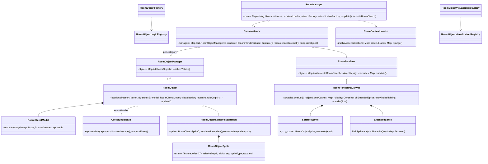

# Audit — `@ambreia/iso` + game/room glue + frame loop (read-only)

Repo `/home/user/ambreia-client` @ `aeb88ba` (branch `claude/determined-ritchie-omy2dy` == `origin/rpg-character`).
Scope: `packages/ambreia-iso` (57 688 lines of TS), `packages/ambreia-game/src/room` (17 803 lines, of which `RoomEngine.ts` 10 335), the frame loop (`App.ts`, `VortexMain.ts`, `Vortex.ts`), the sandbox and tests.
Method: code reading with `file:line` evidence; one Node micro-benchmark (`scratchpad/bench/iso-sort.bench.ts`, run with `tsx`) for the sort/allocation claims. Everything marked UNVERIFIED was not measured.

---

## (A) Facts and diagrams

### A.1 Package shape

| Area | Files / lines | Role |
|---|---|---|
| `src/` core | 14 / 2 912 | `RoomManager` (963), `RoomInstance` (499), `RoomObjectManager`, `IsoStage` (518), `IsoView` (286), interfaces |
| `src/object` | 11 / 904 | `RoomObject`, `RoomObjectModel`, registries, `RoomObjectSprite(Visualization)` (presentation model) |
| `src/scene` | 14 / 2 804 + `object/` 3 243 + `renderer/` 4 115 + `utils/` 1 545 | `RoomContentLoader` (2 137), `RoomObjectFactory`, `RoomPlaneParser` (1 775), `RoomVisualization` (1 242), `RoomPlane` (1 681), **`RoomRenderingCanvas` (3 496)**, `RoomLighting` (538, new), `RoomCamera`, `LegacyWallGeometry`, `TileObjectMap` |
| `src/furniture` | logic 60 files / 4 848; visualization 39 / 7 315; data 4 / 1 403 | the Habbo furniture zoo, `registerFurniture` (74 logics, 37 visualizations) |
| `src/avatar` | `AvatarVisualization` (2 079), `AvatarLogic` (694), pets | room avatar |
| `src/effects` | additions (bubbles, hearts, RPG `TargetCircle`, `SheetAddition`), particles | hooked by `registerEffects` |
| `src/renderer` | 9 / 599 | `RoomRenderer` (object list + canvases), `TextureExtractor` seam |
| `src/utils` | 13 / 2 040 | `RoomGeometry` (projection), `Vector3d`, effects |

Pixi is imported by 27 iso files (`grep "from 'pixi.js'"`): the canvas, planes, avatar/pet visualizations, particles, lighting, content loader, sprite model (`RoomObjectSprite.texture: Texture`).

### A.2 Ownership / class diagram



### A.3 Server message → Pixi (game glue)

```mermaid
flowchart LR
    S[Server packet] --> N[net: MessageEvent + Parser]
    N --> H[RoomMessageHandler.onObjectAdd<br/>RoomMessageHandler.ts:785]
    H --> C[addFloorFurniture → IRoomCreator.addObjectFurniture<br/>:2043]
    C --> Q[RoomEngine.addObjectFurniture → furnitureQueue.push<br/>RoomEngine.ts:4173]
    Q --> D[RoomEngine.createRoomFurniture (budgeted drain, per tick)]
    D --> RI[RoomInstance.createRoomObject → RoomManager.createRoomObject<br/>RoomManager.ts ~507]
    RI --> F1[logics.create(type) → ObjectLogicBase]
    RI --> F2[visualizations.create(type) → RoomObjectSpriteVisualization]
    RI --> FEED[RoomInstance.createObjectInternal → renderer.feedRoomObject]
    RI --> M[logic.processUpdateMessage(RoomObject*UpdateMessage) → RoomObject.setLocation / model.setNumber]
    M -. updateID++ .-> V[visualization.update() reads model → RoomObjectSprite[]]
    V --> RC[RoomRenderingCanvas.render: SortableSprite list → sort → ExtendedSprite (Pixi)]
    RC --> P[Pixi Application render (ticker LOW priority)]
```

**Verdict on "Server state → game model → presentation model → renderer" vs "Sprite = state":** the layering is real. State lives in `RoomObject` (location/direction/states) and `RoomObjectModel` (`object/RoomObject.ts`, `object/RoomObjectModel.ts`); the presentation model is `RoomObjectSprite` (plain object with `texture`, `offsetX/Y`, `relativeDepth`, `updateId`), and Pixi `Sprite`s exist only inside `RoomRenderingCanvas` as a pooled `ExtendedSprite` list written from the sorted `SortableSprite` list (`RoomRenderingCanvas.ts:2956-3119`). Nothing reads a Pixi display object back as state. The exceptions where Pixi objects *carry* state:
- `ExtendedSprite.faded/fadedSide/identifier/tag/clickHandling` are written per frame and then read back by `updateOcclusion`, `hides()`, `checkMouseHits` (`:2191-2600`, `:3188`) — the x-ray/occlusion pass works on the Pixi children (`this._display.children[index]`, `getSprite()` `:3171`), i.e. the drawn list is the data structure for picking and occlusion. This is faithful to AS3 (RoomSpriteCanvas did the same on its `ExtendedSprite`s) but it means the picker needs a rendered frame.
- `RoomPlane` owns a `Graphics` and a `Texture` (`RoomPlane.ts:666-670, 1257-1260`); `AvatarVisualization` holds `Texture`s; `RoomLighting` is Pixi-only (RenderTextures, filters).

### A.4 Extension points

- `RoomObjectLogicRegistry` / `RoomObjectVisualizationRegistry` (`object/*Registry.ts`): `register(type, factory)` into a `Map` — **last registration silently wins**, no warning (`_builders.set(type, create)`), unknown type → one `warn` per type and `null`.
- Modules: `registerScene` (room, tile cursor, selection arrow), `registerFurniture`, `registerAvatars`, `registerEffects` (static hooks: `AvatarVisualization.additions = …`, `FurnitureFireworksVisualization.particleSystems = …`, `effects/registerEffects.ts`), chained by `DEFAULT_ROOM_MODULES` through `createRoomRegistries()`.
- Consumers: `scene/RoomObjectFactory.createRoomObjectLogic()` (also tracks logic event types onto a shared `EventEmitter`), `scene/object/RoomObjectVisualizationFactory` (caches `IRoomObjectVisualizationData` per content type).
- The host still contributes: `RoomEngine.getRoomObjectCategory(type)` (string → category), `RoomContentLoader.getVisualizationType/getLogicType` (furnidata → type names), `RoomEngine` message dispatch (`processRoomObjectEvent`, `handleRoomObjectEvent :7976`) — the "which event class does what" switch is in the game.
- Pinned by `packages/vortex-engine/test/room-registries.test.ts` (74 + 37 types exactly) — no test for duplicate registration or for registering a new type from outside.

### A.5 Frame loop (see also §E)

`requestAnimationFrame` → Pixi `Ticker` → `VortexMain.update(ticker)` (`VortexMain.ts:646`, default priority) → `ComponentContext.update(deltaMs)` (`ComponentContext.ts:324`, receivers sorted by priority, `RoomEngine` registered at priority 1 `RoomEngine.ts:1801`) → `RoomEngine.update(time)` (`:3675`: `createRoomFurniture()`, `RoomManager.update()` → `processLoadedContentTypes()` + every `RoomInstance.update()` → every logic `update(performance.now())`; then every `RoomRenderer.update()` → `render()` → `RoomRenderingCanvas.render(time)` → `canvas.update()` (mouse re-hit); then `updateRoomCameras`) → `VortexMain.onExitFrame()`. A second ticker callback `RoomEngine.onTickerUpdate` (`:7551`, added by `setTicker` `:3712`) runs `createRoomFurniture()` again plus canvas-sync callbacks and the mouse cursor. Pixi's own render runs at `UPDATE_PRIORITY.LOW` after both; `instrumentRendererTimings` brackets it (`Vortex.ts:661`). `App.renderFrame` (`App.ts:1377`) only composites the **UI** 2D canvas (dirty-gated) — the room never goes through it.

Note the `time` argument: `ComponentContext.update(deltaTime)` passes a **delta** (clamped `ticker.deltaMS`) but `RoomEngine.update(time)` forwards it as if it were a timestamp to `RoomManager.update(_time)` (ignored) and `renderer.update(_time)` (ignored — `RoomRenderer.render()` uses `performance.now()` itself, `renderer/RoomRenderer.ts`) and `updateRoomCameras(time)`. Harmless today only because the two consumers ignore it; the parameter is a trap.

---

## (B) Findings

### IR-01 | HIGH | CONFIRMED | Textures / lifecycle — asset-collection reference counting is dead, so `purge()` destroys content the still-displayed room uses
- **Evidence**: `GraphicAssetCollection.ts:38-39` `_referenceCount = 0; _lastReferenceTimestamp = 0;` and `addReference()/removeReference()` `:82-99` — `grep -rn 'removeReference\|\.addReference('` over `packages/` returns **no caller** outside the class. `RoomObjectSpriteVisualization.set assetCollection` (`object/visualization/RoomObjectSpriteVisualization.ts`) only assigns. `RoomContentLoader.purge()` `:1797-1824`: `if(collection.getReferenceCount() < 1 && now - collection.getLastReferenceTimestamp() >= CONTENT_DROP_DELAY)` with `CONTENT_DROP_DELAY = 20000` `:73` → always true (0 < 1 and `now - 0`), so every non-placeholder collection **and its asset library** are disposed on every purge (`collection.dispose(); assetLibrary.dispose()` → `AssetLibrary.unload()` → `asset.dispose()` → `NitroAsset.ts:139-144 spritesheet/baseTexture.destroy(true)`).
- **When purge runs**: `RoomSessionManager.ts:266` `this._roomEngine?.purgeRoomContent()` right after `session.dispose()` on session end. The room instance is disposed only later, by `RoomMessageHandler.setCurrentRoom()` `:357-366` when the **next** `onRoomReady` arrives (`:397`), its sole caller. In between, `RoomEngine.update()` keeps calling `RoomManager.update()` and `renderer.update()` on the old room whose visualizations hold `assetCollection` pointers to disposed collections (`GraphicAsset.recycle()` nulls the texture and pools the asset, `GraphicAsset.ts:173`).
- **Files/Symbols**: `packages/ambreia-common/src/graphics/GraphicAssetCollection.ts`, `packages/ambreia-iso/src/scene/RoomContentLoader.ts::purge`, `packages/ambreia-iso/src/object/visualization/RoomObjectSpriteVisualization.ts::assetCollection`, `packages/ambreia-game/src/session/RoomSessionManager.ts:266`, `packages/ambreia-game/src/room/RoomMessageHandler.ts:357,397`.
- **Observed behavior** (static): the 20 s grace and the "still referenced" guard AS3 relies on are both no-ops; purge is unconditional.
- **Why it matters**: destroyed spritesheets under live sprites (Pixi draws `Texture.EMPTY`/warns), `RoomPreviewer` rooms (`window/widgets/RoomPreviewerWidget.ts`, created through the same `RoomManager`) lose their content when any session ends, and re-entering a room re-downloads every `.nitro`/`.ambreia` piece.
- **Failure scenario**: leave room A (session ends → purge) while the previewer widget shows a furni → the previewer's visualization updates against a pooled `GraphicAsset` with `texture = null` → blank; or the next room shares types with A → re-fetch of all libraries, visible pop-in; worst case Pixi error on a destroyed `TextureSource` during the frames between purge and the next `setCurrentRoom`.
- **False-positive review**: I looked for an alternative owner of the count (`RoomEngine.ts:10302` sets `assetCollection` for previews — assignment only), for a guard in `purge()` on "rooms still alive" (none: it iterates all collections), and for `RoomContentLoader.dispose()` being the only teardown (it is not; purge is per session). AS3's `RoomObjectSpriteVisualization.set assetCollection` does `addReference()`/`removeReference()`; the port dropped it. Could the between-purge-and-next-room window be empty? Only if `onRoomReady` of the next room arrives in the same tick as the session end, which it does not (server round trip). Confirmed.
- **Recommended architecture**: ownership of a collection belongs to the visualizations that hold it: reference in the `assetCollection` setter, release in `dispose()`; `purge()` keeps AS3's "unreferenced for 20 s" semantic. Alternatively make the content cache room-scoped and drop it in `disposeRoomInstance`.
- **Minimal fix (S)**: in `RoomObjectSpriteVisualization`: `set assetCollection(v) { if(v === this._assetCollection) return; this._assetCollection?.removeReference(); this._assetCollection = v; v?.addReference(); }` and `dispose()` releases. Initialise `_lastReferenceTimestamp = Date.now()` in the collection constructor so a never-referenced placeholder gets its grace.
- **Long-term (M)**: move the drop policy out of `RoomContentLoader` into a small `ContentCache` with explicit `retain/release`, tested.
- **How to verify**: unit test: create a visualization, set a collection, purge immediately → collection alive; dispose visualization, purge → alive for 20 s, then dropped. Runtime: leave a room with the previewer open; watch `RoomContentLoader` logs / network tab for re-downloads of libraries on re-entry.
- **Regression risk**: low (adds counting that AS3 had); watch `RoomManager.updateObjectContents` which replaces visualizations (release old, retain new happens through the setter).
- **Effort**: S.

### IR-02 | HIGH | HIGH | Performance architecture — the see-through/x-ray pass is O(own × sprites × probes) alpha readbacks and 4-6 render-to-texture passes **per frame**, always on in the game
- **Evidence**: `RoomEngine.ts:5564` `canvas.seeThrough = true;` for every game canvas. `RoomRenderingCanvas.render()` `:1085` → `updateOcclusion(spriteIndex)` `:2191` every frame: for each candidate sprite `hidesOwn(j)` → `hides(i,j)` `:2535` does an AABB test then up to `HIDE_PROBES²=25` `spriteHit()` calls, each `ExtendedSprite.hitTest()` → `getAlphaHitData(texture)` which **reads back the whole texture** (`drawImage` + `getImageData`) once per `Texture` object (`ExtendedSprite.ts:getAlphaHitData`), cached in a `WeakMap<Texture>`. `updateXray(count)` `:2705` runs **unconditionally** (outside the `if(this.seeThrough)` branch, `:2255-2256` `this.updateHoles(count); this.updateXray(count);`): for every avatar, every later sprite, `hides()` again; then per x-rayed avatar `renderer.render()` ×4-5 into two `RenderTexture`s (`:2770-2785`), plus `updateHoles` ×2 per disc, plus `RoomLighting.render()` ×6-8 passes when lighting is set (`RoomLighting.ts:188-202`).
- **Why the texture churn matters**: an animated avatar's composed texture is a new `Texture` per animation frame (`AvatarImage.getImage()` composes an offscreen canvas unless `_fullImageCache` hits), so the alpha cache misses and a full `getImageData` of the avatar bitmap happens whenever an occluder overlaps it — per walking avatar, per frame, on the CPU, in a `willReadFrequently` 2D context.
- **Files/Symbols**: `scene/renderer/RoomRenderingCanvas.ts::updateOcclusion/hides/updateXray/updateHoles/pointedBuilding`, `scene/renderer/utils/ExtendedSprite.ts::hitTest/getAlphaHitData`.
- **Observed behavior**: not measured (needs textures + GPU). The comment at `RoomRenderingCanvas.ts:1119` says `room` was ~80 ms with 40 walking avatars **before** this pass existed; the pass adds work that scales with avatars × overlapping furni.
- **Failure scenario**: a crowded room (20 avatars behind a wall of tall furni) → each frame 20 × N × 25 probes + 20 × 5 RT passes; frame time climbs with occupancy exactly where the game is busiest; GC churn from `bounds()` tuples and `copyInto` closures adds pauses.
- **False-positive review**: `hides()` early-outs on AABB (`:2545`), `updateXray` early-outs when `renderer === null` (never in game) and only re-renders avatars that have at least one occluder; probes stop at the first hit. `getAlphaHitData` is cached per texture, so static furni cost is one readback each. The remaining per-frame costs (AABB loops O(avatars × sprites), RT passes per occluded avatar, readback per *new* avatar texture) are structural, not accidental. Severity HIGH on architecture (per-frame GPU→CPU readback path in the hot loop), confidence HIGH that it runs every frame, UNVERIFIED cost.
- **Recommended architecture**: compute occlusion on the presentation model, not on pixels: a per-tile "building group in front of own tile" test using `TileObjectMap` + `piece.group` + sorted index (no alpha probing); x-ray rendered once per *change* (cache by `(avatar texture id, occluder set)`) or via a stencil/mask in a single pass; lighting at RESOLUTION 0.5 already, but gated on dirtiness (lights/own tile/time quantised).
- **Minimal fix (S)**: gate `updateXray/updateHoles` under `seeThrough`; skip `hides()` unless the own avatar's AABB moved or the sprite list order changed (`_sortableSpriteList` length + own screen pos as a cheap dirty key); replace the 25-probe grid with a coarser 3×3 and an alpha-threshold mip cached per texture; hoist the two closures in `copyInto` and the `bounds()` tuple (measured: tuple alloc itself is free, see §E, so this one is cosmetic).
- **Long-term (M/L)**: move occlusion to tile space and make x-ray a Pixi mask on a cached avatar texture.
- **How to verify**: `:showstats` channels `room.spr` with/without `seeThrough`, 1/10/40 avatars behind the same furni; count `getImageData` calls via a `CanvasRenderingContext2D.prototype.getImageData` wrapper; `renderer.renderPipes` draw-call counter per frame.
- **Regression risk**: medium (visual feature is new and tuned by eye; keep screenshots).
- **Effort**: S for gating, M for tile-space occlusion, L for a mask-based x-ray.

### IR-03 | HIGH | CONFIRMED | Encapsulation — `RoomEngine.ts` (10 335 lines, 294 methods) is still the god object; iso's "glue" is one class
- **Evidence**: `wc -l packages/ambreia-game/src/room/RoomEngine.ts` = 10 335; method count 294; it is `IRoomEngine` + `IRoomCreator` + `IRoomManagerListener` + `IRoomRenderingCanvasMouseListener` + camera driver + furniture queue + previewer services + mouse cursor + canvas sync. `RoomMessageHandler.ts` (2 543) imports 109 protocol symbols and 11 iso symbols and calls back into `IRoomCreator` (557-line interface).
- **Why it matters**: every new room behaviour (a Door, a Resource node) needs a `RoomEngine` method for its message, a `RoomObjectEvent` subclass, a `handleRoomObjectEvent` case and often an `IRoomCreator` method — see §F. The iso registries removed the two factory `switch`es, but the event-dispatch `switch` and the "what message updates which model variable" knowledge moved nowhere.
- **Failure scenario**: two features editing `RoomEngine.ts` concurrently (combat + interaction) conflict on every merge; the file already exceeds what one review can hold.
- **False-positive review**: is it a façade with small methods? `update :3675`, `createRoomFurniture`, `addObjectFurniture :4173`, canvas creation `:5520-5580` are small; but `handleRoomObjectEvent :7976`, `updateRoomCamera :9689` (+120 lines), the pet/avatar image paths and the previewer paths are substantial logic. Confirmed by size alone.
- **Recommended architecture**: split by responsibility along existing seams: `RoomObjectEventRouter` (iso events → game handlers registered per event type, like the registries), `RoomCanvasHost` (canvas creation, resize, pixi stage, culling flags), `RoomCameraDriver`, `RoomFurnitureQueue`, `RoomPreviewService`; `RoomEngine` keeps `IRoomCreator` + orchestration.
- **Minimal fix (M)**: extract `handleRoomObjectEvent` into a `Map<eventType, handler>` registry that features can populate (spec §4 "les switch deviennent des points d'extension").
- **Long-term (L)**: the split above; `IRoomCreator` shrinks as message handlers talk to the sub-services.
- **How to verify**: `pnpm check` green; `room-*` tests; `wc -l` and a lint budget (`max-lines`) on the file.
- **Regression risk**: medium-high (inherited code, many AS3 traces to carry). Effort L.

### IR-04 | MEDIUM | CONFIRMED | Independence — game/RPG knowledge inside the iso engine
- **Evidence**: `effects/additions/TargetCircle.ts:12` "TS-only: the RPG's target"; `SheetAddition.ts:12` "the RPG's effects"; `scene/messages/RoomObjectAvatarTargetUpdateMessage.ts:3`; `RoomObjectVariableEnum.ts:53` target flag; `RoomRenderingCanvas.ts:2177` "as an RPG does with a building the player walks behind", `:2567` pets/monsters special-cased via `pet_type` in `isFurni()`, `AVATAR_OWN`-centric x-ray/lantern (`RoomLighting.lantern :80`); `furniture/FurnitureLights.ts` (a global `Map` of furni light frames, registered by whom? the game); 31 `RoomEngine*`/`RoomObject*WidgetRequest*` events under `scene/events/` (e.g. `RoomEngineToWidgetEvent`, `RoomObjectWidgetRequestEvent`, `RoomEngineUseProductEvent`, `RoomObjectBadgeAssetEvent`) that name the game's UI; `RoomObjectUserTypes.MONSTERPLANT`; `RoomContentLoader` still reads `getProperty('gpu.ignored_furni')` `:1014` and `getProperty('pet.configuration')` `:1075` through `IRoomContentConfiguration`, and `RoomManager` reads `stories.image_url_base`, `extra_data_service_url`, `extra_data_batches_enabled` `:570-572, 900-902` (Habbo hotel services).
- **Classification**: belongs in a generic iso engine — own-avatar sprite type (AS3 has it), additions hook, lighting as an optional module, "see through what hides a given object" as a *generic* feature parameterised by a target object id. Does not belong — the words "player/target/RPG/monster" in iso, the `pet_type` test inside the renderer, Habbo URL keys in `RoomManager` options, `FurnitureLights` global registry, widget-request events naming UI widgets, `gpu.ignored_furni`/`pet.configuration` property names.
- **Why it matters**: spec §3 rule 1 ("moteurs : aucune connaissance du jeu") and §5 rule 1 ("les moteurs ne lisent aucune clé"). The map editor and imager embed iso; they now carry x-ray/lantern/target code they cannot use.
- **Minimal fix (S)**: rename `seeThrough` to `revealObjectId: number | null` set by the host; move `RoomManager`'s three keys into `IRoomManagerOptions { externalImageBaseUrl, extraDataServiceUrl, extraDataBatches }` (typed, no strings); `isFurni` takes a host predicate `isOccluder(object)` with the default "not user/bot/pet/room/cursor".
- **Long-term (M)**: `scene/events` split into engine events (mouse, state change, move) kept in iso and widget/UI events moved to `game/room/events` (the game already re-exports them from `game/room/index.ts`).
- **Verify**: `grep -rn -i 'rpg\|player\|monster\|target' packages/ambreia-iso/src` shrinks to zero outside comments; map-editor still builds.
- **Risk**: low. Effort S+M.

### IR-05 | MEDIUM | HIGH | Lifecycle — previous room stays alive and updating until the next room is ready
- **Evidence**: `RoomMessageHandler.setCurrentRoom :357` disposes the previous room only when called; its only caller is `onRoomReady :397`. `RoomSessionManager.ts:263-266` ends the session and purges (IR-01) without disposing the room instance. `RoomUI.ts:826-831` disposes the *desktop* only.
- **Why it matters**: `RoomEngine.update()` keeps ticking logics and rendering a room nobody sees (its `canvas.container` remains on `_pixiStage` until `disposeRoomInstance`); combined with IR-01 it renders against destroyed textures.
- **Failure scenario**: logout to the landing page → the old room's canvas keeps drawing under the UI (or over it, if the UI composite is transparent there) and keeps paying its frame cost.
- **False-positive review**: AS3 has the same structure (`_SafeCls_1984.setCurrentRoom`), but AS3's `RoomSessionManager` also drives `RoomEngine.disposeRoom` through `RoomUI`/`HabboRoomSessionManager` on `RSE_ENDED` for the active room; here `RoomUI` only disposes the desktop. I did not find another `disposeRoom` caller (`grep -rn 'disposeRoom(' game/src` → only `RoomMessageHandler:365`). Not confirmed at runtime (no emulator in this session).
- **Fix (S)**: on `RSE_ENDED` for the active room, `RoomEngine.disposeRoom(roomId)` (and `RoomMessageHandler.resetCurrentRoom()`), before `purgeRoomContent()`.
- **Verify**: enter room, leave; `RoomEngine.getRoomInstance(id)` is null and `:showstats` `room.*` channels read ~0.
- **Risk**: low-medium (ensure `onRoomReady` of the next room does not double-dispose; `disposeRoomInstance` is idempotent via `_roomManager.disposeRoom` returning false). Effort S.

### IR-06 | MEDIUM | CONFIRMED | Extensibility — duplicate registrations are silent; registries are keyed by string and not introspectable at runtime beyond `types()`
- **Evidence**: `RoomObjectLogicRegistry.register` = `this._builders.set(type, create)`; same for visualizations and `registerData`; `setDefaultData` overwrites. `registerEffects` writes **static** hooks (`AvatarVisualization.additions = …`), so two `IsoStage`s in one page share one effect set (the J4 bilan already notes it).
- **Why it matters**: a feature registering `furniture_basic` by mistake replaces the engine's logic for every basic furni without a word; module order becomes load-bearing.
- **Minimal fix (S)**: `register()` throws (or `warn`s and keeps the first) on an existing key unless `{override: true}`; test in `room-registries.test.ts`. Make effects hooks instance fields on the registries (`registries.effects.additions`) and have `RoomObjectVisualizationFactory` inject them.
- **Verify**: new test "registering a type twice without override throws".
- **Risk**: low (no duplicate today: 74+37 registrations are unique). Effort S.

### IR-07 | MEDIUM | HIGH | Culling/dirty model — everything updates every frame except avatar culling, which is off; visibility is per-sprite after the work is done
- **Evidence**: `RoomInstance.update()` ticks every logic every frame (`RoomInstance.ts`), `RoomRenderingCanvas.render()` iterates every object and calls `visualization.update()` every frame (`:1150-1160`); the only culling is `rectangleVisible()` per sprite **after** `visualization.update()` (`:1682`), and `RoomCullingMode.avatars` (`scene/renderer/RoomCullingMode.ts`) which is `false` and documented as "expected to stay off". Dirty flags exist downstream: `RoomObject.updateID`, `RoomObjectModel.updateID`, `visualization.getUpdateID()`, per-object `IObjectSpriteCache` early-out `:1618-1635`, `ExtendedSprite.needsUpdate`, `RoomPlane._geometryUpdateId`. Upstream (logic update, visualization update) has no "nothing changed, skip" path: `FurnitureVisualization.update` runs `updateObject/updateModel/updateAnimation` each frame and skips only `updateSprites` when nothing changed (`FurnitureVisualization.ts:165-223`).
- **Why it matters**: the frame cost is O(objects) even for a static room; for the RPG's "zone" rooms (sandbox `?zone=big` 64×64 with 2000 furni) this is the dominant cost. No spatial index is needed at current scale (`zone.json`: 11×10, 5 decor, 1 wall item; typical Habbo rooms <300 objects) — a per-object `dirty` bit would be enough.
- **Fix (S)**: a cheap pre-check before `visualization.update()`: skip when `object.getUpdateID()`, `model.getUpdateID()`, geometry id and "is animating" are unchanged (visualizations already expose `_isAnimating`/`animationUpdate`); keep the AS3 path for animated ones.
- **Verify**: `:showstats room.obj` on a static room should drop near zero.
- **Risk**: medium (visualizations with time-driven state but no model change — fireworks particles, dimmer transitions — must declare themselves animating). Effort M.

### IR-08 | MEDIUM | CONFIRMED | Picking — `IsoView.pick()` is O(width × length) with 4 projections and ~6 allocations per tile per call, driven by `mousemove` in the sandbox/editor
- **Evidence**: `IsoView.ts::tileAt` loops every tile and calls `insideTile` → 4× `tileToView` → `geometry.getScreenPoint(new Vector3d(...))` → `getScreenPosition` → `Vector3d.dif` (alloc) + result object; `sandbox/main.ts` calls `view.pick()` on every `mousemove`. For a 64×64 zone that is 4 096 × 4 projections ≈ 16 k `Vector3d` + 16 k points per mouse move.
- **Fix (S)**: invert the projection once (as `lowestFloorAt()` already does with a 2×2 determinant, `RoomRenderingCanvas.ts:2483`) and test only the ≤ 36 candidate tiles along the height levels; or reuse the engine's `RoomObjectTileMouseEvent` path. Also `pick()` drives `handleMouseEvent(x, y, 'click')` as a probe — fine today only because `mouseListener` intercepts before any logic sees the click.
- **Verify**: time `pick()` on `?zone=big`. Risk low. Effort S.

### IR-09 | LOW | CONFIRMED (measured) | Per-frame allocations in confirmed hot paths — present but cheap
See §E table. The whole-list sort every frame measured 0.11 ms at 3 000 sprites (nearly sorted) and 0.45 ms at 8 000; `bounds()` tuple allocation is free under V8 escape analysis (0.287 ms tuple vs 0.348 ms scratch for 5 000 calls); `RoomPlane.shareKey()` strings for 120 floor planes 0.16 ms/frame. Remaining unmeasured allocations: `checkMouseHits` `new Set()` + `keysToRemove` + `RoomSpriteMouseEvent` per frame (`:3193, :3300`), `copyInto` closures ×2 per x-rayed avatar, `lowestFloorAt` 4 `Vector3d` + 4 points per call (only when pointing a plane), `updateLighting` `own = {x,y}` object, `RoomInstance.getObjectManagerIds()` (`Array.from().map`) in `updateObjectContents` (not per frame), `RoomObjectModel.getNumberArray()` slices on every read (callers in visualizations run on model change, not per frame). Fix: cosmetic hoists when touching those lines. Effort S.

### IR-10 | LOW | HIGH | Depth sort — comparator ignores ties except through a synthetic epsilon; determinism depends on object insertion order
- **Evidence**: `compareSortableSprites = b.z - a.z` (`:666`); `sortable.z = baseZ + relativeDepth + 3.7e-11 * (startIndex + localCount)` (`:1868`) → ties broken by the object's index in `RoomRenderer._objectKeys` (feed order) then sprite index. `Array.prototype.sort` is stable in V8, so equal z also keep previous frame order. Stacked objects get a post-pass shift (`:1162-1178`, `_tileGroundFront`), wall items are exempt via `accurateZ`, raised floors clamp `relativeDepth` (`RAISED_SPRITE_DEPTH`), planes keep `+1000`.
- **Why it matters**: deterministic per session, but two clients can draw an overlapping pair differently if they received objects in a different order (the epsilon encodes arrival order). Multi-tile objects report their front on every footprint tile (`recordGroundFront`), stairs are handled by `floorHeightAt` + `raisedFloorAt` from the game's `LegacyWallGeometry`. Overlapping avatars on the same tile: ordered by `startIndex` only.
- **Fix (S)**: tie-break on `(tileX + tileY, objectId)` instead of arrival index. Effort S, risk low (visual only).

### IR-11 | LOW | CONFIRMED | Disposal gaps on room exit (minor)
- `RoomRenderingCanvas.dispose()` `:1307`: destroys `_master` (children), x-ray/hole RenderTextures, but `_discEraser`/`_discs` (never parented to `_master`) and `_lighting` (owned by the host; `RoomLighting.dispose()` exists `:521`) are not disposed; `_lighting.view` is removed from parent only through the setter. `RoomContentLoader.dispose()` `:290` clears `_assetLibraries` without disposing them (textures outlive the loader; only matters at full shutdown). `FurnitureDynamicThumbnailVisualization.onThumbnailLoaded` `:83` creates `Texture.from(image)` with no disposed guard (legacy type, likely unused). `ExtendedSprite._alphaHitCache` is a `WeakMap` (fine). Static caches that intentionally survive rooms: `RoomRenderingCanvas._edgeTexture/_discTexture` (2 small textures), `AvatarVisualization.ADDITION_TEXTURES` (bounded by addition asset names), `RoomPlane.SHARED` (ref-counted, released in `dispose()`).
- Fix: add `_discEraser.destroy({children:true})` and `this._lighting?.dispose()` (if the canvas is to own it) to `dispose()`. Effort S.

### IR-12 | LOW | CONFIRMED | Coordinates — three projection implementations
- `utils/RoomGeometry.getScreenPosition/getScreenPoint/getPlanePosition` (the engine, with displacement/depth); `RoomRenderingCanvas.lowestFloorAt()` re-derives the inverse by sampling the geometry (`:2483`); `packages/ambreia-map-editor/src/view/isoMath.ts` hard-codes `project = [(x−y)·32, (x+y)·16 − h·32]` "as RoomGeometry projects it" (constants duplicated, no door displacement, no scale); `IsoView.tileToView` adds the canvas centre/scale/pan on top of `getScreenPoint`. Game-side `LegacyWallGeometry.getLocation()` (wall items) is a fourth, legitimately different space. Fix: export `RoomGeometry.inverse(x,y,level)` and a `project(x,y,z,scale)` constant table from iso and make `isoMath.ts` import them. Effort S.

### IR-13 | LOW | CONFIRMED | Pixel-perfect — consistent, with one knob worth a look
- `Vortex.ts:567` `TextureSource.defaultOptions.scaleMode = 'nearest'`; `:579-580` `resolution: 1, autoDensity: true` (logical pixels, like Flash); `App.ts:1282` UI canvas `image-rendering: pixelated`, `:1429` `imageSmoothingEnabled = false`; `RoomRenderingCanvas.getCachedScreenLocation` rounds screen x/y (`:2150`), `renderObject` floors centre offsets; `IsoView.render()` off-screen renderer is `antialias: false`. But `Vortex.ts:578` `antialias: config?.antialias ?? true` on the main `Application` (MSAA on a nearest-sampled pixel-art stage: costs fill rate, no visual gain; sandbox uses `false`). Also `RoomPlane` shared textures use `scaleMode: 'nearest'` explicitly while `holeTextures()` uses `'linear'` on purpose. Effort S.

### IR-14 | INFO | CONFIRMED | Async races — mostly guarded by the id/`updateObjectContents` design, with two soft spots
- Content load: `RoomManager.createRoomObject` builds against the placeholder, marks `initialized=false`, and `processLoadedContentTypes → updateObjectContents` re-initialises only objects **still present** in the room (`RoomManager.ts:845-900`); a room disposed meanwhile is simply absent from `_rooms`. `onContentLoaded` ignores events once `_contentLoader === null` (`:492`). `IsoStage.ensureContent` awaits with timeouts. Good.
- Soft spots: `FurnitureDynamicThumbnailVisualization.onThumbnailLoaded` and `FurnitureExternalImageVisualization.onExtraDataLoaded` (`:203`) mutate a visualization that may be disposed (no `this.object === null` guard) — harmless writes today; `RoomManager.createRoomObject` reads `isLoaded(type)` and `getGraphicAssetCollection` in two places that must agree (the comment at `:245-270` documents two past bugs from exactly that).

### IR-15 | INFO | CONFIRMED | `time` vs `delta` confusion in the update chain (see A.5) — ignored by both consumers today; one future consumer will read a delta as a timestamp.

---

## (C) Positive findings

| Verdict | What | Evidence |
|---|---|---|
| **KEEP** | State / presentation / render split: `RoomObject`+`RoomObjectModel` (state, immutable-key semantics, updateIDs) → `RoomObjectSprite` (plain presentation record with its own `updateId`) → pooled `ExtendedSprite` written only in `updateSprite()` | `object/*`, `RoomRenderingCanvas.ts:2956-3119` |
| **KEEP** | Per-object sprite cache with early-out on `(instanceId, updateId, screenX/Y/Z)`, `getCachedScreenLocation` recomputing projection only on `(geometry.updateId, object.updateID)` change | `:1618-1635, :2086-2159` |
| **KEEP** | `RoomManager` content pipeline: placeholder → `initialized=false` → `updateObjectContents`, 40 ms/frame budget, de-dup of loaded types; the long comments documenting the two past regressions are worth their lines | `RoomManager.ts:245-270, :523-595` |
| **KEEP** | Registries + modules (`createRoomRegistries`, `DEFAULT_ROOM_MODULES`), pinned by `room-registries.test.ts`; `IsoStage`/`IsoView` as the no-session entry (editor, imager, sandbox) | `object/*Registry.ts`, `IsoStage.ts` |
| **KEEP+STRENGTHEN** | `RoomRenderingCanvas.renderObject` stacking/raised-floor DEVIATION (measured against the pack, explained); strengthen with a unit test on `_tileGroundFront` behaviour (there is `floor-altitude.test.ts` for planes but not for the stack shift) | `:1636-1720` |
| **KEEP+STRENGTHEN** | `ExtendedSprite` alpha hit test with first-probe single-pixel path (`probeAlpha`) and per-texture cache; strengthen by keying the cache on `texture.source` + frame rather than the `Texture` object, so an avatar's re-composed textures don't miss | `ExtendedSprite.ts` |
| **KEEP+STRENGTHEN** | `RoomPlane.SHARED` ref-counted floor texture cache (identical floor tiles share one texture) — correct release in `dispose()`; strengthen: compute the key only when `_geometryUpdateId` or material changed, not every frame | `RoomPlane.ts:1412-1495` |
| **KEEP+STRENGTHEN** | `FrameTimings` channels (`room.obj/sort/spr`, `pixi`, `ui`) and `:showstats` — the measurement harness exists; add a channel for the occlusion/x-ray/lighting pass so IR-02 can be measured in-game | `RoomRenderingCanvas.ts:1119-1130`, `Vortex.ts:661` |
| **REFACTOR** | `RoomEngine` (IR-03), x-ray pass (IR-02), `scene/events` split (IR-04), `IsoView.pick` (IR-08) | |
| **REFACTOR** | `RoomObjectSpriteVisualization.extractDarknessToAlpha` per-pixel CPU loop (STYLEGUIDE "Color transforms: use the GPU") — off the frame path (`getImage` only), but the imager has its own copy (`vortex-imager/src/render/extractDarknessToAlpha.ts`) | `RoomObjectSpriteVisualization.ts` |
| **REPLACE** | Content drop policy by wall-clock + dead refcount (IR-01) | `RoomContentLoader.purge` |
| **REPLACE** | Static effect hooks (`AvatarVisualization.additions`, `FurnitureFireworksVisualization.particleSystems`) with registry-held instances (IR-06) | `effects/registerEffects.ts` |

---

## (D) Scorecard — `@ambreia/iso` (0-10)

| Axis | Score | Why |
|---|---|---|
| Encapsulation | 6 | Clean object/model/sprite boundaries; but `RoomRenderingCanvas` (3 496 lines) now holds sorting, culling, mouse, occlusion, holes, x-ray, lighting glue, FPS overlay; `RoomContentLoader` 2 137 lines mixes furnidata, pets, libraries, config. |
| Extensibility | 7 | Registries + modules work (N+1 is 1 file + 1 line in iso for a logic/visualization); silent overrides, static effect hooks, and the game-side switch (`handleRoomObjectEvent`, `IRoomCreator`) keep most new behaviours at 3-5 files. |
| Testability | 5 | Node tests exist (`iso-stage`, `room-plane-parser`, `floor-altitude`, `canvas-furni`, `room-registries`, `room-manager`); the renderer's occlusion/x-ray/lighting have none; the engine needs the asset server for anything with content. |
| Independence | 6 | Imports only `common`/`avatar`/pixi (ESLint wall holds); but RPG vocabulary, Habbo config keys through callbacks, widget-named events, `pet_type` in the renderer. Sandbox borrows the client's `config.json` and avatar configurations through `import.meta.glob('../../vortex-client/...')` — data, not code, but not "iso alone". |
| Lifecycle | 5 | Clear dispose chains (`RoomManager → RoomInstance → managers/renderer → canvas`), `_disposed` guards; undermined by dead refcounting (IR-01) and the late room disposal (IR-05); small renderer leaks (IR-11). |
| API quality | 6 | `IsoStage`/`IsoView` are small and honest; the core API is AS3's (`getObjectWithIndex`, `category` ints, `string` ids via `String(id)`), `IRoomCreator` is 557 lines, `time` vs `delta` ambiguity (IR-15). |
| Performance architecture | 5 | Good: pooled sprites, per-object caches, planes cached and shared, measured sort cheap. Bad: no upstream dirty gate (IR-07), per-frame pixel-readback occlusion (IR-02), x-ray/holes/lighting = many RT passes per frame, mouse re-hit every frame (AS3 parity). |

---

## (E) Frame execution and hot paths

```mermaid
sequenceDiagram
    participant RAF as rAF / Pixi Ticker
    participant VM as VortexMain.update (prio default)
    participant CC as ComponentContext.update
    participant RE as RoomEngine.update (receiver prio 1)
    participant RM as RoomManager.update
    participant RI as RoomInstance.update
    participant RR as RoomRenderer.update
    participant RC as RoomRenderingCanvas.render
    participant PX as Pixi render (prio LOW)
    RAF->>VM: update(ticker)
    VM->>CC: update(min(deltaMS,1000))
    CC->>RE: update(delta)   %% named `time`
    RE->>RE: createRoomFurniture() (budgeted queue)
    RE->>RM: update()  → processLoadedContentTypes() (40 ms budget)
    RM->>RI: update() → every logic.update(performance.now())
    RE->>RR: update() → render(performance.now()) then canvas.update() (mouse re-hit)
    RR->>RC: render(time)
    RC->>RC: doMagic(); updateDisplayTransform()
    RC->>RC: for each object: renderObject → visualization.update → SortableSprites (cull per sprite)
    RC->>RC: stacked post-pass; sort whole list (b.z-a.z)
    RC->>RC: updateSprite × N (Pixi props, texture, filters); cleanSprites
    RC->>RC: updateOcclusion → hides()/alpha probes → updateHoles (RT) → updateXray (RT)
    RC->>RC: updateLighting → RoomLighting.render (6-8 RT passes)
    RC->>RC: update(): checkMouseHits('mouseMove') if no mouse event this frame
    RE->>RE: updateRoomCameras(time)
    RAF->>RE: onTickerUpdate: createRoomFurniture() again, canvas-sync callbacks, cursor
    RAF->>PX: Application.render (FrameTimings `pixi`)
```

Hot-path table:

| Path | Frequency | Complexity | Allocation | Measured? |
|---|---|---|---|---|
| `RoomInstance.update` → logic.update | per frame × objects | O(N) | none (`MovingObjectLogic` uses static helper vector) | read only |
| `renderObject` → `visualization.update` | per frame × objects | O(N × sprites) | `FurnitureVisualization`: none per frame when unchanged; `AvatarVisualization`: asset-name template strings on sprite rebuild (`:798, :1996`) | no — PERFORMANCE RISK — UNVERIFIED (upstream dirty gate missing, IR-07) |
| `RoomVisualization.updatePlanes` → `RoomPlane.update/render` → `shareKey()` | per frame × visible floor planes | O(planes) | ~6 strings per floor plane per frame | **yes**: 0.16 ms / 120 planes |
| `_sortableSpriteList.sort(compare)` | per frame | O(S log S), TimSort on nearly-sorted input ≈ O(S) | none | **yes**: 0.005/0.036/0.109/0.452 ms at 200/1k/3k/8k sprites (nearly sorted); 0.047/0.23/0.84/3.03 ms fully shuffled |
| `updateSprite` × S | per frame | O(S) | none (pooled `ExtendedSprite`) | read only |
| `updateOcclusion` / `hidesOwn` / `hides` | per frame | O(own × candidates) AABB + ≤25 alpha probes per overlapping pair | `bounds()` tuple ×2 per pair (free under escape analysis: 0.287 vs 0.348 ms / 5 000 calls) | PERFORMANCE RISK — UNVERIFIED (probe/readback cost) |
| `updateXray` | per frame (even with `seeThrough=false`) | O(avatars × later sprites) + 4-5 `renderer.render` per occluded avatar | 2 closures per slot (`copyInto`), `indices` arrays reused | PERFORMANCE RISK — UNVERIFIED |
| `updateHoles` | per frame × discs | O(S) + 2 `renderer.render` per disc | none | UNVERIFIED |
| `updateLighting` + `RoomLighting.render` | per frame when lighting set | 6-8 RT passes, blur filters, grid walk O(w×l) per light | `own = {x,y}` per frame | UNVERIFIED |
| `canvas.update()` → `checkMouseHits('mouseMove')` | per frame without mouse event | O(S) alpha hit tests until first hit per object | `new Set`, `keysToRemove[]`, `RoomSpriteMouseEvent` + 2 template strings per hit | UNVERIFIED (AS3 parity) |
| `updateRoomCamera` | per frame per followed room | O(1) | 3 `new Vector3d` per frame (`RoomEngine.ts:9733, :9758, :9784`) | read only, trivial |
| `RoomPlane` texture creation | on geometry/material change | rasterizer O(pixels) + `Texture.from(canvas)` | one canvas per plane (shared for identical floors) | n/a |

Benchmark source: `scratchpad/bench/iso-sort.bench.ts` (Node 22, `tsx --tsconfig packages/vortex-engine/tsconfig.json`), imports only `SortableSprite.ts`.

---

## (F) Room object N+1 table

Rules of the current design: a **logic** = 1 class + 1 `register` line in the owning module; a **visualization** = 1 class + 1 line (+1 `registerData` line if it needs animated data); the server→model path goes through `RoomEngine` (`IRoomCreator` method or `updateRoomObject*`), the model→UI path through a `RoomObjectEvent` subclass + a case in `RoomEngine.handleRoomObjectEvent` (+ `RoomMessageHandler` for a new packet; the `rpg-message` skill for the new style).

| Behaviour | Files added (iso) | Files modified (iso) | Files added (game) | Files modified (game) | Comment |
|---|---|---|---|---|---|
| Chair (sit on step) | 0 | 0 | 0 | 0 | exists: `FurnitureMultiHeightLogic`/`furniture_basic` + `AvatarLogic` posture from the server |
| Door (open/close state, blocks path) | 1 logic (`FurnitureDoorLogic`), 0 viz (`furniture_animated`) | `registerFurniture.ts` (+1) | 0 | `RoomEngine` if a new message updates it (else `ObjectUpdateMessageEvent` state) | pathing is server-side |
| Teleport (use → travel) | 0-1 logic | `registerFurniture.ts` | 0 | `RoomEngine.handleRoomObjectEvent` + `RoomMessageHandler` (use packet) | `RoomObjectFurnitureActionEvent` already exists |
| Container (open inventory UI) | 1 logic (emits a widget request) | `registerFurniture.ts`, `scene/events/` (+1 event class, today in iso) | 1 widget | `RoomEngine.handleRoomObjectEvent` (+1 case), `RoomWidgetRegistry` | the event class should live in game (IR-04) |
| Resource node (depletes, respawns, glows) | 1 logic + 1 viz (+ lights) | `registerFurniture.ts` (+2-3) | 0 | `RoomEngine` (new `updateRoomObject*` for the node message), `RoomMessageHandler` | `FurnitureLights.register()` is a global map: who calls it is the game |
| Trap (telegraph, triggers) | 1 logic + 1 viz | `registerFurniture.ts` | 0 | `RoomEngine` + `RoomMessageHandler` | telegraphs for monsters already went into additions (`SheetAddition`) |
| Crafting station (UI + progress) | 1 logic | `registerFurniture.ts`, `scene/events/` | 1 feature folder | `RoomEngine.handleRoomObjectEvent` | `FurnitureCraftingGizmoLogic` exists as a Habbo leftover |
| Shrine (interact, buff aura effect) | 1 logic + 1 viz | `registerFurniture.ts` | 0 | `RoomEngine` | aura = additions on avatars, via `IAvatarAdditionFactory` (iso) — a new addition type is +1 file in `effects/additions` and +1 case in `AvatarAdditionFactory` |

Remaining giant switches: `RoomEngine.handleRoomObjectEvent :7976` (event-type dispatch), `RoomEngine.getRoomObjectCategory` (type → category), `RoomMessageHandler` constructor (≈60 `addMessageEvent` lines, by design for the old message style), `RoomObjectUserTypes.getVisualizationType` (tiny). `AvatarAdditionFactory` is a small switch over addition ids (effects module). Duplicate registration: silent last-wins (IR-06).

---

## (G) Not verified

- No emulator/browser in this session: nothing was run in the client; IR-01/IR-05 are static conclusions about ordering (`RoomSessionManager` → purge → next `onRoomReady`), not observed frames.
- The cost of the occlusion/x-ray/lighting passes (IR-02) — needs textures and a renderer; the Node benchmark covers only the sort, tuple allocation and key strings.
- `pnpm check` was not run (read-only task, no code changed).
- Whether `RoomPreviewer` is instantiated in a live RPG build (its widget exists; the catalog/inventory users were cut).
- The AS3 reference for `set assetCollection` doing `addReference()` is from memory of `RoomObjectSpriteVisualization.as`; `sources/` was not opened (rule: read `.claude/rules/as3-sources.md` first; out of scope here).
- Avatar texture churn rate per animation frame (`AvatarImage._fullImageCache` hit rate) — read, not profiled.
- The map-editor's and imager's actual use of `IsoStage` vs `RoomStack` beyond file-level imports.
- The tag `pre-noyau-client` is not present locally, so "legacy vs new" was classified by `// AS3:` density and content: new Ambreia code in iso = `IsoStage`, `IsoView`, `IIsoRoomData`, `RoomLighting`, `FurnitureLights`, `RoomCullingMode`, registries + `register*` + `createRoomRegistries`, `TargetCircle`, `SheetAddition`, `RoomObjectAvatarTargetUpdateMessage`, `TextureExtractor`, `RoomVisualizationDataBuilder`, the occlusion/x-ray/holes/stacking parts of `RoomRenderingCanvas` (59 `TS-only` + 13 `DEVIATION` markers in 1 file). Inherited: everything else (`furniture/logic|visualization`, `scene/object`, `avatar`, `utils`, `RoomManager/Instance`, `RoomEngine` 696 traces, `RoomMessageHandler`). Traces missing on moved inherited files: 31 furniture logics/visualizations and `RoomObjectVisualizationEnum.ts` carry no `AS3:` line at all (list in the audit shell output, e.g. `FurnitureHockeyScoreLogic.ts`, `FurnitureCreditLogic.ts`, `WallAdRasterizer.ts`, `FurnitureGuildCustomizedVisualization.ts`), against `.claude/rules/30-as3-traceability.md`.
