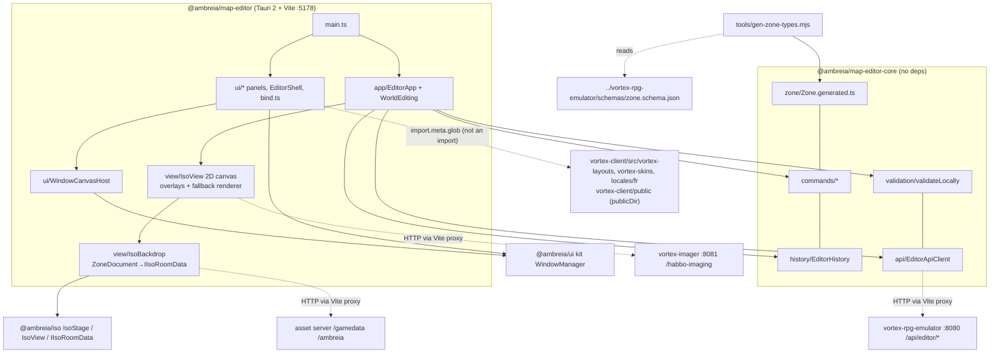

# Map editor audit — `@ambreia/map-editor-core` + `@ambreia/map-editor`

Repo `/home/user/ambreia-client` @ aeb88ba (branch claude/determined-ritchie-omy2dy == origin/rpg-character). Read-only.
Verified by running: `tsx --test packages/ambreia-map-editor-core/test/*.test.ts packages/ambreia-map-editor/test/*.test.ts`
→ 47 tests, 46 pass, **1 skipped** (schema drift check: emulator absent); `eslint packages/ambreia-map-editor-core/src packages/ambreia-map-editor/src` → exit 0.

## (A) Facts

### Shape
| | core | editor app |
|---|---|---|
| Files / lines | 57 / ~1.9k (`Zone.generated.ts` = 479) | 80 / ~7.5k (`IsoView.ts` 758, `EditorApp.ts` 754, `BrowserTabUi.ts` 566) |
| Runtime deps (`package.json`) | **none** (devDeps: `json-schema-to-typescript`, `typescript`) | `@ambreia/common`, `@ambreia/iso`, `@ambreia/ui`, `@ambreia/map-editor-core`, `@tauri-apps/plugin-opener` |
| Actual `@ambreia/*` imports | **zero** (`grep "from '@ambreia"` → nothing; wall would allow `common/`) | iso: 7 modules, all from one file `src/view/IsoBackdrop.ts`; ui: ~22 modules (window kit, component interfaces, XML parsers); common: `AssetLibrary`, `AssetBundle`, `AssetDirectories`, `Logger` |
| Public API | `"exports": {"./*": "./src/*.ts"}` — every file is public, deep-path imports (repo convention) | app, not a library |
| Tests | 9 files: api, boundaries, catalog, commands, history, layers, lot-a, shapes, validate | 2 files: iso-math, monster-labels (pure functions only) |
| ESLint wall | `eslint.config.mjs:327-336`: common only | `:339-348`: `^@ambreia/(?!common/|map-editor-core/|ui/|iso/)` + bans `vortex-(engine|client)` imports |

### Domain model (core)
- `ZoneDocument` (generated): `settings`, `floor{width,length,tiles[],door,doorDirection,thickness}`, `walls{visible,height,thickness}`, `decor[]`, `wallDecor[]`, 11 "world layers" (`entries…triggers`), `ambience`, `prefabs`. The schema carries **no size limits** (`grep maximum|maxItems Zone.generated.ts` → none); limits are hand-mirrored in `zoneGeometry.ts:5-7` (`MAX_SIZE = 64`, `MAX_TILE_HEIGHT = 32`, "Same rules as the server's ZoneDocument").
- Command pattern `IEditorCommand {label; apply(doc) → doc}` (`commands/IEditorCommand.ts`): pure, returns the *same reference* for a no-op. 22 command files. Two families: decor-specific (`placeDecor`, `moveDecor`, `rotateDecor`, `removeDecor`, `patchDecor`, `setDecorLocked`, `setDecorState`, `pasteDecor`, via `updateDecor()` helper) and generic layer commands (`addElement`, `updateElement`, `removeElements`, `duplicateElements` over `LayerKey`); `decor` is **not** a `LayerKey`.
- `EditorHistory` (`history/EditorHistory.ts`): immutable snapshots, `execute()` returns false and records nothing when `apply` returns the same doc (`:49-60`), limit 200, `isDirty = current !== saved`.
- Three layer vocabularies: `LayerKey` (11 document arrays), `LayerName` (7 bottom-panel layers: `floor|decor|npcs|spawns|zones|triggers|ambience`, `LayerState` uses it), app `Category` (16 rail rows). Mapping `LayerKey→LayerName` lives only in the view (`view/WorldOverlayPainter.ts:12 SHOWN_BY`).

### Rendering: hybrid — real iso + editor overlay + full fallback renderer
- `view/IsoBackdrop.ts` wraps `@ambreia/iso`'s `IsoStage` with an offscreen Pixi renderer (`IsoStage.createOffscreenRenderer(2560,1600,…)` :92), `registerScene`+`registerFurniture` modules only (no avatars), one shared stage for the app's lifetime (`IsoBackdrop.shared()` :73-78). It adapts `ZoneDocument → IIsoRoomData` (`roomData()/floorItem()/wallItem()` :268-305), diffs furni by `JSON.stringify` and calls `addItem/updateItem/removeItem`; **any floor or wall-height change rebuilds the whole room** (`sync()` :210-226: key = `JSON.stringify({floor, walls: height})`, then `drop()` + `loadRoom()` + re-add every furni).
- `view/IsoView.ts` owns a 2D canvas: `draw()` (:217-304) blits the backdrop's canvas when `realRoom()` (`backdrop.ready && options.sprites`, :353) then paints overlays (grid following iso's `tileSurface` quarter heights, selection, door, arrival spawns, wall-decor marks, world layers via `WorldOverlayPainter`, hover). When iso is unavailable (no asset server, invalid zone, "vrais mobis" toggled off) it draws tiles/walls/furni itself with imager PNGs (`FurnitureSprites.ts`, `/habbo-imaging`) or boxes.
- Picking is hybrid too: tiles by the editor's own rhombus math (`pick()` :137-215), furni by `backdrop.pick()` = iso's sprite-alpha hit walk when real (:176, :198-201), else by local footprint hit test.
- `view/isoMath.ts` (80 lines) re-states Habbo's scale-64 projection (`x→(32,16), y→(−32,16), z→(0,−32)`), documented "as RoomGeometry projects it"; camera alignment with iso is done empirically in `IsoBackdrop.render()` :150-158 (`view.tileToView(0,0,0)` vs `project(0.5,0.5,0)`).
- Zone previews in the browser (`home/ZonePreviews.ts`) reuse the same `IsoBackdrop` singleton (pause/resume protocol with the editor).

### UI: `@ambreia/ui` windows on one canvas, no DOM panels
- `ui/bootWindowSystem.ts` boots the plain `WindowManager` (kit) exactly like Glaze/J3 sandbox: fonts + skins from `/assets-images.ambreia`, `/assets-xml.ambreia`, authored skins, **45 `vortex_map_editor_*.xml` layouts read from `packages/vortex-client/src/vortex-layouts/` via `import.meta.glob('../../../vortex-client/...')`** (:30-48), French texts from `vortex-client/src/locales/fr/*.json` (incl. `mapeditor.json`, 276 lines). Vite `publicDir` = `../vortex-client/public` (`vite.config.ts:13`).
- `ui/WindowCanvasHost.ts`: rAF loop → `manager.update()` + `compositeToBuffer()`; DOM mouse events are enqueued into the window system; the iso view is a `display object wrapper` child of `viewport_slot`.
- `ui/bind.ts` helpers tolerate a missing widget (warn once) so a Glaze retouch does not crash the app.

### Server data (monsters, palette, zones)
- All through `core/api/EditorApiClient.ts` over HTTP with injected `fetch`, cookie session (`credentials: 'include'`): `/api/editor/{zones,furniture,monsters,…}`, `/api/public/authentication/login`, `/api/public/content/texts/fr` (`texts()` parses `key=value` lines :126-138). Routes are proxied by Vite to `127.0.0.1:8080` (`AMBREIA_API`).
- Monsters (commit 8608ec9): `main.ts:88-105 loadBestiary()` fetches once per run, degrades gracefully (warn, empty list); `ui/panels/monsterLabels.ts` builds options, keeps an id the server no longer serves as `"<id> (inconnu)"`. `IEditorMonster.figure` ("pet figure") is the only game-flavoured datum in core — a DTO, no logic.

### Tauri host
- `src-tauri/tauri.conf.json`: one window 1440×900, `devUrl http://localhost:5178`, `beforeDevCommand "pnpm dev"` (Vite), `beforeBuildCommand "pnpm vite build"`, `frontendDist "../dist"`, **`security.csp: null`**, **`bundle.active: false`**.
- `capabilities/default.json`: `["core:default", "opener:default"]`. `main.rs`: default builder + `tauri_plugin_opener::init()`, no custom commands, no fs/http/shell plugins. Opener used once, lazily and guarded: `EditorApp.ts:431-437` (`'__TAURI_INTERNALS__' in window → openUrl(url)` else `window.open`), to open `http://localhost:5173/?sso=…` (`GAME_CLIENT` hard-coded :36).
- Assets to the iso renderer: `/config.json` (from `publicDir`, i.e. `vortex-client/public/config.json` — only `config.example.json` is tracked), `/gamedata/furnidata_json/1` and `/ambreia/<family>/` **proxied by Vite** to `AMBREIA_ASSETS` (`vite.config.ts:24-25`). No base-URL configuration exists in the app (`grep AMBREIA_API|import.meta.env src` → none; `EditorApiClient` base defaults to `''`).

### Mermaid — packages


### Mermaid — edit → command → zone → render
```mermaid
sequenceDiagram
  participant P as Pointer/Key (WindowCanvasHost)
  participant A as EditorApp / WorldEditing
  participant H as EditorHistory (core)
  participant C as IEditorCommand (core)
  participant B as IsoBackdrop
  participant S as iso.IsoStage (Pixi offscreen)
  participant V as IsoView (2D canvas)
  P->>A: pointer(kind, pick)
  A->>H: execute(cmd)
  H->>C: apply(current)
  C-->>H: next (same ref = no-op)
  H-->>A: true → afterChange() → refresh()
  A->>A: drawView(): if doc !== _syncedDoc
  A->>B: setDocument(doc, level)
  B->>S: floor/walls changed? drop+loadRoom+addItem* : add/update/removeItem (JSON diff)
  A->>V: setModel({doc, selection, hover, world…}) → draw()
  V->>B: render(w,h,zoom,ox,oy) → stage.update(); view.render() canvas
  V->>V: blit + overlays (grid via backdrop.tileSurface, selection, world layers)
  A->>A: panels[].render()
  Note over B,V: setInterval(100ms) in IsoBackdrop → onChange → view.draw() while a room is shown
```

## (B) Findings

**ME-01 | MEDIUM | Confidence high | Tauri build pipeline**
Evidence: `tauri.conf.json` `"frontendDist": "../dist"`, `"beforeBuildCommand": "pnpm vite build"`, `"bundle": {"active": false}`; `EditorApiClient.ts:17` `constructor(private readonly _base = '' …)`; `main.ts:19` `new EditorApiClient()`; `vite.config.ts:19-25` all `/api`, `/habbo-imaging`, `/gamedata`, `/ambreia` are **Vite dev proxies**; `IsoBackdrop.ts:36-45` fetches `/config.json`; no `AMBREIA_API`/`import.meta.env` anywhere in `src/`.
Files: `packages/ambreia-map-editor/src-tauri/tauri.conf.json`, `src/main.ts`, `src/view/IsoBackdrop.ts`, `vite.config.ts`. Symbols: `EditorApiClient._base`, `IMAGING`, `loadAssetDirectories`.
Observed: the only working mode is `tauri dev` wrapping the Vite server. A packaged build serves `dist/` from `tauri://localhost`; every relative fetch (`/api/...`, `/habbo-imaging`, `/gamedata`, `/config.json`) has no proxy and fails; the shell is a dev wrapper, not the "logiciel Windows" the design spec names (design §3).
Why it matters: the architecture promises a desktop tool; the host cannot be shipped and nobody notices because `bundle.active` is false and no build is in `pnpm check`.
Failure scenario: owner runs `pnpm --filter @ambreia/map-editor tauri build` → app starts, login 404/TypeError "Serveur injoignable", iso backdrop never loads.
Recommended architecture: a `ServerEndpoints {api, imager, assets}` value resolved at boot (Tauri: from a settings dialog/`localStorage`, defaulting to `http://127.0.0.1:8080`; web: `''` + proxy), injected into `EditorApiClient`, `FurnitureSprites`, `IsoBackdrop`; CORS/cookie policy on the emulator for `tauri://` origin (or Tauri `http` plugin).
Minimal fix: read the base from `localStorage`/`?api=` and pass it to the three consumers; document that release builds are not supported yet in README. Long-term: endpoints object + Tauri settings window; enable bundling; a CI `vite build` smoke.
Verify: `tauri build` then login; or unit: `new EditorApiClient('http://x')` already tested (api.test.ts:50-58) — add the same for sprites/backdrop.
Regression risk: low (additive). Effort: M.
False-positive review: the README only documents `pnpm editor` (dev) and the spec calls it "premier rendu"; this is a *gap vs the stated target*, not a bug in current use. Severity kept MEDIUM, not HIGH.

**ME-02 | MEDIUM | Confidence high | Schema source of truth / drift detection**
Evidence: `tools/gen-zone-types.mjs:13-14` `schemaPath = process.env.ZONE_SCHEMA ?? resolve(here, '../../../../vortex-rpg-emulator/schemas/zone.schema.json')`; `test/boundaries.test.ts:25` `{skip: !existsSync(resolve(root, '../../../vortex-rpg-emulator/schemas/zone.schema.json'))}`; run here → `# skipped 1`; `ls ../vortex-rpg-emulator/schemas/zone.schema.json` → "No such file". `pnpm check` (`package.json:21`) does not run `gen:types --check`. Hand-mirrored server contract in core: `zoneGeometry.ts:5-7` (`MAX_SIZE`, `MAX_TILE_HEIGHT`, `ROTATIONS`), `validateLocally.ts` codes `'FloorTooLarge' 'DoorNotWalkable' 'DuplicateId' 'BadRotation' 'UnknownFurniture' 'OutOfFloor'`, `api/IZoneSummary.ts`, `api/IEditorMonster.ts`, `api/IFurniturePaletteEntry.ts`, `home/CreateZoneDialog.ts:14` `KEY_SHAPE = /^[a-z0-9_]{3,64}$/` ("The server's own rule").
Observed: when the sibling repo is absent (CI, a fresh clone, this audit) drift between `Zone.generated.ts` and the emulator is undetectable; the schema itself is not vendored, hashed, or versioned (`schemaVersion?: number` exists in the document but no schema revision is recorded in the generated banner). DTOs and limits beyond the schema have no check at all.
Why: a server field rename silently becomes an optional-undefined in the editor; a server-side limit change (e.g. 128×128) is invisible locally.
Failure scenario: emulator adds `floor.thickness` (commit 200a5e9 did exactly this) — detected only because the owner ran `gen:types` by hand.
Recommended architecture: vendor `zone.schema.json` into `packages/ambreia-map-editor-core/schema/` (committed copy + sha in the banner), generate from the copy, and have a *sync* step (like `pnpm gen:headers`/`emulator-sync` skill) that refreshes the copy from the emulator and fails when the copy changed but the generated file didn't. Fold `IZoneSummary`/`IEditorMonster`/palette into the emulator's OpenAPI or a second schema and generate them too.
Minimal fix: commit the schema copy; make the test compare generated output against the **committed copy** (never skip) and keep the emulator comparison as the optional second test. Long-term: single `emulator-sync` covering headers + zone schema + editor DTOs.
Verify: run `tsx --test test/boundaries.test.ts` without the emulator → 0 skipped. Regression risk: none. Effort: S.
False-positive review: `Headers.generated.ts` has the same mechanism per spec design §2 ("même mécanisme"); the spec accepts the dependency. The finding is that the *test skips* rather than vendoring — a concrete hole, so kept.

**ME-03 | MEDIUM | Confidence high | WYSIWYG gap: edited properties not rendered by iso**
Evidence: editor exposes `floor.thickness` and `walls.thickness/visible` (`ui/forms/documentForms.ts:24-25`, `commands/setFloorThickness.ts`, `commands/updateWalls.ts`); `IsoBackdrop.roomData()` :268-285 passes only `floor{width,length,tiles,door,doorDirection}`, `decor`, `wallDecor`, `wallHeight`; `@ambreia/iso/src/IIsoRoomData.ts` has no thickness/visible field; `grep THICKNESS packages/ambreia-iso/src/IsoStage.ts` → none (commit fe6a97d "l'épaisseur … s'applique" touched only `RoomPlaneParser.ts`/`RoomVisualization.ts`, the game path).
Observed: changing "Épaisseur" / "Épaisseur du sol" / walls visibility changes the document (and the game after publish) but not the editor's real preview; the fallback renderer ignores them as well.
Why: the stated value of reusing iso (arch spec §8: "l'éditeur montre exactement ce que verra le joueur") is broken for three fields the UI offers.
Failure: designer sets thin floor, sees normal floor, publishes, player sees thin floor.
Recommended: extend `IIsoRoomData` with `floorThickness?`, `wallThickness?`, `wallsVisible?` and have `IsoStage.buildRoomObject()` set `ROOM_FLOOR_THICKNESS`/`ROOM_WALL_THICKNESS` (the enum exists) and hide walls; pass them in `roomData()`; include them in the `sync()` room key.
Minimal fix: the three fields + key. Long-term: a single `zoneToIsoRoom()` adapter with a test asserting every rendered zone field is mapped (table-driven).
Verify: iso sandbox or editor screenshot with thickness −2 vs 1; unit test on `roomData()`. Regression risk: low (iso change is additive; needs iso test). Effort: S–M.
False-positive review: `walls.visible` might be intentionally editor-only, but `floor.thickness` was *added to the editor three commits ago* while iso learned thickness in the game path only — gap is real.

**ME-04 | MEDIUM | Confidence high | Hidden build-time dependency on `vortex-client` bypasses the wall**
Evidence: `ui/bootWindowSystem.ts:30-48` `import.meta.glob(['../../../vortex-client/src/vortex-layouts/vortex_map_editor_*.xml', …vortex_auth_login_xml.xml])`, `…/vortex-client/src/vortex-skins/*.xml`, `…/vortex-client/src/locales/fr/*.json`; `vite.config.ts:13` `publicDir: resolve(__dirname, '../vortex-client/public')`, `:17` `fs.allow: ['../..']`; `eslint.config.mjs:344` bans `vortex-(engine|client)` only in *import specifiers*; `package.json` declares no `vortex-client` dependency; 45 `vortex_map_editor_*` layouts and `mapeditor.json` (276 lines) live in the client package although `grep -rl "map_editor|mapeditor" packages/vortex-client/src --include=*.ts` → nothing uses them there.
Observed: ESLint passes (exit 0) while the app cannot build without `vortex-client`'s source tree; CLAUDE.md "nothing under packages/ambreia-* imports a vortex-* package" holds literally, not in substance. Rationale in code: "Glaze writes them there".
Why: the editor is not relocatable/standalone; a client refactor (renaming `vortex-layouts/`, splitting locales) breaks the editor silently; editor-only strings/layouts bloat the client's source.
Failure: J6 rename of `vortex-client` → `@ambreia/client` (CLAUDE.md "renamed in a later pass") → editor fails at Vite import analysis.
Recommended architecture: move `vortex_map_editor_*.xml` + `mapeditor.json` into `packages/ambreia-map-editor/src/ui/layouts|locales` (Glaze takes a directory); the shared Habbo skins/bundles come from a small `@ambreia/ui-assets` (or `@ambreia/ui` `assets/` export) used by Glaze, the sandbox and the editor; add an ESLint `no-restricted-syntax` on `import.meta.glob` literals containing `vortex-client`.
Minimal fix: move the 45 layouts and `mapeditor.json`; keep skins/bundles glob for now but add the lint rule as a warning. Long-term: ui-assets package. Verify: `pnpm --filter @ambreia/map-editor build` + Glaze still opens the layouts. Regression risk: medium (Glaze path config). Effort: M.
False-positive review: the design spec places layouts "in the owner's layout" authored with Glaze, and `OWN_LAYOUTS` (`./layouts/*.xml`) already shows the editor can host its own — so the split is incidental, not architectural. Kept.

**ME-05 | MEDIUM | Confidence high | Editor app is not headlessly testable; 2 of ~7.5k lines covered**
Evidence: `test/` holds only `iso-math.test.ts` and `monster-labels.test.ts`; `EditorApp` constructor (`:89-118`) does `new IsoView()` (→ `document.createElement('canvas')`, `IsoView.ts:55`), `IsoBackdrop.shared()` (→ `fetch('/config.json')`), `window.addEventListener('keydown'|'beforeunload')`; `WorldEditing` takes an `EditorApp` (`WorldEditing.ts:36`); tools are `switch` blocks inside `EditorApp.pointer()` (`:538-596`) and `WorldEditing.pointer()`; no `sandbox` script (unlike `@ambreia/ui`/`@ambreia/iso`), `run-vortex-client` skill targets `:5173`.
Observed: all editing logic that is not a core command (stroke accumulation, drag offsets, rect/polygon tools, selection rules, shortcuts, lock checks) runs only in a browser with a window system and canvas; UI widgets are canvas-drawn, so a Playwright test cannot query them without the kit's hit testing.
Why: the recent regressions this area is prone to (tool/category interplay, level filter, lock) have no safety net; "Done means verified" relies on manual screenshots.
Recommended architecture: split `EditorApp` into a DOM-free `EditorSession` (document, history, selection, tools as `ITool {down/move/up(cell, modifiers): IEditorCommand|null}` objects, `LayerState` checks) + a thin `EditorApp` that wires canvas/backdrop/window listeners. Tools become table-driven and unit-testable with a fake `IPick`.
Minimal fix: extract `brush/rectTool/selectTool/place` and `WorldEditing` pointer logic into pure functions `(state, pick) → {state', command?}` with tests (no file structure change). Long-term: `ITool` registry + a `pnpm --filter @ambreia/map-editor sandbox` page + a driver script like `run-vortex-client` for `:5178`.
Verify: new tests run under `pnpm test` (glob `packages/*/test/**/*.test.ts` already includes the package). Regression risk: medium (refactor of 750-line class). Effort: M–L.
False-positive review: core (the "definitive" part per design §2) is well tested (46 tests); this finding is scoped to the app and is about *architecture for testability*, not a current defect.

**ME-06 | MEDIUM | Confidence high | Layer lock/visibility not enforced for world layers; three layer vocabularies**
Evidence: `WorldEditing.ts` — `grep isEditable|isLocked|isVisible` → none; `EditorApp.pointer()` :553-559 hands off to `this.world.pointer(kind, pick, e)` before any `layers.isEditable` check (floor/decor tools do check: `:576,584,587,590,602,649,674`); `LayerState` keys are `LayerName` (7), world layers are `LayerKey` (11), the mapping `SHOWN_BY` is private to `view/WorldOverlayPainter.ts:12-15` and used only for drawing (`:54`); `BottomEditUi.ts:50-55` toggles `setVisible/setLocked` by `LayerName`.
Observed: with "Spawns" locked (or hidden) in the layers panel, the spawns category still places, drags, patches and deletes spawns; a hidden layer's elements are still selectable by click (`WorldEditing.selectTool` → `elementAt`).
Why: the lock/visibility concept is core state (`LayerState`, design §2) but the rule "which LayerKey belongs to which LayerName" is a view constant, so the model cannot enforce it.
Failure: designer locks spawns to paint floor; in spawns category a stray click adds `spawn_7`; save refuses ("Monstre ?") or ships an empty spawn.
Recommended: move `SHOWN_BY` to core as `LAYER_OF: Record<LayerKey, LayerName>` next to `LAYER_KEYS`; `LayerState.isEditableKey(key)`; `WorldEditing.pointer/add/update/remove` check it; `elementAt` callers skip hidden layers.
Minimal fix: the check in `WorldEditing.pointer()` + `add()` using the moved map. Long-term: unify `Category`/`LayerName`/`LayerKey` into one `LAYERS` table (key, panel group, label key, colour, id prefix, shape kind) in core consumed by rail, painter, forms. Verify: core test "a locked layer's commands are refused"; manual: lock spawns, click. Regression risk: low. Effort: S (fix) / M (table).
False-positive review: `LayerState` doc says "A hidden or locked layer takes no clicks" — the intent is explicit, the world path simply predates it (commit 2c638f9 added world tools after). Not a design choice.

**ME-07 | LOW | Confidence high | Redraw-everything on every event; grid overlay rebuilt per frame**
Evidence: `IsoView.draw()` :217-304 runs on every pointer move (`EditorApp.pointer` → `drawView()` → `setModel()` → `draw()`), every `IsoBackdrop.onChange` (`IsoBackdrop.ts:67` `setInterval(() => this._view && this.onChange(), 100)` → `EditorApp.ts:107` `backdrop.onChange = () => this.view.draw()`), every sprite load; per draw: `floor.tiles.map(...)` for `_topLevel` (:272), `forEach drawTile` over all tiles with `backdrop.tileSurface(x,y)` + `traceSurface` (16 quads) + stroke per tile when grid on (:453-480), `sortedDecor()` allocates and sorts decor per draw (:567-577) and twice per `pick()` (:204). `WindowCanvasHost.tick` composites the whole window manager every rAF regardless. No dirty flag, no cached grid layer.
Observed: at 64×64 (4096 tiles, the `MAX_SIZE`) with grid on and a raised map, ≥10 full overlay rebuilds per second even when idle. Not measured.
Why: the schema allows 4096 tiles and unbounded decor; the design is O(tiles+decor) per frame rather than per change.
Recommended: cache the grid/height overlay in an offscreen canvas keyed by `(doc.floor, options, zoom, pan, topLevel)`; `requestAnimationFrame`-coalesce `draw()` (a `_dirty` flag), stop the 100 ms timer when no animated furni; memoize `sortedDecor` on `(doc.decor, furniture)`.
Minimal fix: coalesce `draw()` into one rAF; memoize `sortedDecor`. Long-term: layered offscreen canvases. Verify: `performance.now()` around `draw()` on a 64×64 arena template. Regression risk: low. Effort: S–M.

**ME-08 | MEDIUM | Confidence medium | Any floor edit rebuilds the whole iso room although iso offers incremental tile updates**
Evidence: `IsoBackdrop.sync()` :210-226: `room = JSON.stringify({floor: doc.floor, walls: …})`; `if(room !== this._room) { this.drop(); await this._stage.loadRoom(ROOM, roomData(doc)); this._view = this._stage.createView(...); … }`; `IsoStage.loadRoom()` :184-220 re-adds every furni with `await this.addItem()` sequentially; `IsoStage.setTile(roomId, x, y, tile)` exists (`IsoStage.ts:316-332`, rebuilds the room object only) and is **never called** by the editor (`grep setTile packages/ambreia-map-editor/src` → none). Undo/redo of a floor stroke goes through the same path.
Observed: one brush cell on a zone with N furni = dispose room + rebuild planes + N awaited furni adds + new view (camera re-aligned by `render()`); the 100 ms `onChange` pulse hides the hitch partially.
Why: scales with furni count, the exact axis a "real mobis first" editor grows along (spec §1.2).
Recommended: diff `floor.tiles` against the synced doc and call `setTile` per changed cell when `width/length/door` are unchanged; rebuild only on resize/door/walls change. Keep furni.
Minimal fix: the tile diff in `sync()`. Long-term: `IsoStage.setTiles(roomId, changes[])` batching one plane rebuild. Verify: count `loadRoom` calls in a test double of `IsoStage` while applying `editTiles`. Regression risk: medium (stairs/heights of furni standing on changed tiles must update — check `IsoStage.setTile` moves furni z). Effort: M.
False-positive review: `setTile` may not re-place furni standing on the tile (not verified); if so the minimal fix must also `updateItem` for furni on changed cells. Severity kept MEDIUM because the schema's 64×64 + decor scale makes the full rebuild the dominant cost.

**ME-09 | LOW | Confidence high | Shared `IsoBackdrop` singleton with a single mutable callback and an uncleared timer**
Evidence: `IsoBackdrop.ts:64-68` private ctor `setInterval(...)` never cleared; `:65 onChange: () => void` reassigned by `EditorApp.ts:107` and `ZonePreviews.ts:93` (`backdrop.onChange = () => undefined` "The last editor's view still listens"); `main.ts:70-73` creates a new `EditorApp` per zone.
Observed: after leaving a zone the stale app's `view.draw()` keeps running at 10 Hz until a preview overwrites the callback; two owners coordinate by `pause()/resume()` comments rather than a contract.
Recommended: `IsoBackdrop` exposes `acquire(owner): IBackdropLease {onChange, release()}`; or an event emitter + `dispose()` on `EditorApp.leave()`. Minimal: `EditorApp.leave()` sets `backdrop.onChange = noop`. Effort: S.

**ME-10 | LOW | Confidence high | Server/UI concerns inside core: French labels, JSON-stringify equality**
Evidence: `commands/*.ts` labels `Poser ${class}`, `Supprimer N éléments`, `Épaisseur du sol`, `Paramètres de la salle` (core is meant to be the definitive, UI-less part); `updateElement.ts:16`, `updateSettings.ts:12`, `updateWalls.ts:11`, `patchDecor.ts:15` use `JSON.stringify(a) === JSON.stringify(b)` for no-op detection (key-order sensitive: a patch that re-orders keys is recorded as history).
Why: localisation of the History panel is impossible without touching domain code; order-sensitive equality is a latent "phantom undo step".
Recommended: `label: {key, args}` resolved by the app; a `shallowEqual`/`deepEqual` helper in core. Effort: S.

**ME-11 | LOW | Confidence medium | Tauri security defaults: CSP disabled, no bundling, broad opener scope**
Evidence: `tauri.conf.json` `"security": {"csp": null}`; capabilities `opener:default` (Tauri's documented default allows `open-url` for http/https/mailto/tel — exact scope not verified here, no cargo registry); `EditorApp.ts:36` `GAME_CLIENT = 'http://localhost:5173/'` hard-coded; only remote-ish content is same-origin via Vite proxy.
Observed: acceptable for a localhost dev tool; not for a distributed binary (ME-01). No custom Rust commands, no fs/shell plugins — good.
Recommended when shipping: a CSP allowing `self` + the configured endpoints; `opener` scope narrowed to the game client URL via a capability `scope`. Effort: S.

**ME-12 | INFO | Confidence high | Parallel renderer kept as full fallback**
Evidence: `IsoView.ts` draws tiles with faces, walls (`drawWalls` :417-451), furni from imager PNGs (`FurnitureSprites.ts`), boxes, labels — ~400 lines active only when `!realRoom()`; design §1 planned "la vue simple reste comme calque « navigation »"; `options.sprites` toggles it off at will.
Observed: two pick paths (`pick()` :176/198-213), two sort orders (`sortedDecor` vs iso's depth sort), two sprite sources (imager vs iso). Both must agree for the same click to hit the same furni.
Recommended: keep the fallback but shrink it to the "navigation" promise (tiles + footprints, no imager sprites, no walls) once iso is reliable; or make "vrais mobis off" mean *iso with furni hidden* (`IsoStage.removeItem`), removing `FurnitureSprites` entirely. Effort: M. Not a defect.

**ME-13 | INFO | Confidence high | ESLint walls are enforced by pre-commit/lint-staged and the edit hook, not by `pnpm check`**
Evidence: `package.json:21 "check": "pnpm typecheck && pnpm test"`, `:48-50 lint-staged → eslint --fix`, `.claude/settings.json:22 eslint-on-edit.mjs`. Core additionally has `test/boundaries.test.ts` (runs in `check`); the app has no equivalent test.
Recommended: add the same import-scan test to `packages/ambreia-map-editor/test/` (also catching `import.meta.glob` literals, ME-04). Effort: S.

## (C) Positive findings
- **KEEP** — `IEditorCommand` + `EditorHistory` snapshot model: pure `apply`, same-reference no-op contract honoured by every command checked (`editTiles`, `resizeFloor`, `moveDecor`, `updateElement`…), identity-based `isDirty`, tests pin `h.current === start` (`history.test.ts:28-30`). Deterministic ids via `nextId(doc, prefix)`.
- **KEEP** — Core purity: zero external imports, `fetch` injected (`EditorApiClient`), 46 Node tests in 1.5 s, boundaries test for imports.
- **KEEP** — iso reuse through a generic no-session entry (`IsoStage`, `IIsoRoomData`, `IIsoView.render()/pick()/tileToView()`, `tileSurface`) shared with sandbox and imager (plan J4 D5); iso/ui contain no editor-specific code (grep: only comments). Graceful degradation when assets/imager/server are missing (`IsoBackdrop.create` catch, `loadBestiary`, `FurnitureSprites` retries).
- **KEEP** — UI as `@ambreia/ui` windows on one canvas (`WindowCanvasHost`, `bind.ts` tolerant lookups, `SlotSwitcher`): the editor looks like the game, layouts are Glaze-editable, forms are spec-driven (`IFieldSpec`, `elementForm`).
- **KEEP+STRENGTHEN** — Generic layer commands (`addElement/updateElement/removeElements/duplicateElements` over `LayerKey`) + `newElement/withShape/translateElement/elementCells`: extend to `decor` (ME-14 below) and give them the lock check (ME-06).
- **KEEP+STRENGTHEN** — `gen-zone-types.mjs --check` + boundaries test: vendor the schema so the check never skips (ME-02).
- **KEEP+STRENGTHEN** — `isoMath.ts` is small and documented; add one test asserting `project()` ≡ `IIsoView.tileToView()` on a loaded stage (today alignment is empirical in `IsoBackdrop.render()` :150-158; stairs already come from iso's `tileSurface`).
- **REFACTOR** — Decor-specific command family vs generic layer family (two ways to move/remove/duplicate/lock), `EditorApp` (754 lines: tools, clipboard, server flows, view model, shortcuts), `Category`/`LayerName`/`LayerKey` triple + the `EditorUi.slots/panel` switches.
- **REPLACE** — `import.meta.glob('../../../vortex-client/…')` reach-through by package-owned layouts/locales or an assets package (ME-04).

## (D) Scorecard (0–10)
| Axis | core | editor app | Note |
|---|---|---|---|
| Encapsulation | 8 | 6 | core: per-file exports, immutable types; app: `EditorApp` public mutable fields (`selection`, `tool`, `hover`, `busy`…) read by 20+ panels |
| Extensibility | 7 | 5 | new command = 1 file; new layer = ~10 core + ~15 app files (table E); tools are switch-based |
| Testability | 9 | 3 | 46 tests vs 2 pure-function files; app needs DOM/canvas/fetch |
| Independence | 9 | 5 | core imports nothing; app silently needs `vortex-client` source + public, Vite proxy, imager, asset server |
| Lifecycle | 8 | 6 | core stateless except `EditorHistory`/`LayerState`; app: singleton backdrop with mutable callback, uncleared interval, lock release via `beforeunload` fetch |
| API quality | 7 | 6 | French labels in core, `ZoneCell.x?` optionality leaks `?? 0` everywhere (schema-driven); app: clear `IPanelUi`, `IViewModel` contracts |
| Performance architecture | 7 | 5 | core O(n) immutable copies per edit (fine); app redraws all per event, full room rebuild per floor edit |

## (E) N+1 table
| Addition | Files added | Files modified (today) | Notes |
|---|---|---|---|
| New command (e.g. "mirror decor") | 1 core (`commands/x.ts`) + 1 test | 1–2 app (button/shortcut) | Clean. |
| New validation rule | 0 | `validation/validateLocally.ts` + `validate.test.ts` | Server code string mirrored by hand (ME-02). |
| New floor/decor tool | 0 | `ToolName.ts`, `TOOL_KEYS.ts`, `EditorApp.pointer()`+`keydown`, `ViewToolsUi`/`FloorPanelUi`, layout XML in **vortex-client**, `mapeditor.json` | ~6; no tool abstraction. |
| New world-layer *field* | 0 | `elementForm.ts` (or inspector), `describeElement.ts`, `Zone.generated.ts` (regen) | ~3. Good. |
| New world layer (document array) | 0–1 | core: `LayerKey`, `LAYER_KEYS`, `LAYER_ID_PREFIX`, `newElement`, `withShape`, `elementCells`/`translateElement` (if new shape key), `zoneGeometry.allIds` (second hand-kept list), `Zone.generated` regen; app: `Category`, `RAIL`, `CATEGORY_LAYER`, `CATEGORY_LABEL_KEYS`, `EditorUi.slots/panel`, `elementForm`, `describeElement`, `WorldOverlayPainter` (`SHOWN_BY`,`COLORS`,`LAYERS`), maybe `LayerName`/`LayerState`/`LAYER_COLORS`/`BottomEditUi`, rail layout XML + locale in vortex-client | ~18–22 files; the `'spawns'` grep hits 27 files. A single `LAYERS` table in core would cut this to ~4. |
| New object kind on decor (e.g. wall-decor tools) | 1–3 core commands | `EditorApp`, `IsoView` fallback + pick, `IsoBackdrop.wallItem`, inspector | decor path is bespoke; cannot reuse layer commands. |

## (F) Not verified
- Tauri runtime behaviour (no Rust toolchain/cargo registry here): exact `opener:default` scope, CSP-null consequences in WebView2, whether `tauri build` even completes.
- Whether the game client bundles `mapeditor.json`/`vortex_map_editor_*` layouts (no `.ts` reference found in `vortex-client/src`; its locale loading mechanism was not traced).
- Keyboard shortcuts while typing in a canvas text field (`EditorApp.keydown` guards `closest('input, textarea, select')`; `@ambreia/ui` text fields appear to use a hidden DOM input — not traced).
- `IsoStage.setTile()` semantics for furni standing on the changed tile (ME-08 minimal fix depends on it).
- Actual frame cost at 64×64 with grid on (ME-07) — architectural reading only.
- Server-side codes/limits (`MAX_SIZE`, `KEY_SHAPE`, finding codes) against `vortex-rpg-emulator` — repo absent.
- Equivalence of `isoMath.project` with iso's `RoomGeometry` at scale 64 beyond the empirical alignment in `IsoBackdrop.render()`.
