# Net / Protocol audit — `@ambreia/net`, `@ambreia/protocol`, game `communication/`

Repo `/home/user/ambreia-client` @ `aeb88ba` (branch `claude/determined-ritchie-omy2dy` == `origin/rpg-character`). Read-only audit.
**The emulator `../vortex-rpg-emulator` is NOT present in this container**: every check that needs it
(field order vs `.cs`, `gen-headers --check`, `wire-diff`) was evaluated from the tools' code and tests,
not against the server. Those gaps are listed in §F.

Verified here: `gen-headers --check` → `check skipped` exit 0 (no emulator); `wire-diff` → exit 2 (no emulator);
`tsx --test packages/ambreia-net/test packages/ambreia-protocol/test` → 48/48 pass; the header/release/wire-diff tool tests → 28/28 pass.

---

## A. Facts and diagrams

### A.1 Transport (`packages/ambreia-net/src/connection/SocketConnection.ts`, 796 lines)

| Aspect | What exists | Evidence |
|---|---|---|
| Open | `init(host, port)` builds the URL (`ws://`/`wss://` passthrough, else scheme from `window.location.protocol`), `new WebSocket(url)`, `binaryType='arraybuffer'`, 10 s open timeout (`_timeout`, multiplied by attempt in the manager) | `SocketConnection.ts:120-160`, `:566-579`; `HabboCommunicationManager.ts:565` `this._connection.timeout = this._connectionAttempt * 10000` |
| Framing | `[int32 length][int16 header][body]`, length excludes itself; `splitMessages` loops while `bytesAvailable >= 6`, holds partial frames (`buffer.position = startPosition; encryption.reset()`), handles N frames per WebSocket message, compacts the buffer with `copyWithin` | `WireFormatter.ts:76-193` |
| Max packet | `MAX_DATA_SIZE = 1048576` (1 MiB) client side; `length < 2 || length > MAX` throws → connection torn down. Server side documented 65536 (`docs/CLIENT-SERVER-ARCHITECTURE.md` §3). | `WireFormatter.ts:35`, `:106-133` |
| Buffering in | `_receivedBuffer: ByteArray` appended on `onmessage`; processed both on arrival **and** from the ticker (`CoreCommunicationManager.update` → `processReceivedData`) | `SocketConnection.ts:539-564`; `CoreCommunicationManager.ts:58-74` |
| Buffering out | `_pendingMessages` only while `readyState === CONNECTING`; `_pendingComposers` (closures) while no client→server cipher yet, or authenticated-but-not-configured. **No queue once the socket closed**: `sendRaw` returns false and warns once | `SocketConnection.ts:204-240`, `:590-637` |
| RC4/DH handshake | `ClientHello` + `InitDiffieHandshake` sent via `sendUnencrypted` (only `PreEncryptionMessageComposer` allowed); server prime/generator are "RSA-signed" = raw public-key decrypt + loose PKCS#1 strip; client picks a 30-byte private key with `Math.random`, RSA-encrypts its public key (padding also `Math.random`); shared key → `ArcFour` KSA; server→client cipher only if the server says so | `IncomingMessages.ts:153-283`, `:447-459`; `RSA.ts:186-256`; `ArcFour.ts` |
| Reconnect | **None.** Comment in code: "there is no reconnect" (`:610-612`). The only retry is the *initial* port/attempt loop: `_maxConnectionAttempts = 2` over `ports` (default `[40001]`) | `SocketConnection.ts:597-621`; `HabboCommunicationManager.ts:49-50`, `:541-567` |
| Close | `close()` clears the timeout, `socket.close()` if OPEN, nulls `_socket`, `_connected=false`. `onclose` logs code/reason/`sinceLastRx`/`hiddenFor`, calls `connectionClosed(code, wasClean)` and emits `disconnected` | `SocketConnection.ts:423-438`, `:487-507` |
| Malformed length | throw → catch in `processReceivedData`: clear buffer, `connectionError`, emit `error`, `close()`. Rationale comment is correct (keystream already advanced; cannot resync) | `SocketConnection.ts:400-416` |
| Truncated body / read past end | `ByteArray.read*` throw `RangeError('End of buffer')`; caught per message in `handleReceivedMessage` → `log.error('Parse error…')`, `messageParseError()`; **connection stays up** (frame boundary known) | `ByteArray.ts:272-402`; `SocketConnection.ts:768-794` |
| Backpressure | `WebSocket.bufferedAmount` never read (0 occurrences). No send throttling | grep |
| Heartbeat | Server PINGs; client answers `PongMessageComposer` via the normal (queued) `send`. `VortexMain.startSendingHeartBeat()` is **not a wire heartbeat**: gated on legacy `spaweb=1`, it only emits a `'heartbeat'` event on `vortexEvents` every 10 s. No client-side dead-link detection (no "no PING for N s" timer) | `IncomingMessages.ts:307-314`; `VortexMain.ts:959-994` |
| Disposal | `dispose()` last, guards `_disposed`, removes visibility listener, clears registry/handlers/queues | `SocketConnection.ts:441-469` |

### A.2 Connection state machine — actual vs ideal

```mermaid
stateDiagram-v2
    direction LR
    [*] --> Idle
    Idle --> Connecting: HabboCommunicationManager.initConnection() / tryNextPort()\n→ SocketConnection.init()
    Connecting --> Connecting: onerror / 10s timeout → connectionError() → tryNextPort()\n(≤ 2 attempts × ports; new WebSocket on the SAME SocketConnection)
    Connecting --> Failed: attempts exhausted → log.error only
    Connecting --> Handshaking: onopen → 'connected' → ClientHello + InitDiffie (plaintext)
    Handshaking --> Encrypted: CompleteDiffie → setEncryption() → HANDSHAKED\n→ VersionCheck, UniqueID, SSOTicket
    Handshaking --> Failed: DisconnectReason (HANDSHAKE_FAIL) or RSA/BigInt throw (silent stall, see NP-05)
    Encrypted --> CharacterScreen: (F3a) account ticket: RpgCharacterList etc. flow, unbounded wait\n(waitForAuthentication(+Infinity))
    CharacterScreen --> Authenticated: AuthenticationOK → isAuthenticated() → queue incoming until…
    Authenticated --> Configured: App.ts → connection.isConfigured() → replay queues
    Configured --> Disconnected: onclose (any code) → IncomingMessages.onConnectionDisconnected()\n→ demo.disconnected(-3) → alert dialog
    Configured --> Disconnected: DisconnectReason N → alert (122 → "update required" → reload at top level)
    Disconnected --> [*]: dialog closed → DISCONNECT_ACKNOWLEDGED → postMessage to parent frame ONLY;\nat top level: nothing. No Reconnecting state exists.
```



Ideal (for comparison): `Idle → Connecting → Handshake → Authenticated → EnteringWorld → InWorld → (Reconnecting ⇄) → Disconnected/Failed`.
What is missing: an explicit state field (state is 6 booleans spread over 3 classes: `_connected/_authenticated/_configurationReady` in `SocketConnection`, `_isHandshaking/_wasDisconnected` in `IncomingMessages`, `_isDisconnected/_isLoggedIn/_authenticationStarted` in `HabboCommunicationDemo`), `Reconnecting`, `EnteringWorld/InWorld` (the character screen phase is implicit in "authenticated = entered world").

**What the user sees on disconnect**: `SocketConnection.onclose` → `disconnected` → `IncomingMessages.onConnectionDisconnected()` (`IncomingMessages.ts:430-441`) → `HabboCommunicationDemo.disconnected(-3, '')` → `windowManager.alert('${disconnected.generic}', '${connection.login.logged_out}')` (`HabboCommunicationDemo.ts:456-501`). Closing the dialog emits `DISCONNECT_ACKNOWLEDGED`; `App.ts:997-1002` only `postMessage`s when embedded in an iframe — **at top level nothing happens**, the client stays rendered with a dead socket, and every later action hits `sendRaw` → `send-after-close` warn-once → `false` (`SocketConnection.ts:613-621`). The `HabboCommunicationManager.connectionClosed()` 1006-vs-1000 distinction (`:431-445`) only affects `_connectionActions.setDisconnected()`, whose App implementation is `this._authenticated = false` (`App.ts:945`) — it does not affect what the user sees.

### A.3 Packet flow — inherited style (Event + Parser + Composer)

```mermaid
flowchart LR
    WS[WebSocket onmessage ArrayBuffer] --> RB[_receivedBuffer append]
    RB --> SM[WireFormatter.splitMessages\nRC4 decipher (mark/reset)\nlength check 2..1MiB]
    SM --> W[MessageDataWrapper(id, body)]
    W --> Q{authenticated &&\n!configured?}
    Q -- yes --> PQ[_pendingReceivedMessages\n(replayed in order by isConfigured())]
    Q -- no --> HR[handleReceivedMessage]
    PQ --> HR
    HR --> TAP[IPacketTap.incoming?]
    TAP --> NS{_incomingHandlers\n.get(id)?}
    NS -- new style --> NSH[(see A.4)]
    NS -- no --> REG[MessageRegistry.getMessageEventsForId]
    REG -- none --> DROP[warn once 'No registered handler' + PacketLogger.unhandled]
    REG -- events --> P[events0.parser.flush(); parse(wrapper)]
    P -- false --> SILENT[silently nothing]
    P -- throw --> PE[log.error 'Parse error' + messageParseError()]
    P -- true --> CB[for each event: event.connection = this;\nemit 'messageEvent'; event.callback(event)]
    CB --> MGR[RoomMessageHandler / IncomingMessages\n(event.getParser&lt;T&gt;() getters)]
    MGR --> STATE[RoomEngine / demo state]
    subgraph out[Outgoing]
      UI[User intent] --> C[new XMessageComposer(...)]
      C --> SEND[connection.send()]
      SEND --> GATE{cipher && (!auth || configured)?}
      GATE -- no --> PC[_pendingComposers closure]
      GATE -- yes --> ID[MessageRegistry.getMessageIdForComposer\n(class ref, then class NAME)]
      ID --> ENC[encodeAndSend: PacketLogger, tap, WireFormatter.encode\n(type by JS typeof!), RC4 encipher]
      ENC --> RAW[sendRaw → socket.send]
    end
```

### A.4 Packet flow — new style (`MessageMap`, spec §6)

```mermaid
flowchart LR
    HR[handleReceivedMessage] --> H[_incomingHandlers.get(header)\n{name, handle}]
    H --> MM[MessageMap entry.read =\nhandler.handle(parser.parse(wrapper))]
    MM --> PARSER[IIncomingParser&lt;M&gt;.parse → plain class\n(protocol/parser/rpg/&lt;d&gt;)]
    PARSER --> HANDLER[IMessageHandler: {handle: m =&gt; announce('event', m)}]
    HANDLER --> SESSION[Rpg&lt;Domain&gt;Session: remembers last message,\nemits typed EventEmitter event]
    SESSION --> FEATURE[features/&lt;x&gt;/feature.ts listeners → views/HUD]
    MM -- throw --> ERR[log.error 'Handler error' + messageParseError]
    subgraph out[Outgoing]
      I[User intent] --> S[session.cast()/send()] --> M[new RpgXMessage(...) plain class]
      M --> MS[map.send(connection, msg):\n_outgoing.get(msg.constructor) → serializer.serialize()]
      MS --> SV[connection.sendValues(header, name, values)] --> ENC[encodeAndSend (same tail as legacy)]
    end
```

Facts:
- **Views/managers never touch `IMessageDataWrapper`**: the only reference outside `net`/`protocol` is the `IConnectionCallback.messageParseError(wrapper)` signature in `HabboCommunicationManager.ts:484`. No `wrapper.read*` in `game`/`client`/`engine` (grep). Legacy managers read typed parser getters through `event.getParser<T>()` (53 uses in `room/`).
- **No feature writes bytes manually**: every send is `connection.send(composer)` or `map.send(connection, msg)`; `WireFormatter.encode` is the only encoder.
- **Order-preserving queue before configuration**: incoming `_pendingReceivedMessages` (`SocketConnection.ts:391-395`, flushed `:664-673`) and outgoing `_pendingComposers` as closures so composers and maps interleave in call order (`:40-41`, `:213`, `:235`). The gate is opened by `App.ts:704` right after `await vortex.connect()`. Since F3a, authentication happens on entering the world, so the characters-screen phase runs *unqueued* (correct: `_authenticated` is false then).
- Install site: each feature's `afterAttach` awaits a microtask then `host.made.<x>?.install(connection)` and only **warns** when the connection is missing (`skills/feature.ts:369-376`). Both styles share one `SocketConnection`.

### A.5 Unknown / broken packets — matrix

| Case | Behaviour | Evidence | Silent? |
|---|---|---|---|
| Unknown incoming header | `warn` once per id: "No registered handler … dropped. Further occurrences … are silent."; `PacketLogger._unhandled` tally always kept | `SocketConnection.ts:734-751`; `PacketLogger.ts:45-62` | After the first: console-silent; recoverable through `__packets.unhandled()` |
| Known header, class registered, **no listener subscribed** | Same branch (events array empty) — e.g. `RoomEntryInfoMessageEvent` (registered `HabboMessages.ts:332`, zero `new RoomEntryInfoMessageEvent(` anywhere) | grep | yes after first |
| Registered event without parser | `warn` once "registered but its event carries no parser — dropped" (can only happen when `parserClass` is missing; all inherited events supply one) | `:753-766` | yes after first |
| Legacy `parse()` returns `false` | `if(parser.parse(wrapper))` → nothing, **no log at all** (10 parsers can return false, mostly on `wrapper === null`, unreachable) | `:772`; `ObjectsMessageParser.ts:52-54` | **yes, always** |
| Parser throws (truncated/garbage body) | `log.error('Parse error for N')` + `messageParseError(wrapper)` → `ErrorReportStorage.setParameter(…, String(message))` = `"[object Object]"` | `:790-794`; `HabboCommunicationManager.ts:484-489` | no (error) but the report payload is useless |
| Handler throws (legacy callback) | caught per event, `log.error`, other events still run | `:779-786` | no |
| Handler throws (new style) | caught, `log.error('Handler error for N (Name)')` + `messageParseError` | `:717-725` | no |
| Values left unread | nothing checks `bytesAvailable === 0` after parse (prod); the rpg tests' `wire()` helper also does not (documented in `rpg-message` skill) | — | **yes** |
| Invalid length / desync | fatal: buffer cleared, `error`, `close()` | `:400-416` | no |
| Unknown composer sent | `warn` once per class, returns `false` | `:217-223`; `unknown-message-warnings.test.ts:76-92` | after first |
| Message class not in map | `warn` once per class, `false` | `MessageMap.ts:73-85` | after first |

**What `log.once` hides** (`Logger.ts:548-556`): the key is `<logger>:<key>`, kept in a process-wide `Set` for the life of the page; subsequent calls get a pinned-SILENT logger. So `send-after-close` (`SocketConnection.ts:615`) warns **once per page** — a second disconnect in the same page (after any future reconnect) would be silent; `unknown-composer:<Class>` is once per class. In `net` there are 4 `log.once` sites plus the hand-rolled `_unhandledMessageIds` set (same semantics). None are per-connection; none reset in `dispose()`.

### A.6 Registry facts (`HabboMessages.ts`, 1094 lines)

- **44 `_events.set` + 16 `_composers.set` = 60 registrations**; 735 of 1094 lines are comments, 137 blank → ~220 code lines; most comments describe registrations that were deleted in the core cut (e.g. lines 740-800 narrate guild/group/floor-plan headers that no longer exist). CLAUDE.md's "60 messages" matches **HabboMessages only**; the real contract (`Headers.generated.ts`) is **71 incoming + 32 outgoing = 103 headers** (`awk` count), 43 of which are served by the new style (`NewStyleHeaders.ts`: 27 incoming, 16 outgoing). 60 + 43 = 103 ✔, and `incoming-registered`/`outgoing-registered` tests assert exactly that partition with no overlap.
- Duplicate-id detection at config time: `HeaderMap.set` logs `error` (does not throw) on a header collision (`HabboMessages.ts:148-160`). `MessageRegistry.registerMessage*Class` warns on a duplicate **class name**, not id (`MessageRegistry.ts:193-221`).
- New-style duplicate refusal: `SocketConnection.handleIncoming` throws when `_incomingHandlers` has the header **or** `_messageRegistry.hasIncomingMessage(header)` (`:243-258`); `MessageMap.install` is all-or-nothing (`MessageMap.ts:54-70`). Tested (`message-map.test.ts:89-106`). The check is one-directional: `addMessageEvent()` after an `install()` on the same header is not refused (`registerMessageEvent` never consults `_incomingHandlers`), but the static tests make that unreachable with the committed config.
- Literal ids: `no-literal-ids.test.ts` greps `.set(\d+` in HabboMessages and checks every registered id exists in `Headers.generated`. It does not scan maps/features — there, `Incoming.X` is the only way to get a number and the Vite release plugin would throw on an unknown name, but a literal `1446` typed in a map would pass every test (and silently break on a release re-draw).
- Dead registrations: `RoomEntryInfoMessageEvent` (0 listeners), `DisconnectMessageComposer` (0 construction sites — the client never tells the server it is leaving; logout is `location.assign(pathname)` in `HudPanelsView.ts:117`).

### A.7 Header generation and release revisions

- `gen-headers.mjs`: `--check` with **no emulator → prints "check skipped", exit 0** (`gen-headers.mjs:22-29`; tested `gen-headers.test.mjs:19-25`). Without `--check`, missing emulator → exit 1. With an emulator, `--check` renders and byte-compares (`sameContent`, CRLF-tolerant). Stale/renamed/removed detection: a rename or removal in `Headers.cs` changes the rendered file → check fails → `pnpm gen:headers` rewrites → then `incoming/outgoing-registered` tests name the header neither style serves (removed from `Headers.cs` = disappears from `Incoming`, and a stale `HabboMessages` entry fails `no-literal-ids` "every registered id is one the emulator declares"). `-1` ids are dropped (`headers.mjs:96-100`). Worktree-aware candidate lookup (`emulatorCandidates`).
- Pre-commit (`.husky/pre-commit`): `lint-staged`, `gen-headers --check || exit 1`, `sync-agent-docs || exit 1`. **No `.github/workflows`, no other CI file** → the gate is `pnpm check` on the developer's machine plus the Claude Stop hook (`check-on-stop.mjs`, only when the session changed `.ts`). A commit from a machine without the emulator passes the header check vacuously.
- Release scheme (spec 2026-10-08): `ClientHelloMessageComposer` sends `REVISION` (`'AMBREIA-DEV'` in `Headers.generated.ts:6`; `client-hello-revision.test.ts`). Production build: `vite-plugin-release.mjs` loads the newest `Releases/AMBREIA-*.json` (or `AMBREIA_RELEASE`), replaces every `Incoming.X`/`Outgoing.X` with the number (throws naming file+member if absent), serves `Headers.generated` as `{REVISION, Incoming:{}, Outgoing:{}}`; `vite.config.ts:84 sourcemap:false`; `check-release-bundle.mjs` fails the build if any message name or `.map` is in `dist/assets`. `pnpm build` chains `tsc && vite build && check-release-bundle` (`vortex-client/package.json:9`).
- **Compatibility check is server-side only**: the client has no notion of "server revision". New-client vs old-server mismatch: the server rejects the unknown revision string and sends `DisconnectReason 122` (`DisconnectReasonMessageEvent.INCOMPATIBLE_CLIENT_VERSION`), the client shows `${disconnect.updaterequired.*}` and `App._onUpdateRequired` reloads (`location.replace(pathname)`) at top level or hands over to the parent frame (`App.ts:968-979`). Note `DisconnectReasonMessageParser.reasonText` still maps **22** to 'Incompatible client version' and does not know 122 (`DisconnectReasonMessageParser.ts:44-45`) — only cosmetic since `resolveDisconnectedReasonLocalizationKey` uses the constant. Anything but a `DisconnectReason` on 4000 from a mismatched server is garbage to the client (random ids) → "No registered handler" warnings, nothing else — not verifiable without the emulator.

### A.8 Packet inspector

`PacketLogger` (`net/src/PacketLogger.ts`): static, installed unconditionally by `VortexMain.ts:387` (`PacketLogger.install()`, **not** behind `import.meta.env.DEV`), exposes `globalThis.__packets {on, off, only, dump, unhandled, clear}`. Cost in production per packet: one object allocation + `push` into a 200-entry history + `shift()` when full (**always**, even when disabled: `record()` pushes before the `_enabled` check, `:135-146`), plus a `Map` upsert for unhandled ids. `IPacketTap` (`IPacketTap.ts`) is the edit/drop/inject hook: `setPacketTap`, `injectIncoming` (never deciphered, skips the pre-configuration queue); nothing installs a tap in the repo (`setPacketTap` has no caller outside tests) — the inspector UI of spec §8 does not exist yet. Tests: `packet-tap.test.ts` (5), `__packets` itself untested.

---

## B. Findings

### NP-01 | HIGH | CONFIRMED | Transport lifecycle
**Evidence**: `SocketConnection.ts:606-612` "`onclose` leaves `_socket` non-null … Nothing ever flushes that queue (only `onopen` does, and there is no reconnect)"; `:613-621` `log.once('send-after-close').warn('… nothing reconnects. Every action from here on is dropped until the page is reloaded.')`; `App.ts:997-1002` `_onDisconnectAcknowledged = () => { if(window.parent === window) return; window.parent.postMessage(…) }`; `HabboCommunicationManager.ts:230-235` `renewSocket()` has no live caller (`HabboCommunicationDemo.ts:678` is a comment).
**Files/Symbols**: `SocketConnection.sendRaw/onclose`, `HabboCommunicationManager.connectionClosed/renewSocket`, `HabboCommunicationDemo.disconnected/alert`, `App._onDisconnectAcknowledged`.
**Observed**: any socket close (1000 or 1006) → one alert dialog; after it is closed, at top level, the client is a dead page. No reconnect, no "reconnecting…" state, no automatic return to login.
**Why it matters**: an MMORPG client on Wi-Fi/mobile sees 1006 regularly; the fix today is the player reloading.
**Failure scenario**: tab frozen 5 min → 1006 on thaw → dialog → closed → HUD alive, every click dropped, one warning in the console.
**Recommended architecture**: a `ConnectionStateMachine` in `net` (states of §A.2) owning the socket; `game` subscribes to state transitions; reconnect with exponential backoff + jitter, bounded attempts, re-running the handshake and re-sending the (server-refreshed, §A.10) ticket; a `Reconnecting` overlay.
**Minimal fix**: at top level, `_onDisconnectAcknowledged` → `location.assign(location.pathname)` (what `HudPanelsView` logout already does), so the dialog always leads somewhere.
**Long-term**: the state machine + reconnect; the server already displaces stale sessions (`ISessionGateway.AddSessionToPlayerAsync`, doc §2 Phase 4) so a re-login is safe.
**Verify**: `run-vortex-client`, stop the emulator, observe; unit test on the state machine.
**False-positive review**: looked for any caller of `renewSocket`/`createSocket`/a second `init()` after `onclose` — none; `_onUpdateRequired` does reload but only for reason 122. Confirmed.
**Regression risk**: M (reconnect interacts with queues and `log.once`). **Effort**: S (minimal) / L (long-term).

### NP-02 | MEDIUM | HIGH | Initial retry loop races the old socket
**Evidence**: `HabboCommunicationManager.ts:447-458` `connectionError()` → `tryNextPort()` → `this._connection.init(host, port)` (`:566`); `SocketConnection.init()` (`:146-151`) does `this._socket = new WebSocket(url)` **without** closing/detaching the previous socket; the previous socket's `onclose` (`:487-507`) later runs against the shared object: `this._connected = false`, `emit('disconnected')` → `IncomingMessages.onConnectionDisconnected()` (`:430-441`) → `demo.disconnected(-3,'')` → alert, while the retry is still connecting (and `_wasDisconnected` is never reset on retry).
**Observed/Scenario**: first attempt refused (onerror) → retry starts → the failed socket's close event fires → "logged out" dialog over a connection that may then succeed; if the retry had already opened, `_connected` is flipped to false by the stale handler. 2 attempts max, so no storm.
**Fix**: `init()` should detach the old socket's handlers (set `onclose/onerror/onmessage = null`) before creating a new one, and the demo should ignore `disconnected` while a retry is pending; or make `connectionClosed` the single source of the disconnect alert.
**False-positive review**: `tryNextPort` returns early when `connected`; the race is only during the initial attempts (timeout path too: `startTimeout` closes the socket then calls `connectionError`, so the close event is guaranteed to follow the retry). Likelihood high on a refused port, impact a spurious dialog. Not observed live (no server here).
**Risk**: S. **Effort**: S.

### NP-03 | MEDIUM | CONFIRMED | Wire type discipline is by JS `typeof`, not by the contract
**Evidence**: `WireFormatter.ts:207-265` `writeValue`: `null/undefined → return` (field silently skipped), `number → Number.isInteger ? writeInt : writeFloat`, `Array → count + items`. New-style serializers return `[message.skillId, message.targetObjectId, message.x, message.y]` (`RpgSkillCastMessageSerializer.ts:9`) with `readonly x: number` (`RpgSkillCastMessage.ts:9`). `MoveAvatarMessageComposer.ts:25` rounds only `z`; `RoomEngine.ts:9227` passes `location.x, location.y` from `getActiveSurfaceLocation` (a surface hit, not necessarily integral).
**Observed**: a float that reaches a `number` field is written as 4 bytes IEEE-754 where the server does `PopInt` → the server reads a nonsense int and (worse) every later field is still aligned so nothing fails loudly; an `undefined` field shifts all following fields.
**Why it matters**: `wire-diff` maps TS `number` → `int` (`wire-diff.mjs:15`) so the tool believes the contract holds; the runtime encoder does not enforce it.
**Scenario**: a skill cast on a hovered tile with a fractional coordinate → server targets tile 1,071,644,672.
**Minimal fix**: in `encodeAndSend`/`writeValue`, throw (dev) or `Math.trunc` + `log.once` warn on a non-integer `number` and on `undefined`; the `Long/Short/Byte` wrappers already exist for the other widths, add an explicit `Float` wrapper so floats are opt-in.
**Long-term**: typed serializer DSL (`int(m.x)`, `str(m.name)`) so the serializer declares the wire type and `wire-diff` reads it.
**Verify**: unit test `encode(1,[1.5])` throws; existing `wire-format.test.ts` extended.
**False-positive review**: checked that `RoomEngine.ts:8712` passes `tileX/tileY` (ints) — fine; `:9227` is the plausible float path; `VersionCheckMessageComposer` gets `getProperty()` which returns `''` not `undefined` (`Component.ts:553`), so the `undefined` branch is not hit by inherited callers today. Confirmed as a latent hazard, not an observed bug.
**Risk**: S. **Effort**: S/M.

### NP-04 | MEDIUM | CONFIRMED | Untrusted counts/lengths are unbounded; strings are trusted as keys/paths
**Evidence**: every list parser loops on a raw `readInt()` count: `RpgTelegraphsMessageParser.ts:11-23` (count × cellCount), `RpgCombatEventsMessageParser.ts:11-14`, `RpgInventoryMessageParser.ts:13-16`, `RpgSkillsMessageParser.ts:13-14`, `UsersMessageParser.ts:96-98` `Array.from({length: count}, …)`, `FloorHeightMapMessageParser.ts:165-170`. Only guard: the frame is ≤ 1 MiB (`WireFormatter.ts:35`) and reads throw `RangeError` at the end of the frame (`ByteArray.ts:296-320`). Strings: `readUTF` = `readUnsignedShort` length (≤ 65535) → bounded by the frame. Server strings are used as resource keys: `itemIcon(item.definitionId)` → `assetUri` (`InventoryView.ts:205,228`), `` `${item.definitionId}.name` `` text keys (`CharacterWindow.ts:177`), `skillIcon(skillId)` (`skills/feature.ts:96`); ids are used as `Map` keys (`RpgCombatSession._health`, `RpgSkillSession._statuses`), never as array indexes (checked the rpg sessions).
**Observed**: a count of 2^31-1 with a 1 MiB frame → `Array.from({length: 2147483647})` in `UsersMessageParser` **pre-allocates 2^31 slots before reading** (RangeError: invalid array length or a multi-GB allocation attempt) — the rpg parsers `push` incrementally so they fail on the first read past the end after ~100k iterations. Nested `cellCount` loops can allocate many small objects before the throw.
**Why it matters / classification**: a *malicious or buggy server* (or a G-Earth user editing their own stream) can only hurt their own client — spec §7 says the client is not a security barrier; this is **client hardening / robustness**, not a vulnerability. No URL is built from a server string (asset packs come from `config.json`), so no SSRF/XSS-shaped path found.
**Fix**: a `readCount(max)` helper on `IMessageDataWrapper` (`count < 0 || count > bytesAvailable/minItemSize → throw`), used by every list parser; replace `Array.from({length})` with incremental push in inherited parsers; strip/limit `definitionId`-like keys to `[a-z0-9_.:-]` before using them as asset names.
**Verify**: fuzz test feeding random bytes to each `rpg` parser asserting it throws within N ms and allocates < X.
**False-positive review**: confirmed `Array.from({length: count})` pattern in `UsersMessageParser.ts:98`; confirmed no `arr[serverId]` indexing in the new sessions. Severity kept MEDIUM (self-inflicted only).
**Risk**: S. **Effort**: M.

### NP-05 | MEDIUM | HIGH | Handshake failures stall silently (wrong RSA modulus, invalid key)
**Evidence**: `IncomingMessages.ts:186-190` `BigInt(primeDecimal)` on the RSA-"decrypted" string — with a modulus mismatch (`app.server.rsaModulus` absent or wrong) the decrypt yields garbage → `BigInt()` throws `SyntaxError` → caught by `SocketConnection.ts:779-786` as "Handler error for 3309" and **nothing else happens**: no `HANDSHAKE_FAIL`, `waitForAuthentication(+Infinity)` (`Vortex.ts:474`) waits forever. Same for `isValidServerPublicKey()` false → `log.error; return` (`:252-256`). The 10 s timeout only covers `onopen` (`SocketConnection.ts:566-579`).
**Observed**: a misconfigured deployment shows the login/characters screen forever; the console has one error.
**Fix**: wrap the two handshake handlers in try/catch → `dispatchLoginStepEvent(HANDSHAKE_FAIL)` + `connection.close()`; add a handshake deadline (e.g. 15 s from `HANDSHAKING` to `HANDSHAKED`) that fails the same way; `waitForAuthentication` already rejects on `HANDSHAKE_FAIL` (`HabboCommunicationDemo.ts:381-384`) and `App` could then show a boot error.
**False-positive review**: `RSA.decryptString → removePKCS1Padding` returns the raw bytes decoded as text when no `0x01/0x02` marker is found (`RSA.ts:189-224`), so garbage *will* reach `BigInt()`; confirmed no try/catch around `onInitDiffieHandshake`. Not reproduced live.
**Risk**: S. **Effort**: S.

### NP-06 | MEDIUM | CONFIRMED | DH private key and RSA padding from `Math.random`
**Evidence**: `IncomingMessages.ts:447-459` `generateRandomHexString`: `Math.floor(Math.random() * 255)` (also never yields `0xff`); `RSA.ts:252` `padded[i] = Math.floor(Math.random() * 255) + 1`. `CryptoTools.randomBytes/randomHexString` with `crypto.getRandomValues` exist (`CryptoTools.ts:109-130`) and are unused here.
**Classification**: client hardening. Spec §7 accepts RC4 as non-protection against the player, but RC4-over-`ws://` was meant to protect against a third party on the network; a predictable DH private key makes the RC4 key recoverable by a passive observer who sees a few `Math.random` outputs (V8 xorshift128+ is recoverable) — moot under `wss://`, real on the `ws://` dev host (NP-07).
**Fix**: `CryptoTools.randomHexString(30)` in `IncomingMessages`, `crypto.getRandomValues` in `addPKCS1Padding`. One-line each.
**False-positive review**: AS3 used `Math.random` too (faithful port); the question is whether anything depends on the PRNG — no. Confirmed.
**Risk**: none. **Effort**: S.

### NP-07 | LOW | CONFIRMED | `ws://` is warned about, not refused; dev default is a public plaintext host
**Evidence**: `SocketConnection.ts:134-137` `log.warn('Insecure WebSocket connection (ws://). Use wss:// in production.')` then connects anyway; `browserSources.ts:10` `DEV_SERVER_HOST = 'ws://ourvjasausgxlxmrunm7ys1w.72.60.91.223.sslip.io'` (used whenever the page is on `localhost`); `:28-30` derives `wss` from `https:` otherwise; `AppConfig.ts:13` accepts any `ws(s)://` string from `config.json`. Spec §7 rule 4: "`wss://` obligatoire en production".
**Mitigation already in place**: browsers block `ws://` from an `https:` page (mixed content), so an HTTPS deployment is safe by the browser, not by the client.
**Fix**: in `SocketConnection.init` (or `AppConfig` refinement) refuse `ws://` when `import.meta.env.PROD` and the page is not `localhost`; keep the dev exception explicit.
**Risk**: S. **Effort**: S.

### NP-08 | MEDIUM | CONFIRMED | SSO ticket stays in the URL for the whole session
**Evidence**: `browserSources.ts:44-47` reads `?sso=`; `App.ts:682-684` consumes `kernelConfig.app.sso`; **no `history.replaceState`** anywhere (grep); `HabboCommunicationDemo.ts:518-523` and `App.ts:985-987` both document that "the SSO ticket rides on `?sso=` in the URL" and that a reload re-uses it; the server *refreshes the ticket's expiry on every successful use* (doc §5 step 3), i.e. the ticket is a reusable bearer token until idle-expiry.
**Observed**: the ticket sits in the address bar, browser history, and would go out as `Referer` to any cross-origin resource the page loads (none found in `client` today; asset packs are same-origin by config).
**Classification**: client hardening + server design (reusable ticket). Not a client bug per se.
**Fix**: after `loadConfig`, `history.replaceState(null, '', location.pathname)` and keep the ticket in memory only (the reload-on-122 path already drops the query; the in-frame flow gets a fresh ticket from the site). Server side: one-shot tickets + a separate reconnect token.
**Risk**: S (anything that relied on reload-with-ticket — `_onUpdateRequired` already strips it). **Effort**: S.

### NP-09 | LOW | CONFIRMED | `PacketLogger` records every packet in production even when off
**Evidence**: `PacketLogger.ts:135-146` `record()` pushes into `_history` and `shift()`s at 200 **before** `if(!PacketLogger._enabled) return`; installed unconditionally (`VortexMain.ts:387`); `PacketLogger.incoming()` is called for every message (`SocketConnection.ts:715,732`) — one object + string `name` per packet (`getIncomingMessageName` does `name.replace('MessageEvent','')` per call: `MessageRegistry.ts:146-150`, a string allocation per packet on the hot path).
**Why it matters**: `docs/STYLEGUIDE.md` performance rule (no per-frame allocation); the `net` channel of `FrameTimings` bills this.
**Fix**: keep the unhandled tally (cheap, Map upsert), make history recording conditional on `_enabled || DEV`; cache the stripped names in the registry.
**Risk**: none. **Effort**: S.

### NP-10 | LOW | CONFIRMED | Dead registry entries and misleading registry comments
**Evidence**: `RoomEntryInfoMessageEvent` registered (`HabboMessages.ts:332`) with zero listeners → will log "No registered handler for incoming message id 2…" once per session; `DisconnectMessageComposer` registered (`:728`) and never constructed; `DisconnectReasonMessageParser.reasonText` maps 22 not 122 (`:44-45`); 735/1094 lines of `HabboMessages.ts` are comments, many about headers that no longer exist (e.g. `:740-800` guild/floor-plan narratives, "`350` disagrees with the emulator" for a composer whose note no longer exists in `UseFurnitureMessageComposer.ts`).
**Fix**: either wire `RoomEntryInfo` (RoomEngine) or move it out of the contract on the server; send `Disconnect` on logout (or delete the composer with the server); prune comments to the live 60 lines.
**Risk**: S. **Effort**: S.

### NP-11 | LOW | CONFIRMED | Header drift gate is vacuous without the emulator and there is no CI
**Evidence**: `gen-headers.mjs:22-29` `--check` exits 0 with "check skipped" when `Headers.cs` is absent (by design: "A clone without the emulator beside it cannot regenerate: let it commit"); `.husky/pre-commit` is the only automation; `.github/` holds only `copilot-instructions.md`, no workflows; `wire-diff` is run by hand ("Caught by: nothing else" in `emulator-sync/SKILL.md`).
**Implication**: drift (renamed header, reordered field) is caught only on a machine that has the sibling checkout *and* runs the hook/skill; a fresh clone or a CI runner would never see it. The header-collision class of bug (`HeaderMap`) is logged, not failed.
**Fix**: a CI job that clones the emulator at the pinned revision (submodule or `VORTEX_EMULATOR_DIR` + ref file) and runs `gen-headers --check`, `wire-diff`, `pnpm check`; make `--check` exit non-zero when `CI=1` and the emulator is missing; make `HeaderMap.set` throw in tests.
**Risk**: S. **Effort**: M.

### NP-12 | LOW | CONFIRMED | Legacy `parse()` returning `false` is a silent drop
**Evidence**: `SocketConnection.ts:772` `if(parser.parse(wrapper)) {…}` with no else; 10 parsers return false (`grep`), e.g. `ObjectsMessageParser.ts:52-54` on `wrapper === null`.
**Fix**: `else log.once(...).warn('parser refused message N')`. **Effort**: S.

### NP-13 | INFO | CONFIRMED | Connection state is scattered; "authenticated" means "entered world"
Six booleans across three classes (§A.2). `HabboCommunicationDemo` derives `_isLoggedIn/_isDisconnected`, `IncomingMessages` derives `_isHandshaking/_wasDisconnected`, `SocketConnection` derives `_connected/_authenticated/_configurationReady`; `IConnectionActions` (`App.ts:936-946`) is a 7-method callback interface whose implementation is 5 no-ops. A single `ConnectionState` enum + one emitter would replace all of them (see NP-01).

### NP-14 | INFO | CONFIRMED | Minor hazards
- `messageParseError(wrapper)` stores `String(message)` → `"[object Object]"` (`HabboCommunicationManager.ts:484-489`): the crash-report slot is useless; store `getMessageId()` + hex of the remaining bytes.
- `_pendingComposers` is unbounded while never configured (a page that never authenticates accumulates every send); cap or drop with a warning.
- `MessageRegistry.getMessageIdForComposer` falls back to **class name** (`MessageRegistry.ts:120-123`); minified production bundles rename classes, so two composers minified to the same name would collide. Only the class-reference path is safe; the fallback should go.
- `HabboCommunicationManager.updateHostParameters()` still reads legacy `connection.info.host/port` (`:325-354`) while `configure()` takes `app.server` — two sources of truth for the host (the legacy one has no caller found in features; left as migration debt).
- `PacketLogger`'s `__packets` and skills' `__ambreia` globals ship in production (spec §7 rule 6 says dev tools should not; not a security issue).

---

## C. Positive findings

| Verdict | What | Why |
|---|---|---|
| **KEEP** | `MessageMap` + `handleIncoming` refusal + `NewStyleHeaders` partition tests | Small (86 lines), typed, all-or-nothing install, duplicate refusal tested; the two registration tests make "served by exactly one style" a compile-time-ish invariant. |
| **KEEP** | `WireFormatter.splitMessages` partial-frame + RC4 `mark/reset` + fatal-on-bad-length | Correct handling of the one unrecoverable case, with the diagnostic `nextMessageId`; the compaction is allocation-light. |
| **KEEP** | Order-preserving `_pendingComposers` as closures | Elegant way to interleave both styles before `isConfigured()`; tested. |
| **KEEP** | `onmessage`-driven processing in addition to the ticker | Fixes the background-tab freeze; well explained in code. |
| **KEEP** | `gen-headers` + `Headers.generated.ts` + `no-literal-ids` + release plugin + `check-release-bundle` | Mechanism is sound and tested (28 tool tests); only the CI/emulator-absent gap (NP-11). |
| **KEEP+STRENGTHEN** | rpg contract tests (`rpg-*.test.ts`) with the strict `wire()` helper | Good: wrong type / read past end fail. Add: "nothing left unread" assertion, real-bytes round trip through `WireFormatter`, and a fuzz test (NP-04). |
| **KEEP+STRENGTHEN** | `PacketLogger.unhandled()` tally | The right observability primitive; make history recording dev/opt-in (NP-09). |
| **KEEP+STRENGTHEN** | `IPacketTap` / `injectIncoming` | Correct seam for the §8 inspector; nothing uses it yet — build the inspector on it, keep it out of the prod bundle. |
| **REFACTOR** | `HabboMessages.ts` | 60 live lines in 1094; prune the archaeology, or generate it. |
| **REFACTOR** | `HabboCommunicationDemo` + `IncomingMessages` + `HabboCommunicationManager` | Three AS3-shaped classes for one login flow; collapse into a `Handshake` feature with an explicit state machine (NP-01/13). |
| **REPLACE** | `writeValue` `typeof` dispatch | With declared wire types (NP-03). |
| **REPLACE** | `Math.random` in the handshake | With WebCrypto (NP-06). |

---

## D. Scorecard (0-10)

| Dimension | `@ambreia/net` | `@ambreia/protocol` | Notes |
|---|---|---|---|
| Encapsulation | 8 | 8 | Wrapper never leaks past parsers; bytes written only by `WireFormatter`. −: `SocketConnection` is both transport and dispatcher (796 lines); `IConnection` exposes 20 members incl. legacy `addListener(string)`. |
| Extensibility | 8 | 7 | New-style map = 2-3 files + 1 line; legacy style still needs a class per message and a registry edit. |
| Testability | 7 | 6 | Transport testable with a fake socket (done); no test of reconnect/timeout/close paths; parsers tested with a fake wrapper not real bytes; no fuzz. |
| Independence | 9 | 8 | `net` imports only `common`; `protocol` imports `net`/`iso`/`common` (ESLint wall). |
| Lifecycle | 4 | n/a | No reconnect, scattered state, retry race (NP-01/02/05/13). |
| API quality | 6 | 7 | `IConnection` mixes AS3 names (`isAuthenticated()` is a *setter*), callbacks (`IConnectionCallback`) and events; `MessageMap` API is clean. |
| Performance architecture | 6 | 8 | Per-packet allocations in `PacketLogger`/`getIncomingMessageName` (NP-09); double `ByteArray` copy in the encrypted path (`WireFormatter.ts:150-162` decrypts into `encrypted` then copies into `messageData`); parsers themselves are straight-line. |

---

## E. Message inventory

Legend: style **L** = inherited Event/Composer in `HabboMessages.ts`; **N** = new-style `MessageMap`. Listener counts are `new XEvent(` construction sites outside `HabboMessages`/tests (grep). All 103 headers of `Headers.generated.ts` are covered (tests enforce it).

### E.1 Incoming (server → client), 71

| Header (`Incoming.*`) | Style | Parser | Handler / listener | Dead? |
|---|---|---|---|---|
| InitDiffieHandshakeComposer | L | InitCryptoMessageParser | IncomingMessages.onInitDiffieHandshake | |
| CompleteDiffieHandshakeComposer | L | GenerateSecretKeyMessageParser | IncomingMessages.onCompleteDiffieHandshake | |
| AuthenticationOKMessageComposer | L | — | IncomingMessages.onAuthenticationOK | |
| DisconnectReasonComposer (4000, fixed) | L | DisconnectReasonMessageParser | IncomingMessages.onDisconnectReason | |
| PingMessageComposer | L | — | IncomingMessages.onPing → Pong | |
| UserRightsMessageComposer | L | UserRightsMessageParser | 2 listeners (session) | |
| UserObjectComposer | L | UserObjectMessageParser | 2 listeners | |
| MaintenanceStatusMessageComposer | L | MaintenanceStatusMessageEventParser | IncomingMessages.onMaintenance | |
| FigureUpdateComposer | L | FigureUpdateMessageParser | 1 | |
| RoomReadyMessageComposer | L | RoomReadyMessageParser | 4 | |
| OpenConnectionMessageComposer / CloseConnectionMessageComposer | L | | 1 each | |
| HanditemConfigurationMessageComposer | L | | 1 | |
| RoomForwardMessageComposer | L | | 1 | |
| CantConnectMessageComposer | L | | 2 | |
| YouAreController / YouAreNotController / YouAreOwner | L | | 1 each | |
| FloorHeightMapMessageComposer | L | FloorHeightMapMessageParser | 2 | |
| FurnitureAliasesMessageComposer | L | | RoomMessageHandler | |
| HeightMapMessageComposer / HeightMapUpdateMessageComposer | L | | RoomMessageHandler | |
| RoomEntryTileMessageComposer | L | | 2 | |
| **RoomEntryInfoMessageComposer** | L | RoomEntryInfoMessageParser | **0 listeners** | **dead: dropped with warn-once at runtime** |
| ObjectsMessageComposer / ObjectAdd / ObjectUpdate / ObjectRemove / ObjectDataUpdate | L | | RoomMessageHandler | |
| ItemsMessageComposer / ItemAdd / ItemUpdate / ItemRemove / ItemStateUpdate / ItemDataUpdate | L | | RoomMessageHandler | |
| UsersMessageComposer / UserUpdate / UserRemove | L | UsersMessageParser… | RoomMessageHandler (2/1/2) | |
| RoomPropertyMessageComposer | L | | 1 | |
| RoomVisualizationSettingsComposer | L | | 2 | |
| AvatarEffectMessageComposer | L | | 2 | |
| CarryObjectMessageComposer | L | | 1 | |
| UserChangeMessageComposer | L | | 3 | |
| NotificationDialogMessageComposer | L | | 1 | |
| RpgCharacterList / RpgClassList / RpgCharacterResult / RpgCharacterState / RpgCharacterProgress / RpgCharacterStats | N | `parser/rpg/characters/*` | `RpgCharactersMap` → `RpgCharacterSession.events` (characters/classes/result/state/progress/stats) | |
| RpgInventory / RpgItemResult | N | `parser/rpg/items/*` | `RpgInventorySession` | |
| RpgZoneInteractives / RpgTarget | N | `parser/rpg/interaction/*` | `RpgInteractionSession` | |
| RpgChat / RpgChatResult / RpgEmote | N | `parser/rpg/chat|emote/*` | `RpgChatSession` | |
| RpgCombatEvents / RpgVitals / RpgSelfVitals / RpgDeath / RpgCombatResult / RpgMonsterYell | N | `parser/rpg/combat/*` | `rpgCombatMap` → `RpgCombatSession.events` (hits/vitals/self/death/result/yell) | |
| RpgSkills / RpgSkillResult / RpgCastStart / RpgCastEnd / RpgCooldowns / RpgStatuses / RpgSkillEvents / RpgTelegraphs | N | `parser/rpg/skills/*` | `rpgSkillMap` → `RpgSkillSession.events` | |

### E.2 Outgoing (client → server), 32

| Header (`Outgoing.*`) | Style | Serializer / Composer | Sent from | Dead? |
|---|---|---|---|---|
| ClientHelloMessageEvent (4000, fixed) | L | ClientHelloMessageComposer (sends `REVISION`) | IncomingMessages.onConnectionEstablished (`sendUnencrypted`) | |
| InitDiffieHandshakeMessageEvent / CompleteDiffieHandshakeMessageEvent | L | Pre-encryption composers | IncomingMessages | |
| VersionCheckMessageEvent / UniqueIDMessageEvent / SSOTicketMessageEvent | L | | HabboCommunicationDemo.sendConnectionParameters | |
| PongMessageEvent | L | PongMessageComposer | IncomingMessages.onPing | |
| **DisconnectMessageEvent** | L | DisconnectMessageComposer | **never constructed** | **dead** |
| InfoRetrieveMessageEvent | L | | IncomingMessages.onAuthenticationOK | |
| OpenFlatConnectionMessageEvent / QuitMessageEvent | L | | room session (2 each) | |
| LookToMessageEvent | L | | RoomEngine | |
| UseFurnitureMessageEvent / UseWallItemMessageEvent | L | | RoomEngine (2/1) | |
| GetFurnitureAliasesMessageEvent | L | | IncomingMessages.onAuthenticationOK | |
| MoveAvatarMessageEvent | L | MoveAvatarMessageComposer | RoomEngine (2 sites; one with possibly fractional x/y, NP-03) | |
| RpgCharacterListRequest / RpgCharacterCreate / RpgCharacterChooseClass / RpgEnterWorld | N | `serializer/rpg/characters/*` | `RpgCharacterSession.send()` | |
| RpgItemMove / RpgItemSplit / RpgItemEquip / RpgItemUnequip / RpgItemDestroy / RpgItemClaimParcel | N | `serializer/rpg/items/*` | `RpgInventorySession` | |
| RpgTargetSelect | N | | `RpgInteractionSession` | |
| RpgChatSend / RpgEmote | N | | `RpgChatSession.send()/emote()` | |
| RpgSkillCast / RpgActionBarSet / RpgCastCancel | N | `serializer/rpg/skills/*` | `RpgSkillSession.cast()/setBar()/cancel()` | |

### E.3 Outgoing gating (question 7)
No client-side authority found: `RpgSkillSession.cast()` sends unconditionally (`RpgSkillSession.ts:257-260`; `readyAt()` only feeds the HUD veil); `RpgChatSession.send()` has no length/cooldown check (`:55-57`); `RoomEngine` has `isMoveBlocked()` (`:9220`), a UX gate on movement. All consistent with Principle 3 (client validation is UX only).

### E.4 Contract alignment (question 6, emulator absent)
Checked by reading: new-style parsers read `int/string/boolean` only (no shorts/longs/floats), counts are `int`, booleans one byte, strings 2-byte-length UTF-8 (`ByteArray.readUTF`), nested lists read item fields into locals then the inner loop (`RpgTelegraphsMessageParser`, `RpgClassListMessageParser`) — the shape `wire-diff` relies on. Signedness: `readInt` is signed 32-bit; the server writes `WriteInteger` (signed) per the docs; `readLong` exists but no rpg message uses it. Optional values: none in rpg messages (all fields unconditional), the only conditional read in the audited set is `GenerateSecretKeyMessageParser.ts:44-46` (`bytesAvailable` guard before the boolean) and `DisconnectReasonMessageParser.ts:67-70`. **Field order vs the `.cs` serializers could not be verified** (no emulator).

---

## F. Not verified

- Anything requiring `../vortex-rpg-emulator`: `gen-headers --check` against the real `Headers.cs`, `wire-diff` rows (DIFF/MISSING/UNPAIRED), field order of all 43 rpg parsers/serializers, whether the server really sends `RoomEntryInfo`, the 122 reason on revision mismatch, server-side bounds (`MaxPacketBodyBytes` 65536 vs client 1 MiB).
- Live behaviour: no browser run (`run-vortex-client` not used): the disconnect dialog, the retry race (NP-02), the handshake stall (NP-05) were traced in code only.
- `pnpm check` as a whole (only `net`/`protocol` tests and the header/release tool tests were run: 48 + 28 pass).
- Legacy room parsers (`parser/room/engine/*`, ~30 files) were sampled (`UsersMessageParser`, `FloorHeightMapMessageParser`, `ObjectsMessageParser`), not read exhaustively.
- `HabboWebApiSession`/`ApiRequest`/`WebApiLoginProvider` (HTTP side, 1,900 lines) were out of scope and not read.
- Whether the `LoginScreen`/`AuthApi` path (`/webapi/api/ssotoken`, cookie `same-origin`) logs or persists the ticket beyond memory (file read only for the fetch calls).
