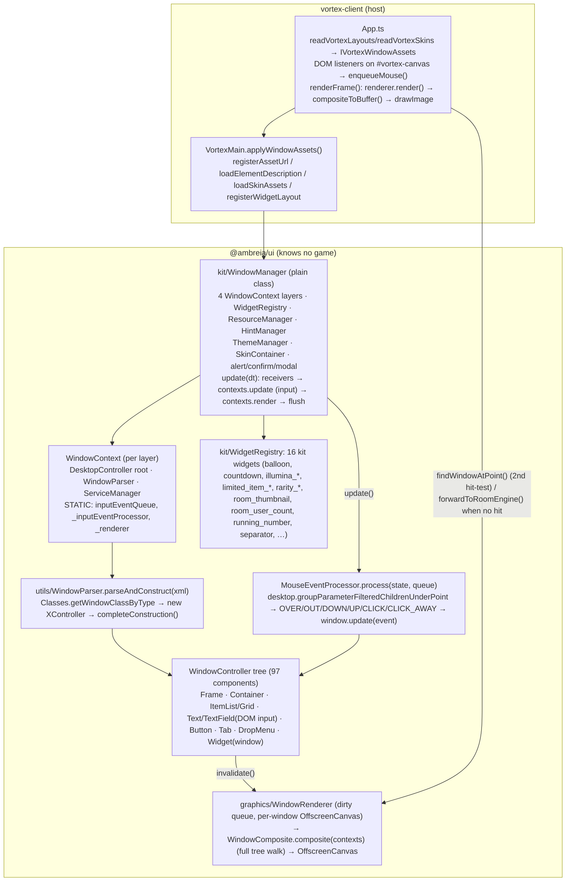
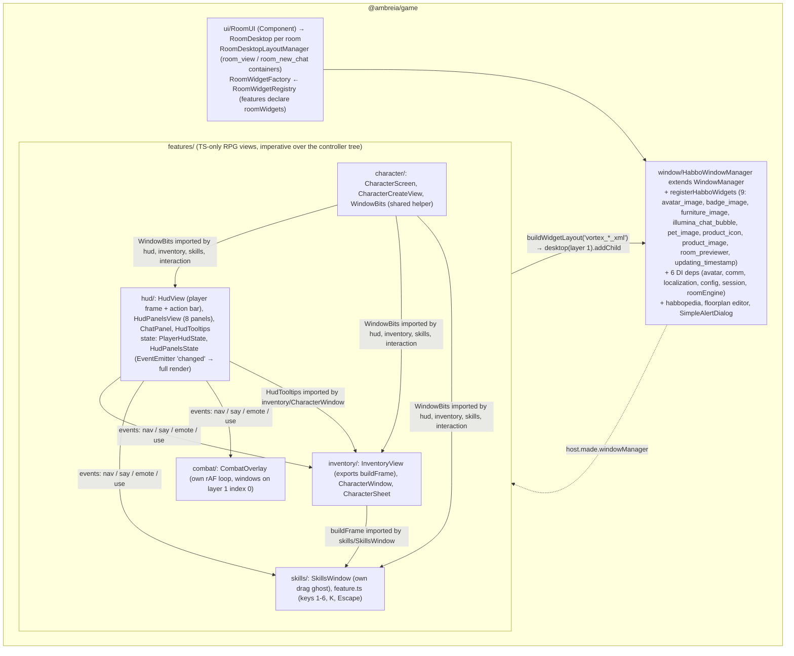

# Audit — UI engine (`@ambreia/ui`), game window/HUD, Glaze

Repo `/home/user/ambreia-client` @ `aeb88ba` (branch `claude/determined-ritchie-omy2dy` == `origin/rpg-character`). Read-only. Line numbers are of that commit. Older audits (`docs/audits/*`, July 2026) were re-verified where reused; e.g. the `DesktopController.mouseX` bug they describe is fixed (`packages/ambreia-ui/src/components/DesktopController.ts:37-45` now reads `WindowContext.inputEventQueue?.mouseX`).

---

## (A) Facts & Mermaid

### Sizes (files / lines, `wc -l`)

| Area | Files | Lines | Notes |
|---|---|---|---|
| `ambreia-ui/src` (engine core: `WindowController` 4628, `WindowContext` 662, `WindowModel` 454) | 19 top-level | 6 886 | |
| `ambreia-ui/src/components` | 97 | 18 336 | `TextController` 2539, `ItemListController` 1279, `TextFieldController` 1216, `ItemGridController` 1028 |
| `ambreia-ui/src/graphics(+renderer)` | 29 | 8 598 | Canvas2D compositor; `WindowRenderer` 898, `WindowComposite` 798, `TextSkinRenderer` 1168 |
| `ambreia-ui/src/kit` | 87 | 13 089 | `WindowManager` 1499, `TableView` 984, 16 kit widgets, dialogs, `ThemeManager`, `HintManager` |
| `ambreia-ui/src/{events,services,motion,dynamicstyle,theme,debugger,reactive,assets,utils}` | ~90 | ~7 000 | |
| `ambreia-ui/test` | 4 | 167 | 9 tests (manager layers/receivers/layout, registry, item-grid) |
| `ambreia-game/src/window` | 30 | 9 015 | `HabboWindowManager` 438, 9 game widgets (~4 900), `utils/` 3.3k (floorplan editor 2 189, habbopedia, `SimpleAlertDialog`) |
| `ambreia-game/src/ui` | 41 | 6 424 | `RoomDesktop` 1838, `RoomUI` 986, `RoomWidgetRegistry` 54 |
| `features/hud` | 10 | 2 718 | `ChatPanel` 683, `HudPanelsView` 528, `HudView` 412 |
| `features/character` | 8 | 1 274 | `CharacterCreateView` 554, `CharacterScreen` 342, `WindowBits` 83 |
| `features/inventory` | 7 | 1 113 | `InventoryView` 380, `CharacterWindow` 225 |
| `features/skills` | 4 | 1 600 | `SkillsWindow` 857, `feature.ts` 378 |
| `vortex-client/src/vortex-layouts` | 269 XML | — | 188 of 269 are referenced by no `.ts` and no skill script (see §B UI-21) |
| `vortex-client/src/debugger/WindowDebuggerOverlay.ts` | 1 | 2 741 | dev-only (`App.ts:1015`: `import.meta.env.DEV || VITE_WINDOW_DEBUGGER==='1'`) |
| `vortex-glaze` | 35 ts + 25 xml | 10 285 | `EditorCanvasLayer` 944, `WindowProperty` 753, `WindowHierarchy` 699 |

Traceability markers (`grep`): `ambreia-ui/src` 3 622 `// AS3:` / 219 `TS-only` / 15 `DEVIATION`; `game/window` 681/31/13; `game/ui` 628/15/26; the four RPG features and Glaze: 0/0/0 (new code, correctly unmarked per `.claude/rules/30-as3-traceability.md`).

### Engine: WindowManager → layouts → controller tree → Canvas2D composite → host canvas

### Game over the engine

Separation as found: **generic engine** = `ambreia-ui/src` minus `kit/` (controllers, renderer, input, services); **generic kit** = `kit/` (manager, dialogs, 16 widgets — several are Habbo-only, §2); **game widgets** = `game/window/widgets` (9); **feature views** = `game/features/*/{HudView,…}` (zero `// AS3:`); **host display** = `App.ts` (canvas, DOM input, render loop, room-engine forwarding) + `VortexMain.applyWindowAssets`.

### Key facts verified

- Layout registration path: `App.readLibraryLayouts(xmlBundle)` + `App.readVortexLayouts()` (`App.ts:1116-1134`, by **file basename**, `import.meta.glob('./vortex-layouts/*.xml')`) → `IVortexWindowAssets.layouts` → `VortexMain.applyWindowAssets()` (`VortexMain.ts:803-835`) → `windowManager.registerWidgetLayout(name, xml)` — before the manager is attached (comment at `:808-810`). Skins: `readVortexSkins()` merges per file with try/catch (`App.ts:1067-1114`).
- `buildFromXML()` returns the window **unattached** (`WindowManager.ts:424-430`, AS3 parity). Every feature does `desktop.addChild(window)` itself.
- `WindowManager.update()` (`WindowManager.ts:917-971`): receivers (index loop, try/catch) → emits INPUT if queue non-empty → 4 contexts `update()` top→bottom (each runs `MouseEventProcessor.process` on the **same static queue**; consumed entries are `remove()`d, `MouseEventProcessor.ts:324-327`) → RENDER event → 4× `context.render()` → `renderer.render()` (no-op when queue empty, `WindowRenderer.ts:267-305`) → `queue.flush()` → `ModalDialog.onUpdate()` → `MouseCursorControl.change()`.
- Statics shared across all managers: `WindowContext.inputEventQueue`, `_inputEventProcessor`, `_renderer` (`WindowContext.ts:58-64`), `ModalDialog._windowManager/_container/_initialized` (`ModalDialog.ts:31-39`, never reset), `WindowParser.localizationResolver` (`WindowParser.ts:43`), `TextController._measureCanvas` (`TextController.ts:72`).
- Pointer: `App._onMouseMove` (`App.ts:1658-1699`) enqueues, then **also** calls `findWindowAtPoint(x,y)` to decide `forwardToRoomEngine()` and the CSS cursor → two hit-tests per DOM move (processor's per frame + App's per event). Wheel is dispatched **directly** by App (`App.ts:1841-1852`, `target.update(target, event)` bubbling), not through the queue. Drag/scale operators are driven from `document` move/up listeners installed on mousedown (`App.ts:1620-1631`).
- Glaze `CanvasSurface` (`CanvasSurface.ts:245-300`) does **not** enqueue: it hit-tests and calls `hit.update(hit, downEvent)` directly, with its own doc move/up handlers — a second, hand-rolled input path over the same engine (grep `inputEventQueue` in glaze: 0 hits).
- Text input: each `TextFieldController` creates its own DOM `<input>/<textarea>` at construction (`TextFieldController.ts:66, 805-877`, appended to `document.body`, `z-index 9999`, `display:none` until focus) and positions it against `document.querySelector('canvas')` (`:897`) with a per-frame rAF while focused (`:461-496`), which also walks the parent chain to the desktop to auto-unfocus a detached/hidden field (`:502-525`).
- Keyboard: the engine dispatches `WKE_KEY_DOWN` **only** from a focused text field (`TextFieldController.ts:1083,1124`); there is no engine-level keyboard routing. Game hotkeys are raw `globalThis.addEventListener('keydown')` in three features (`skills/feature.ts:321`, `interaction/feature.ts:86`, `inventory/feature.ts:123-134`), never removed.
- WidgetRegistry: unknown type → `log.warn` once, builds nothing (`WidgetRegistry.ts:41-57`); `register()` silently overwrites a duplicate (`:35-38`). RoomWidgetRegistry by contrast throws on duplicates naming both features (`RoomWidgetRegistry.ts:28-33`) — tested (`feature-extensions.test.ts`).
- Sandbox (`ambreia-ui/sandbox/main.ts`): imports `vortex-client` **data only** (`vortex_character_xml.xml?raw`, `vortex-skins/*.xml` via glob, the two `.ambreia` bundles) — no code; it never enqueues mouse events, so it proves rendering, not input.
- Glaze deps: `package.json` deps = `@ambreia/common`, `@ambreia/ui`, `eventemitter3`, `pixi.js`; devDeps `@ambreia/game`, `@ambreia/kernel` used only by `test/widget-types.test.ts:4-5` (`new HabboWindowManager({} as IContext, …).widgets.types()` to keep `GLAZE_GAME_WIDGET_TYPES` in step). ESLint wall `eslint.config.mjs:315-325` restricts `vortex-glaze/src` to `common|ui`.
- `pnpm lint` on `.claude/skills/design-habbo-window/previews`: 421 problems, 414 `no-undef`. The `fill_*.js` files are page-side snippets run through `Runtime.evaluate` after `compose.mjs` injects helpers (`compose.mjs:70-91`: `find`, `place`, `text`, `bar`, `add`…) — they are not modules and are not meant to be linted as such (`eslint.config.mjs:19-33` ignores do not cover them).

---

## (B) Findings

### UI-01 | HIGH | CONFIRMED | Input model — hotkeys
**Evidence.** `skills/feature.ts:321-336` (`globalThis.addEventListener?.('keydown', …)`: digits 1-6, `k`, `Escape`), `interaction/feature.ts:86-91` (`Escape` → `session.select(0)`), `inventory/feature.ts:123-134` (`i`, `c`), `WindowDebuggerOverlay.ts:146-154` (Ctrl+Shift+D), `:404-406` (Escape in pick mode), `BugReporter.ts:263-265` (F8). None calls `stopPropagation`/`preventDefault` or checks a "handled" flag; none is ever removed (features return `null` from `create`, no dispose path; `App.dispose()` only uninstalls the debugger `App.ts:1142`).
**Files/Symbols.** the three `feature.ts`, `IGameFeature`, `WindowKeyboardEvent`.
**Observed.** `Escape` fires three handlers at once (cancel ground pick + cancel own cast, deselect target, stop debugger pick). Each feature re-implements the "not while typing" guard with `target.tagName === 'INPUT'|'TEXTAREA'`. A feature that binds `k` or `c` tomorrow collides silently. HMR disposal of `Vortex` leaves the listeners alive on the old closures.
**Why it matters.** The spec's success criterion (§4: a feature = a folder + a line) breaks at the keyboard: binding is undiscoverable, un-rebindable, un-testable, and Escape semantics are first-come.
**Failure scenario.** Player is choosing a ground tile for a skill while targeting a mob; Escape cancels both the pick and the target; a modal confirm (kit) is open at the same time and does not even see Escape (kit has no Escape handling, grep `Escape` in `ambreia-ui/src` → only `TableCellView.ts:269`).
**Recommended architecture.** One `InputBindings` service owned by the host (or a `features/input` feature exposed on `host.made.input`): `bind(id, defaultChord, handler, {scope:'world'|'screen'|'global', whenTyping:false})`, duplicate chord → throws naming both features (same contract as `RoomWidgetRegistry`); Escape routed as a stack (topmost modal/popup/pick first). Features declare `keys: {...}` in `IGameFeature` the way they declare `roomWidgets`.
**Minimal fix.** Shared `onHotkey(host, key, handler)` helper with a `Map<string, feature>` that throws on duplicates and a single `typing()` guard; return an unbind kept in a per-feature disposer.
**Long-term.** Rebinding UI + persisted bindings; the window system receives `WKE_*` through the manager for focused windows (Escape closes topmost frame/popup).
**Verify.** Grep for `addEventListener?.('keydown'` → expect 0 in features; test: two features binding the same key fail at boot.
**Regression risk.** Low–medium (Escape ordering changes behaviour). **Effort.** M.
**False-positive review.** Checked that no central dispatcher exists elsewhere (`grep keydown` across game/engine/client): confirmed none; the `typing()` guards work only because the fields are DOM inputs (`skills/feature.ts:33-37`).

### UI-02 | HIGH | CONFIRMED | Lifecycle — hide vs detach vs dispose is per-feature convention
**Evidence.** `WindowController.set visible` only flags + invalidates (`WindowController.ts:479-495`); `set parent(null)`/`removeChild` detaches without disposing (`:141-180`, `:3398-3427`); `destroy()` → `WE_DESTROY`(cancelable) → `dispose()` (`:2947-2972`). The renderer frees a buffer only on `WindowDisposeEvent` (`WindowRenderer.ts:788-794`); `purge()` would free detached/invisible ones (`:515-572`) but `WindowManager.purge()` has **no caller** (grep `.purge(` → only kernel/avatar/room). `CloseButtonController` is an empty `InteractiveController` (`CloseButtonController.ts:13-33`); no `WE_CLOSE` is raised for frames (only `DropBaseController.ts:272`). Features therefore each decide: `InventoryView.ts:363` (`header_button_close` → `hide()` = `visible=false`), `HudPanelsView.ts:465-477` (`close_button` → state update / `_questsClosed`), `ChatPanel.ts:457,536` (`close_button` → `destroy()` popups), `HudTooltips.out()` → `destroy()`.
**Observed.** Hidden frames keep their `WindowRendererItem` (OffscreenCanvas) and DOM inputs forever; detached-not-disposed windows (the "misnamed hideMainWindow" pattern CLAUDE.md warns about) are tracked by nobody — `TextFieldController.isEffectivelyVisible()` had to grow a desktop-reachability walk (`TextFieldController.ts:502-525`) precisely because of it. Features' `hide()` keep `visible=false` windows attached on layer 1, so `findWindowAtPoint` skips them (fine) but `purge` never runs.
**Why it matters.** No single owner of "closed"; the three semantics leak into feature code and into dev tooling (debugger `buildAncestorChainText`, `WindowDebuggerOverlay.ts:1334`, exists to tell orphans apart).
**Failure scenario.** A feature shows a 60-row list, hides it, shows another; 60 buffers + 60 text measurements stay resident; on HMR or logout nothing disposes feature views (none is disposed from `create()`'s closure).
**Recommended.** Define the state machine in `IWindow`: `close()` = emit `WE_CLOSE` (cancelable) → default `destroy()`; frames' `close_button` calls it (one place: `FrameController`). A `WindowManager.purge()` call on a timer or on `RSE_ENDED`. Each feature view registered on a `host.disposables` so `Vortex.dispose()` tears them down.
**Minimal fix.** Wire `FrameController` to dispatch `WE_CLOSE` on its close button; call `windowManager.purge()` from `RoomUI` on session end.
**Long-term.** Lifecycle table (§E) as documented contract + a debugger problem rule "attached-invisible > N minutes".
**Verify.** Debugger "open list" after opening/closing inventory 5×: buffer count (`WindowRenderer._rendererItems.size`) should drop.
**Regression risk.** Medium (AS3 code relying on `visible=false` survival). **Effort.** M.
**False-positive review.** Re-read `WindowRenderer.purge` caller list and `WindowManager.dispose` (frees everything at shutdown, so this is a session-lifetime growth, not a permanent leak).

### UI-03 | HIGH | CONFIRMED | Encapsulation — process-wide singletons in the engine
**Evidence.** `WindowContext.ts:58-64,131-176` (`static inputEventQueue/_inputEventProcessor/_renderer`), `WindowManager.ts:1262,1461` (`WindowContext.setRenderer`), `ModalDialog.ts:31-39,134-146` (`_initialized` never reset; no reset in `WindowManager.dispose` `:1429-1486`), `WindowParser.ts:43` (`static localizationResolver`), `TextController.ts:72`.
**Observed.** Two `WindowManager`s in one page share one queue, one renderer and one modal container. Node tests build fresh managers per test (`node-window-host.ts`) and pass only because each test disposes; a second `initialize()` after an HMR dispose re-creates the renderer but `ModalDialog._container` still points at a disposed manager's window.
**Why.** Spec §3 rule 1 wants plain classes with injected deps; statics make the sandbox/Glaze/test isolation accidental.
**Failure.** Glaze "live preview inside the client" or a debugger preview manager → modals and input go to the wrong manager.
**Recommended.** Move queue/processor/renderer into `WindowManager` and pass to contexts (constructor already takes `factory`); make `ModalDialog` an instance service on the manager (`getModalService()`); `localizationResolver` becomes an option.
**Minimal fix.** Reset `ModalDialog` statics in `WindowManager.dispose()`; assert in `initContexts` that `WindowContext._renderer` is null or ours.
**Verify.** Test: two managers, enqueue on A, B's desktop never sees OVER.
**Risk.** Medium (AS3 parity of static `inputEventQueue`). **Effort.** M.
**False-positive review.** Only one manager exists at runtime today in client and Glaze; the harm is architectural (testability, future embedding), not a live bug.

### UI-04 | MEDIUM | CONFIRMED | Game knowledge inside `@ambreia/ui/kit`
**Evidence.** `kit/WidgetRegistry.ts:72-89` registers `limited_item_overlay_grid/preview/supply`, `rarity_item_overlay_grid/preview`, `room_thumbnail`, `room_user_count`, `illumina_*`, `pixel_limit`; `kit/enum/HabboWindowType.ts`, `HabboWindowParam.ts`, `HabboIconType.ts`, `HabboAlertDialogFlag.ts`, `BadgeImageType.ts`, `kit/utils/ProductCategoryMapping.ts`, `kit/widgets/IAvatarImageWidget.ts`, `IBadgeImageWidget.ts`, `IPetImageWidget.ts`, `IFurnitureImageWidget.ts`, `IProductDisplayInfo.ts`. 102 of 355 ui files mention "habbo" (mostly AS3 traces), 13 "catalog", 17 "room".
**Observed.** The 16 "kit" widgets split into generic (balloon, countdown, hover_bitmap, progress_indicator, running_number, separator, illumina_border/input ≈ a skin family) and **Habbo catalog/navigator widgets** (limited_item_*, rarity_item_*, room_thumbnail, room_user_count, pixel_limit) that read `IProductDisplayInfo`/room data the RPG cut removed. The game widget *interfaces* (`IAvatarImageWidget`…) live in ui so features can type `widget as IAvatarImageWidget` (`WindowBits.ts:5`, `HudView.ts:8`).
**Why.** Spec §3: "moteurs : aucune connaissance du jeu". Violated in name space and in widget set; harmless at runtime (they build only if a layout names them).
**Recommended.** `kit/widgets/habbo/` → move to `game/window/widgets` (registered by `registerHabboWidgets`); keep interfaces in ui only if abstracted (`IFigureImageWidget`); rename `Habbo*` enums to `WindowStyle/WindowType` extensions (note `kit/enum/WindowStyle.ts` already diverges from `enum/WindowStyle.ts`: BLACK/SHINY only in kit — UI-15).
**Minimal.** Move the 5 catalog/navigator widgets + `ProductCategoryMapping` to game; registry test keeps counts.
**Verify.** `grep -ril "product\|rarity\|limited_item\|room_user" packages/ambreia-ui/src` → 0.
**Risk.** Low. **Effort.** S.

### UI-05 | MEDIUM | CONFIRMED | Features import each other's classes (spec §3 rule 3)
**Evidence.** `inventory/CharacterWindow.ts:13` ← `../hud/HudTooltips`; `skills/SkillsWindow.ts:13` ← `../inventory/InventoryView` (`buildFrame`); `skills/feature.ts:4,10-12` ← `../hud/{HudPanelsState,chatModel,PlayerHudState,hudRules}`; `skills/RpgSkillSession.ts:14` ← `../combat/vfxSheets`; `WindowBits` (`character/`) imported by hud, inventory, skills, interaction (8 sites). No ESLint rule guards feature↔feature (`eslint.config.mjs:283-312` only walls host packages and `core/`).
**Observed.** `WindowBits`, `HudTooltips`, `buildFrame`, `hudRules.placeTip` are de-facto a "game UI kit" living inside arbitrary features. Removing `character/` (spec: delete folder + line) breaks four features.
**Recommended.** `game/src/ui/kit/` (or `features/ui-kit/` with no `feature.ts`) holding `WindowBits`, `HudTooltips`, `buildFrame`, `placeTip`; ESLint `no-restricted-imports` pattern `^\.\./(?!ui-kit/)[a-z-]+/` for `features/**`; cross-feature data (ISlotTip, IHudCast) via `host.made` interfaces only.
**Verify.** Lint rule red on today's tree → fix → green.
**Risk.** Low. **Effort.** S–M.

### UI-06 | MEDIUM | CONFIRMED | HUD extension model: every panel edits `hud/*`
**Evidence.** `HudPanelsState.ts:60-101` (`IHudPanels`: gold, gems, tokens, questAlert, zoneName, zonePlayers, quests, party, buffs/buffTimes/buffExpiring/buffTips, partySelected, navOpen, target, boss, alert, chat, chatTabs, chatTab, sayChannel, chatSettings); `HudPanelsView.ts:27-38` (`LAYOUTS` map of 8 panels), `:177-220` (`place()` hard-codes each panel's anchor), `:222-247` (`render()` switch per panel), `:414-459` (`describe()` tooltips per panel), `:459-510` (`_onEvent` click routing per panel). `features/index.ts` `IEngineManagers.hud/hudPlayer` expose the whole state.
**Observed.** Adding quests/party/minimap/world-events requires editing `IHudPanels`, `LAYOUTS`, `Panel`, `place()`, `render()`, `describe()`, `_onEvent`, and the `images` list in `hud/feature.ts`. Other features already write into it (`skills/feature.ts:235-246` `hud.update({buffs…})`, `inventory/feature.ts:62` `navOpen`, `interaction` → `target`). `update()` rebuilds the whole object and `render()` re-runs every panel + `place()` + `HudView.place()` on **any** field change (chat line, cast tick at 100 ms `skills/feature.ts:18,129`, status tick 1 s `:248`).
**Not yet** a 10k-line class (528 lines) but the growth vector is unambiguous: one state object, one view, one event handler.
**Recommended architecture (minimal HUD extension model).** `IHudPanel { id; layout; anchor: 'top-left'|'top-right'|'bottom-left'|…; order; render(state); describe?(window); onEvent?(event, window) }` registered through `IGameFeature.hudPanels` (same shape as `roomWidgets`, duplicate id → throw naming both). `HudPanelsView` becomes a dock/layouter: one stack per anchor, `place()` generic. Each panel owns its state (`host.made.quests`…), the HUD owns only layout + tooltip/menu plumbing. `HudPanelsState` keeps only cross-cutting fields (navOpen, questAlert, chat).
**Minimal fix.** Split `render()` into per-panel renderers keyed by changed fields (`update()` already knows the keys); move quests/party out first.
**Verify.** Add a dummy "minimap" panel from a new feature folder without touching `hud/*`.
**Risk.** Medium. **Effort.** M.

### UI-07 | MEDIUM | CONFIRMED | Design-system reuse: RPG screens reinvent kit behaviour
**Evidence.** Tooltips: `HudTooltips.ts` (own `setTimeout` 500 ms, own `placeTip`, builds `vortex_hud_tip_xml`) vs kit `WindowToolTipAgent` (`services/WindowToolTipAgent.ts:37-67`, driven by `InteractiveController.toolTipCaption/Delay`); features use `toolTipCaption` 0× (grep). Menus: `ChatPanel.toggleMenu` (`ChatPanel.ts:344-390`) builds rows from `vortex_hud_chat_menu_row_xml` and hand-places (`placeAbove :598-608`) vs kit `DropMenuController` (311 lines) — menus do not close on `WME_CLICK_AWAY` (grep `CLICK_AWAY` in features → 0). Drag: `SkillsWindow.ts:656-712` (own `pointermove` on `globalThis`, ghost window, `slotAt` via `hitTestGlobalPoint`) vs kit `WindowMouseDragger`/`WindowParam.DRAGGABLE_WITH_MOUSE` (`kit/enum/WindowParam.ts:40`). Progress bars: `setBar()` duplicated in `HudView.ts:383-397` and `HudPanelsView.ts:398-412` (`bg/fill/value` idiom) vs kit `ProgressIndicatorWidget`. Frames: `buildFrame` (`InventoryView.ts:31-50`) vs `CharacterScreen.build/place` (`:72-107`) vs `HudView.build` (`:125-186`) — same "build, addChild, centre" three times. Close: §UI-02.
**Duplication count.** `setText` ×3 (HudView, LoginScreen, WindowBits), `setBar` ×2, `setIcon` ×2, `place` ×4, `build` ×8, `show/hide/toggle` ×8/8/3, `render` ×8, `dispose` ×19 (all hand-written, same shape).
**Why.** Each new screen pays the same tax and diverges (tooltip delay constant duplicated `HudTooltips.ts:9`; menus without click-away).
**Recommended.** A small `RpgView` base (build layout → attach → place → `show/hide/toggle` → `dispose`) + `RpgTooltip` built on `WindowToolTipAgent` extended to accept a layout factory (`IToolTipAgentService.show(window, layoutName, fill)`) + `RpgMenu` on `DropMenuController` or at least a shared popup with click-away. Keep `WindowBits` as the one place for `setText/setBar/setIcon/avatar`.
**Minimal.** Move `setBar/setIcon` into `WindowBits`; `HudTooltips` → `game/ui/kit`; add click-away to `ChatPanel` popups via the frame's `WME_CLICK_AWAY`.
**Verify.** grep private `setBar(` → 0 outside WindowBits.
**Risk.** Low. **Effort.** S–M.

### UI-08 | MEDIUM | HIGH | PERFORMANCE RISK — UNVERIFIED: per-frame movers on a full-tree Canvas2D composite
**Evidence.** `App.renderFrame` composites when `renderer.hasPendingUpdates() || renderVersion changed` (`App.ts:1392-1446`); `WindowComposite.composite()` walks every visible window of every layer each time (`WindowComposite.ts:140-162,348-651`; `docs/WINDOW_OPTIMIZATIONS.md` §1 "Cache des branches stables" still open). Movers: `CombatOverlay._tick` repositions bars/casts/numbers every rAF (`CombatOverlay.ts:255-300`), `TextFieldController` rAF while focused, `HudView` 250 ms ticker (`HudView.ts:19`), skills 100 ms cast ticker and 1 s status ticker re-rendering the **whole** HUD (UI-06) and rebuilding the buff grid (`HudPanelsView.rebuild` compares array identity `:345-357`; `skills/feature.ts:238-243` allocates new arrays each tick → `destroyGridItems()` + `buildWidgetLayout('vortex_hud_buff_xml')` per buff per second).
**Observed.** In combat the UI composite runs every frame (any `x/y` change invalidates → non-empty render queue → full composite + `drawImage` to the DOM canvas). Each `buildWidgetLayout` parses XML (`WindowParser.parseAndConstruct` → `DOMParser`, `WindowParser.ts:700-720`) — no parsed-layout cache per name (grep `_widgetLayouts` → `Map<string,string>` of XML text).
**Why.** The one measured number (`:showstats` `ui` channel) is per-frame share; nothing measured for N=8 panels + 20 combat windows. Allocation per tick also contradicts CLAUDE.md "render loops allocate nothing per frame" (HUD code allocates arrays/objects per `changed`).
**Recommended.** (1) Cache parsed `Document` per layout name in `WindowManager` (parse once, `cloneNode` or construct from cached Element). (2) Composite cache for stable branches (doc §1). (3) Combat overlay on the PixiJS layer (it already anchors to room objects) or a dedicated cheap layer. (4) HUD: render per changed key; `buffTimes` update captions in place instead of rebuilding.
**Minimal.** Parsed-layout cache + buff-grid in-place update.
**Verify.** `:showstats` with `__ambreia.hud.demo()` + 10 combat bars moving; count `buildWidgetLayout` calls/s via a counter.
**Risk.** Low. **Effort.** S (cache) / L (composite cache).
**False-positive review.** Hit-testing cost is **not** a risk: `WindowRenderer.render()` is a no-op on an empty queue and `groupParameterFilteredChildrenUnderPoint` is O(windows) per event; two hit-tests per mousemove (App + processor) is cheap at today's window counts.

### UI-09 | MEDIUM | CONFIRMED | Layout diagnostics are silent or soft
**Evidence.** `WindowParser.ts:401` throws on unknown `params` names; unknown **window tags** fall back to `null` type (WidgetCatalog comment `WidgetCatalog.ts:26`); unknown `<var>` keys are applied as properties with no check (no `warn` in `WindowParser.ts`: grep `log.` → 0 hits); duplicate `name`s are legal and resolved first-match by `findChildByName`; missing layout → `log.warn('Widget layout not found')` and `null` (`WindowManager.ts:585-606`) → each feature logs its own `warn/error` and shows nothing (`HudView.ts:136`, `CharacterScreen.ts:81` `error`). Missing widget type → `warn` once (`WidgetRegistry.ts:48-56`). Missing `asset_uri` → nothing drawn (skill `SKILL.md`: "this system does not throw on a layout mistake, it draws nothing"). The dev debugger compensates with heuristics (`collectProblems`, `WindowDebuggerOverlay.ts:1913-2020`: empty containers, overflow, raw `${key}` captions).
**Observed.** A typo in `widget_type` or `asset_uri` in `vortex_hud_player_xml` yields a blank slot with one warn in the console; 188/269 vortex layouts are unreferenced by code so nothing validates them (UI-21).
**Recommended.** Dev-mode validation pass on `registerWidgetLayout`: parse once, check tag names ∈ `TYPE_NAME_TO_CODE`, `widget_type` ∈ registry (deferred until game widgets registered), `asset_uri` ∈ resource names, duplicate names within a layout → `warn` with layout name + path; a node test iterating `vortex-layouts/*.xml` through `nodeWindowManager` (the harness exists) asserting no warnings.
**Minimal.** The node test (S) — it would also catch the 188 orphan layouts' rot.
**Verify.** Introduce a typo → test red.
**Risk.** None. **Effort.** S–M.

### UI-10 | MEDIUM | CONFIRMED | Focus model is split between DOM and engine; no modal focus, no tab order
**Evidence.** `FocusManager.ts` tracks one `_focusedWindow` and a stack but is set "programmatically" only (`:11-15`); `TextFieldController.focus()` moves DOM focus (`:432-443`) and `isEffectivelyVisible` polls per frame (`:461-496`); `App._onMouseDown` comments on the canvas-blur race (`App.ts:1548-1560`). `ModalDialog` darkens and blocks pointer by layer 3 but does not move keyboard focus (no `focus()` call in `ModalDialog.ts`); kit `AlertDialog/ConfirmDialog` have no Enter/Escape handling (grep → `TableCellView` only). Chat input focus via `WE_FOCUSED/WME_CLICK` (`ChatPanel.ts:231-240`); no "Enter focuses chat" global.
**Observed.** Focus restoration after a modal closes is absent; Tab cycles browser focus into hidden inputs (`display:none` ones are skipped, but N visible-field inputs all have `tabindex` default → browser tab order = DOM creation order, not visual).
**Recommended.** Engine-level keyboard routing: `WindowManager.dispatchKey(event)` → focused window chain (`FocusManager.getFocus()`), modal layer first; Escape/Enter defaults in `FrameController`/dialogs; set `tabindex=-1` on bridge inputs and implement Tab inside the engine.
**Minimal.** `tabindex=-1` on bridge inputs; Escape/Enter in `AlertDialog/ConfirmDialog`.
**Verify.** Open confirm, press Enter → OK; Tab never leaves the canvas.
**Risk.** Low. **Effort.** M.

### UI-11 | MEDIUM | CONFIRMED | Glaze duplicates the host's input path and has a stale "game widget" copy
**Evidence.** `CanvasSurface.ts:245-300` hand-dispatches `WindowMouseEvent.DOWN` and drives dragger/scaler from document listeners — the same code `App.ts:1600-1650` has, written twice; App additionally enqueues to `MouseEventQueue` (`App.ts:1512-1533`) so OVER/OUT/CLICK_AWAY come from `MouseEventProcessor`; Glaze never enqueues → tooltips, OVER/OUT and CLICK_AWAY behave differently in the editor than in the client. `GLAZE_GAME_WIDGET_TYPES` (`GameWidgetPlaceholder.ts:12-15`) is a hand copy kept honest only by `test/widget-types.test.ts` importing `@ambreia/game` + `@ambreia/kernel` as devDeps.
**Observed.** Not a fork of renderer/parser: `LayoutSerializer.ts:1-31` reuses `WindowParser.windowToXMLString`, `WidgetCatalog.ts:1` reuses `TYPE_NAME_TO_CODE`, rendering is `compositeToBuffer`. The duplication is input + the widget list + the dev-server layout overlay (`vite.config.ts:20-120`, `GlazeBoot.overlaySourceLayouts :369-430`).
**Recommended.** Extract `HostInput` (canvas listeners → `enqueueMouse` + dragger/scaler doc handlers + wheel) into `@ambreia/ui/kit/host/CanvasInput.ts`; both App and Glaze use it. Replace the widget copy by a `WindowManager.widgets.placeholderFor(types)` fed from a JSON the game package *exports* (`game/window/widget-types.json`) so glaze keeps zero code deps.
**Minimal.** Move `GLAZE_GAME_WIDGET_TYPES` to a JSON in `ambreia-game` read by both (keeps the test, drops `kernel` devDep).
**Verify.** Glaze tooltips/OVER identical to client; `pnpm --filter vortex-glaze` devDeps without `@ambreia/kernel`.
**Risk.** Low. **Effort.** M.

### UI-12 | MEDIUM | CONFIRMED | Localisation: fallback is the raw key; keys live outside the feature
**Evidence.** `WindowBits.text()` → `getLocalizationWithParams(key, key, …) ?? key` (`WindowBits.ts:12-15`); `textOr/contentName` return a capitalised id (`:18-30`); layout `${key}` tokens resolved by `WindowParser.localizationResolver` with no miss log; texts loaded from `vortex-client/src/locales/<lang>/<feature>.json` (`App.ts:57,677`) — not `features/<x>/locale/` as spec §4 draws; content texts fetched at runtime (`inventory/feature.ts:37-56`). Hard literals: `'MAX'` (`CharacterHudBridge.ts:8`), `'Niv. 35 · Boss'` and all demo strings in `hud/feature.ts:133-157` (demo only), `vortex.mapeditor.spawns.search` reused as inventory search placeholder (`InventoryView.ts:304`). The debugger flags raw keys heuristically (`LOCALIZATION_KEY`, `WindowDebuggerOverlay.ts:1893`).
**Observed.** A missing key renders `vortex.hud.menu.help` on screen; no dev warning; keys are owned by the client package, so deleting a feature folder leaves its texts.
**Recommended.** Co-locate `features/<x>/locale/{fr,en}.json`, load through `IGameFeature.texts` (glob in `features/index.ts`); `getLocalization` miss → `log.once(key).warn` in dev; a node test that every `vortex.*` key used in `features/**` and in `vortex-layouts/*.xml` exists in `fr` and `en`.
**Minimal.** The key-coverage test + dev warn.
**Verify.** Remove a key → test red; console shows one warn.
**Risk.** None. **Effort.** S.

### UI-13 | LOW | CONFIRMED | DOM text-input bridge: one element per field, positioned against the first `<canvas>`
**Evidence.** `TextFieldController.ts:66` creates the element at construction for every field (6 RPG layouts with fields; `vortex_hud_chat_xml` 1); `:897` `document.querySelector('canvas')` — in the client there are two stacked canvases (`App.ts:1452-1463` comment) and the first in DOM order is PixiJS's; both are `innerWidth×innerHeight` at the same origin so the rect coincides today. Position sync reads `getBoundingClientRect()` per frame while focused (`:897-898`).
**Why.** Fragile coupling to page structure; a CSS offset, a DPR-scaled canvas or a different host (imager/sandbox with a non-fullscreen canvas) misplaces carets.
**Recommended.** Inject the host canvas (or a `getCanvasRect()` provider) via `IWindowManagerOptions` next to `resizeHost`; create the DOM element lazily on first focus; cache the rect, refresh on resize/scroll.
**Effort.** S. **Risk.** Low.

### UI-14 | LOW | CONFIRMED | `WidgetRegistry.register` overwrites silently
**Evidence.** `WidgetRegistry.ts:35-38` (`this._builders.set(type, create)`), test `widget-registry.test.ts` has no duplicate case, whereas `RoomWidgetRegistry.register` throws naming both features (`RoomWidgetRegistry.ts:28-33`).
**Fix.** Throw (or `warn`) on re-registration unless `{replace:true}` (Glaze placeholders need replace). **Effort.** S.

### UI-15 | LOW | CONFIRMED | Duplicated enums in ui (`enum/` vs `kit/enum/`)
**Evidence.** `WindowParam`, `WindowState`, `WindowStyle`, `WindowContextLayer` exist in both; `WindowStyle` differs (kit adds `NULL`, `BLACK`, `SHINY`; `diff` shown in audit log), `WindowParam` 137 vs 133 lines. 11 files import `enum/WindowParam`, 1 imports `kit/enum/WindowParam`.
**Fix.** One `enum/WindowParam` etc.; kit re-exports with the Habbo extensions. **Effort.** S.

### UI-16 | LOW | CONFIRMED | Dev/preview scripts fail `pnpm lint` (414 `no-undef`)
**Evidence.** `node eslint .claude/skills/design-habbo-window/previews` → 421 errors (414 `no-undef`, 5 `no-useless-escape`, 2 `no-unused-vars`); `fill_*.js` are evaluated page-side after helper injection (`compose.mjs:70-91`), `eslint.config.mjs:19-33` ignores `.vortex-dev`, `sources`, `dist` but not `.claude/skills/**/previews`.
**Fix.** Either add `'.claude/skills/**/previews/**/*.js'` to `ignores`, or a config block declaring `globals: {root, find, place, text, show, tint, bar, icon, add, build}` for that path (keeps the 7 real errors). **Effort.** S.

### UI-17 | LOW | CONFIRMED | Game feature views are untested; `host.made` is a mutable bag
**Evidence.** `packages/ambreia-game/test/*` tests `hud-rules`, `hud-state` (pure), `feature-extensions`; grep `HudView|HudPanelsView|SkillsWindow|InventoryView|CharacterScreen|ChatPanel` in `packages/*/test` → 0. Views depend on `IHabboWindowManager` (needs the whole game manager) although they only call `buildWidgetLayout/getDesktop/alert` — `nodeWindowManager()` (`node-window-host.ts`) could drive them if typed against `IWindowManager`. `IEngineManagers` (`features/index.ts:55-90`) is 21 nullable fields any feature writes (`host.made.hud = panels`, `host.made.skills = session`…).
**Recommended.** Type views on `IWindowManager` (ui) + a `texts` function; write node tests building the real `vortex_hud_*` layouts (the harness exists) asserting slot counts and that `demo()` renders without warnings. Replace `host.made` writes by `provides` on the feature (`defineFeature` already has `provides`).
**Effort.** M.

### UI-18 | LOW | CONFIRMED | `WindowManager.update` loop runs 4 contexts × (process + render) per frame with shared statics
**Evidence.** `WindowManager.ts:949-959`: 4× `context.update()` (each `MouseEventProcessor.process` on the same queue; returns early when empty, `MouseEventProcessor.ts:102-105`) then 4× `context.render()` → same static renderer's `render()` 4×, each pass draining the queue (first pass does the work). Harmless but shows the layer abstraction leaks: contexts do not own their rendering.
**Fix.** With UI-03, one render per manager. **Effort.** folds into UI-03.

### UI-19 | LOW | HIGH | DPR/pixel policy is "1:1 CSS px, no DPR" by design — documented, not configurable
**Evidence.** `App.resizeCanvas` sets backing = `innerWidth×innerHeight` (`App.ts:1324-1350`), `TextFieldController.ts:838-843` comment "canvas is 1:1 CSS pixels (no DPR scaling)", `Vortex.ts:576-579` `resolution: config?.resolution ?? 1` for Pixi, `ctx.imageSmoothingEnabled=false` (`App.ts:1424`). Text crispness: Volter rendered via `GlyphAtlas` binary coverage or `fillText` (debugger toggle, `WindowDebuggerOverlay.ts:170-200`); measurement on a static canvas (`TextController.ts:72`), per-char `measureText` for advances (`:2171-2240`). Integer positions enforced by features (`Math.round` in `place()` everywhere) not by the engine.
**Observed.** On DPR 2 the UI is upscaled by the browser (blurry pixel art is avoided by nearest-neighbour? No — CSS upscaling of a 1× canvas is bilinear unless `image-rendering: pixelated` is set; not grepped in CSS, UNVERIFIED). Browser zoom changes `innerWidth` → relayout; aspect handled only by `place()` anchors.
**Recommended.** Decide "integer-scale the UI canvas (1×/2×) with `image-rendering: pixelated`" as a host option; engine stays 1×. **Effort.** S–M.

### UI-20 | INFO | CONFIRMED | Legacy vs new classification
- **Legacy (ported, traced)**: all of `ambreia-ui/src` except `reactive/`, `assets/SkinMerge.ts`, `debugger/`, `services/WindowMouseDragger/Scaler` (0 traces; some files are enums). `game/window/*` (681 traces; `habbopedia`, `floorplaneditor`, `EffectPreviewer`, `BCFloorPlanEditor` 945 lines are **Habbo modules the core cut should have removed or parked** — floor plan editor is a hotel feature), `game/ui/*` (628).
- **New (TS-only, 0 traces by rule)**: `features/{hud,character,inventory,skills,combat,interaction,chat,login}`, Glaze, `WindowDebuggerOverlay`, `kit/WidgetRegistry`, `RoomWidgetRegistry`.
- `// AS3:` kept on moved code: yes (J3 move via `move-modules`; `kit/WindowManager.ts` carries 60+ traces to `HabboWindowManagerComponent.as`).
- 31 ui files have no AS3 marker; 20 are enums/motion one-liners; `ToolTipController`, `ScalerController`, `BorderController`, `CloseButtonController`, `PasswordFieldController` are ported shells without trace (should get one).

### UI-21 | INFO | CONFIRMED | 188 of 269 `vortex-layouts` are unreferenced
**Evidence.** Shell loop over basenames vs `packages/{ambreia-game,vortex-engine,vortex-client}/src` + `.claude/skills`: 188 unreferenced (families: map 45, craft 18, achievement 15, market 14, social 13, dungeon 12, quest 12, shop 8…). All are still bundled and registered (`readVortexLayouts` globs everything) and exercised by nothing.
**Why.** Mock-ups kept as layouts; fine as design corpus, but they rot silently (UI-09) and every one is parsed at registration? No — stored as text (`Map<string,string>`), parsed on first build; cost is bundle size only.
**Fix.** `vortex-layouts/mockups/` subfolder excluded from the client glob but included by Glaze/skill render; or the UI-09 node test to keep them valid.

### UI-22 | INFO | CONFIRMED | Hotel modules still in `game/window/utils`
`BCFloorPlanEditor` (945), `HeightMapEditor` (599), `FloorPlanCache` (483), `HabboPagesViewer` (268, `assets` always null → `TODO(AS3)` in `HabboWindowManager.ts:51-57`), `ImportExportDialog`, `FloorPlanPreviewer` — ~2 600 lines of hotel code wired into `HabboWindowManager` (`:24-25`). CLAUDE.md "Never re-port a removed hotel module"; these were never removed. Candidate for deletion (tag `pre-noyau-client` keeps them).

---

## (C) Positive findings

| Verdict | What | Evidence |
|---|---|---|
| **KEEP** | Engine/game wall is real and enforced | `ambreia-ui/package.json` deps = common only; `eslint.config.mjs:230-241`; sandbox and node host run the manager without DI (`node-window-host.ts`) |
| **KEEP** | Input through AS3's `MouseEventQueue`/`MouseEventProcessor` (OVER/OUT/CLICK_AWAY/bubbling in one place) | `App.enqueueMouse` comment `App.ts:1497-1511`; coalesced moves `MouseEventQueue.ts:64-80` |
| **KEEP** | `RoomWidgetRegistry` as the model of an extension point (declare in feature, duplicate throws naming both, unknown warns once, tested) | `RoomWidgetRegistry.ts`, `feature-extensions.test.ts` |
| **KEEP** | `WindowManager.update` receiver loop: index-based, no per-frame allocation, isolates a throwing receiver | `WindowManager.ts:917-947`, tests `window-manager.test.ts:57,72` |
| **KEEP** | Pure, tested HUD rules/state split (`hudRules`, `PlayerHudState`, `HudPanelsState`) | `hud-rules.test.ts`, `hud-state.test.ts` |
| **KEEP** | Layouts as XML, `static_bitmap asset_uri` idiom, Glaze round-trip preserves game widget props | `.claude/rules/window-ui.md` §5; `GameWidgetPlaceholder` + test |
| **KEEP** | Glaze is a true consumer (serializer, catalog, renderer, parser all from ui) | `LayoutSerializer.ts:1-31`, `WidgetCatalog.ts:1`, `CanvasSurface` uses `compositeToBuffer` |
| **KEEP** | Dev debugger is tree-shaken from prod and off the game surface (Ctrl+Shift+D) | `App.ts:1010-1018`, `WindowDebuggerOverlay.ts:28,146-154` |
| **KEEP+STRENGTHEN** | `WidgetRegistry` (add duplicate guard, UI-14; move Habbo widgets out, UI-04) | |
| **KEEP+STRENGTHEN** | `WindowBits` as the shared view helper → promote to `game/ui/kit` with `setBar/setIcon/tooltips` (UI-05/07) | |
| **KEEP+STRENGTHEN** | `TextFieldController` DOM bridge (works, documented) → inject canvas rect, lazy element (UI-13) | |
| **REFACTOR** | `HudPanelsState`/`HudPanelsView` into a panel registry (UI-06) | |
| **REFACTOR** | Static engine singletons → manager-owned (UI-03) | |
| **REFACTOR** | Hotkeys → one binding service (UI-01) | |
| **REPLACE** | Hand-rolled Glaze input (`CanvasSurface`) with the shared host input (UI-11) | |
| **REPLACE/REMOVE** | `game/window/utils/floorplaneditor`, `habbopedia` (UI-22) | |

---

## (D) Scorecard (0–10)

| Dimension | `@ambreia/ui` | game window / HUD | glaze |
|---|---|---|---|
| Encapsulation | 6 (walls hold; statics + Habbo widgets in kit) | 5 (features cross-import; `host.made` bag) | 8 |
| Extensibility | 6 (WidgetRegistry; no key/panel points) | 5 (room widgets good; HUD/hotkeys closed) | 7 (catalog, ops) |
| Testability | 6 (node host exists, 9 tests for 60k lines) | 4 (rules tested, views 0) | 5 (3 tests) |
| Independence | 8 (common only; sandbox data-only dep on client) | 6 (never imports host; game widgets need 6 managers) | 8 (ui+common; devDep game/kernel for one test) |
| Lifecycle | 4 (hide/detach/dispose unowned; purge unused; statics not reset) | 4 (views never disposed; listeners never removed) | 6 |
| API quality | 6 (`IWindowManager` 50 methods, faithful AS3 shape; `buildFromXML` unattached) | 5 (duplicated helpers; `IHabboWindowManager` 19 more) | 7 |
| Performance architecture | 6 (dirty queue, pooled events; full composite, no layout cache) | 4 (full HUD re-render per change; per-second rebuilds; own rAF loops) | 7 |

---

## (E) Tables

### Window lifecycle (as implemented)

| State | How entered | Renderer buffer | DOM input (TextField) | Tracked by | Exit |
|---|---|---|---|---|---|
| created, unattached | `buildFromXML/buildWidgetLayout` (`WindowManager.ts:419-449`) | none until first render | created at construction (`TextFieldController.ts:66`), `display:none` | caller only | `addChild` or `destroy()`; otherwise orphan (not drawn, not hit-tested, buffer-less) |
| attached + visible | `desktop.addChild(w)` | allocated on first `renderWindowBranch` | shown on focus | parent chain, `WindowRenderer._rendererItems` | `visible=false`, detach, destroy |
| hidden (`visible=false`) | setter `WindowController.ts:479` | **kept** | hidden; auto-unfocus by per-frame walk | parent chain | — (`purge()` would free; never called) |
| detached (`parent=null`, not disposed) | `removeChild`/`parent=null` (`:3398`) | **kept** until `purge`/dispose | kept (auto-unfocus) | nobody | `destroy()` by whoever still holds it |
| activated/focused | `activate()`/`focus()` (`:2568`, `:2868`), `FocusManager` | — | DOM focus | `FocusManager._focusedWindow` | `deactivate/unfocus`; next target resolved on remove only |
| modal | `ModalDialog` layer 3 snapshot+darken | own | — | `ModalDialog` statics | `dispose()` |
| destroyed/disposed | `destroy()` → `WE_DESTROY` (cancelable) → `dispose()` (`:2947`, `:3831`) | freed via `WindowDisposeEvent` (`WindowRenderer.ts:788`) | removed (`TextFieldController.ts:745-790`) | — | terminal (`state=0x40000000`) |

### HUD extension N+1 (what adding a panel touches today)

| Step | Today (edit `hud/*`) | Proposed (`IGameFeature.hudPanels`) |
|---|---|---|
| State fields | `IHudPanels` + defaults (`HudPanelsState.ts:60-115`) | feature-owned state |
| Layout name | `LAYOUTS` + `Panel` union (`HudPanelsView.ts:24-38`) | `{id, layout}` in declaration |
| Placement | `place()` anchor math (`:177-220`) | `anchor` + `order`; dock lays out |
| Render | `render()` branch (`:222-247`) | `render(state)` on the panel |
| Tooltips | `describe()` branch (`:414-457`) | `describe?()` |
| Clicks | `_onEvent` branch (`:459-510`) | `onEvent?()` |
| Images | `images` list in `hud/feature.ts:14-20` | feature's own `images` |
| Texts | `vortex-client/src/locales/*/hud.json` | feature `locale/` |
| Removal | 7 edits | delete folder + line |

### Input / hotkey table

| Key | Owner | Guard | Removal | Conflicts |
|---|---|---|---|---|
| 1–6 (`Digit`/numpad) | `skills/feature.ts:326-327` → `use(slot)` | `room !== null`, not typing, no ctrl/alt/meta | never | 7–0 reserved for items (`PlayerHudState.ts:92`) but unbound |
| K | `skills/feature.ts:329` → skills window | same | never | — |
| Escape | `skills:330-335` (cancel pick + own cast), `interaction:90` (deselect), debugger `:404` (pick) | typing check ×2 | never | **3 simultaneous handlers**, no modal/popup awareness |
| I / C | `inventory/feature.ts:129-131` | typing, no modifiers | never | — |
| Enter in chat/login fields | `WKE_KEY_DOWN` via DOM input (`ChatPanel.ts:216`, `LoginScreen.ts:235`) | field focused | with field | — |
| Ctrl+Shift+D / F8 | debugger / BugReporter | dev / always | on uninstall / never | — |
| Mouse: move/down/up/click/dbl/wheel/contextmenu | `App.setupMouseEvents` (`App.ts:1482-1494`) → queue + direct wheel + room forward | `Vortex.instance.disposed` | never (comment at `:1550-1554`) | Glaze has its own copy |
| Q/E/R, 7–0 | shown on action bar (`HudView.ts:25`, `PlayerHudState.ts:92`) | — | — | **unbound** |
| Rebinding | not possible (literals in three closures) | | | |

---

## (F) Not verified

- No runtime measurement of composite/HUD cost (UI-08 is a static-analysis risk; `:showstats` not run). No browser session was launched.
- CSS `image-rendering` on `#vortex-canvas` (UI-19) not grepped in CSS/HTML.
- Whether `ItemGridController.destroyGridItems()` + rebuild each second actually fires in play depends on the server sending timed statuses; inferred from `skills/feature.ts:238-243` array allocation + `HudPanelsView.rebuild` identity check.
- The exact behaviour of `MouseEventProcessor` across the four layers for a window on layer 0 under a layer-1 window (consumption via `queue.remove()`) was read, not exercised.
- Glaze live-preview feasibility was assessed from code shape only (serializer round-trip caveats at `LayoutSerializer.ts:12-20` say 249/805 shipped layouts round-trip after the child-target fix; not re-measured).
- `docs/audits/*` items other than `DesktopController.mouseX` were not re-verified.
- Accessibility (§12): feasible basics not blocked by the look — DOM bridge inputs already carry IME/caret; a hidden ARIA live region for chat/system lines, `aria-label` on the bridge inputs, focus-visible outline drawn by the engine, and reduced-motion for `Motions` are all additive — but none exists today and none was prototyped.
